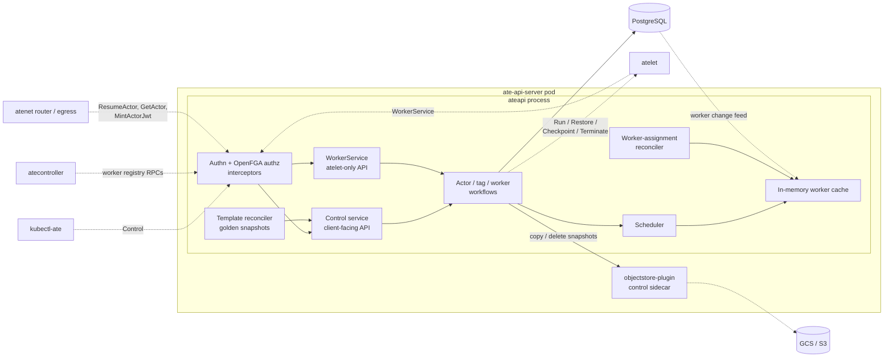
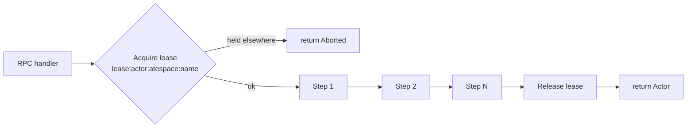

`ateapi` is the Substrate API server. It runs as the `ate-api-server`
Deployment in `ate-system` (two replicas by default) behind the `api` Service on
port 443, and it serves gRPC backed by PostgreSQL. It's the source of truth for
every Substrate API resource (atespaces, actor templates, actors, tags, workers,
and access and egress policies), and every other component either calls it
(atecontroller, atenet, atelet, `kubectl ate`) or is called by it (atelet).

The replicas don't hold any state of their own beyond caches, so anything that
has to stay consistent across replicas (e.g. resource records, per-actor leases,
the worker change feed, authorization tuples) lives in the database.

## What it owns

As the diagram above shows, every caller comes in through the same
authentication and authorization interceptors, whether it's `kubectl ate` on the
`Control` service or atelet on the `WorkerService`, and both services hand off
to the same actor, tag, and worker workflows.

## Resource identity

Every resource carries a common `ResourceMetadata` with `atespace`, `name`,
`uid`, `version`, `create_time`, `update_time`, and `delete_time`. An
atespace-scoped resource (ActorTemplate, Actor, Tag) is identified by the tuple
`(atespace, name)`, while a global resource (Atespace, Worker) is identified by
`name` alone. Requests point at a resource with an `ObjectRef{atespace, name}`
or carry the resource body itself (e.g. `CreateActorRequest{actor: Actor}`).

The server assigns `uid` and `version`, and updates require them as
preconditions (deletes accept them optionally), so a stale read or a resource
that was deleted and recreated fails with `Aborted` instead of overwriting the
wrong thing. The [Atespace](/concepts/atespace/) page covers how scoping works.

## The Control service

`Control` is the client-facing API, and the table below lists its RPCs grouped
by resource.

| Resource | RPCs | Notes |
|---|---|---|
| Atespace | `CreateAtespace`, `GetAtespace`, `ListAtespaces`, `DeleteAtespace` | Delete fails `FailedPrecondition` while actors, templates, or tags remain |
| ActorTemplate | `CreateActorTemplate`, `GetActorTemplate`, `ListActorTemplates`, `DeleteActorTemplate` | Immutable once created; delete also removes the template's golden actor and golden tag |
| Actor | `CreateActor`, `GetActor`, `ListActors`, `UpdateActor`, `DeleteActor` | Created `SUSPENDED`; `UpdateActor` changes `worker_selector`, effective on the next resume; delete works from any state |
| Actor lifecycle | `ResumeActor`, `SuspendActor`, `RevertActor` | See the workflows below |
| EgressPolicy | `Get/Create/Update/DeleteActorEgressPolicy` | One `default` policy per actor |
| Tag | `CreateTag`, `GetTag`, `ListTags`, `UpdateTag`, `DeleteTag` | A tag holds its own copy of an actor's external snapshot |
| Actor identity | `MintActorJwt`, `MintActorCertificate` | Only the egress gateway may call these; see [Actor identity](/concepts/actor-identity/) |
| Worker | `ListWorkers`, `GetWorker`, `CreateWorker`, `UpdateWorker`, `DeleteWorker`, `DrainWorker`, `MarkWorkerAvailable`, `MarkWorkerUnavailable`, `ListWorkerActorAssignments` | The write RPCs are driven by atecontroller's worker syncer |
| AccessPolicy | `Get/Create/UpdateGlobalAccessPolicy`, `Get/Create/Update/DeleteAtespaceAccessPolicy` | Role bindings for authorization |

List RPCs page with `ListOptions{page_size, page_token}`, and `ListActors` and
the other atespace-scoped lists take an optional `atespace` (leave it empty to
list across all atespaces).

Actor `status.state` is one of `SUSPENDED`, `RESUMING`, `RUNNING`,
`SUSPENDING`, `REVERTING`, `DELETING`, or `CRASHED`. Let's look at the three
lifecycle RPCs a bit closer.

- `SuspendActor` checkpoints a running actor and releases its worker. By
  default it's asynchronous, which means it returns once the checkpoint is on
  the node and atelet uploads it in the background, while
  `DURABILITY_MODE_SYNCHRONOUS` waits until the snapshot is complete in object
  storage.
- `ResumeActor` places a suspended actor on a worker and restores it. A call on
  an actor that's already `RUNNING` returns immediately (`resumed=false`), which
  is what makes it cheap for the router to call on every request.
- `RevertActor` discards a running or crashed execution (or a node-local
  snapshot) and returns the actor to `SUSPENDED` at its last durable snapshot.

## The WorkerService

`WorkerService` is a second service on the same port for the node side. ateapi
serves it only to atelet, authenticated by atelet's pod certificate and only for
workers on that atelet's own node, and atelet relays most of these RPCs on
behalf of the worker processes it supervises.

| RPC | Purpose |
|---|---|
| `AcquireWorkerEpoch`, `RegisterWorker` | A worker process takes a new epoch at startup and registers its pod IPs and capacity under it |
| `SetWorkerSandboxRuntimes` | Reports the sandbox runtimes the worker can run; nothing is placed until it does |
| `RequestActorSuspend` | The worker proposes suspending an idle actor; ateapi runs the normal suspend workflow |
| `ReportActorSnapshotState` | Records that a background upload finished, or that atelet detached an actor from the node |
| `ReportActorCrashed` | Moves a `RUNNING` actor whose sandbox died to `CRASHED` and frees its slot |
| `MintWorkerActorCertificate`, `MintWorkerActorJwt` | `worker-for-actor` credentials atelet uses while acting for an actor it hosts |

So why run two services on the same port? The split keeps two kinds of caller
apart, with `Control` answering to users and platform components and
`WorkerService` carrying what only a node can observe.

## Workflows and leases

Each lifecycle operation runs as a workflow, which is a fixed sequence of
idempotent steps. Every step first checks persisted state to see whether its
work is already done, so a retried workflow fast-forwards to wherever the last
attempt stopped.

1. Acquire a lease on `lease:actor:<atespace>:<name>`. Leases are rows in
   PostgreSQL with a 30s TTL that the holder renews in the background (about
   every 10s). The workflow runs under a context that's cancelled if the lease
   is lost, so a stalled replica can't keep writing after another one has taken
   over.
2. Run the steps, each of which reads and writes the database under a version
   precondition and may call atelet over mTLS gRPC.
3. Return `Aborted` ("another operation is in progress") if the lease is
   already held, in which case the caller retries.

The table below lists the main workflows and their steps.

| Workflow | Steps |
|---|---|
| Resume | load the actor → create external volumes → assign a worker → attach volumes → tell atelet to restore (or boot) → finalize as Running |
| Suspend | load the actor → mark Suspending → tell atelet to checkpoint → detach volumes → finalize as Suspended → release the replaced snapshot |
| Revert | load the actor → mark Reverting → discard the worker → discard any in-progress snapshot → finalize as Suspended |
| Delete | mark Deleting → terminate on atelet → detach volumes → release the worker → delete volumes → release external snapshots → remove the record |
| Tag | make sure the source snapshot is uploaded → reserve the tag → copy the snapshot to the tag's prefix → finalize |

`ResumeActor` reads the actor before it takes the lease, and if the actor is
already running it returns without touching the lease table. Templates, tags,
and workers have leases of their own (`lease:actortemplate:…`, `lease:tag:…`).
We walk through the step-by-step flows in [Resume actor](/flows/resume-actor/)
and [Suspend actor](/flows/suspend-actor/).

## Scheduling and the worker cache

A worker is a multi-actor host, which means it reports a resource capacity and
each actor assigned to it books its template's CPU and memory limits against
that capacity. Assignments are their own records (`ActorAssignment`), one per
hosted actor.

So how does the scheduler decide which worker should host an actor? It answers
from an in-memory worker cache, which is seeded by listing workers, kept current
by a change feed that PostgreSQL delivers from a transactional outbox, and fully
relisted every 5 minutes to recover from missed events.

A worker is a candidate when it is `ACTIVE`, has reported its runtimes,
matches both the template's and the actor's `worker_selector`, runs the sandbox
class and a runtime the actor's snapshot needs, sits on the required node when
the latest snapshot is node-local, and has room. Among the candidates the
scheduler samples two at random and picks the less-loaded one (power of two
choices).

## Background reconcilers

Next to the RPC server, ateapi runs two loops of its own.

- The template reconciler exists because ActorTemplates are database records
  rather than Kubernetes objects, so ateapi builds their golden snapshots
  itself. On a periodic resync (20s by default) it walks templates
  whose golden snapshot isn't done, and for each one, holding a per-template
  lease, it creates a golden actor in the template's own atespace (named by the
  template's UID), resumes it, waits out the warmup, suspends it synchronously,
  copies the snapshot into a published golden tag, and deletes the golden
  actor. The warmup is 20s unless every container declares a wakeup probe, in
  which case it's zero. See [Golden snapshot](/flows/golden-snapshot/).
- The worker-assignment reconciler handles worker restarts. When a worker
  process restarts it registers a higher epoch, and the reconciler notices the
  epoch rise and crashes the actors that ran under the old epoch, since their
  sandboxes died with it.

Neither loop handles worker registration. atecontroller watches worker pods and
calls the worker RPCs above, and when a worker's pod goes away, `DeleteWorker`
moves any actor still running on it to `CRASHED` (an actor that already
suspended cleanly stays `SUSPENDED`) before removing the record.

## Object storage through a plugin

ateapi never talks to object storage directly. Its pod runs the
`objectstore-plugin` as a control sidecar on a Unix socket, and the workflows
call it to copy a snapshot (for tags and golden snapshots) and to delete
snapshots (on suspend, delete, and revert), while uploads and downloads happen
on the nodes. The [Storage](/components/storage/) page covers both sides.

## Authentication and authorization

Callers authenticate with an mTLS client certificate (Substrate components use
Kubernetes pod certificates carrying a SPIFFE ID) or with a bearer JWT from a
provider listed in `--authentication-config`, such as Kubernetes ServiceAccount
tokens, and either one becomes a principal ID.

Authorization is always on, and every RPC is checked against an OpenFGA model
embedded in ateapi. Its tuples live in the same PostgreSQL database, so a
resource write and its authorization change commit together. Users get `owner`,
`editor`, or `viewer` on the global scope or on one atespace through
AccessPolicies, and `--authz-bootstrap-owners` names principals that are always
global owners. Substrate's own components (atecontroller, the router, the egress
gateway, atelet, the API server's sidecar) hold fixed system roles bound to
their pod certificates, each granting only the calls that component makes.

:::caution[Bootstrap owner in development installs]
`ate-setup` makes the shared `ate-client` ServiceAccount the default bootstrap
owner so demos and tests work, which means anyone who can mint a token for it
is a global owner. For a shared install, set real operator principals instead.
:::

## Related

- [Resume actor flow](/flows/resume-actor/) shows the resume workflow in action.
- [Golden snapshot](/flows/golden-snapshot/) walks through the template
  reconciler's flow.
- [Atespace](/concepts/atespace/) covers the tenancy and authorization boundary.
- [Actor identity](/concepts/actor-identity/) explains what `MintActorJwt` and
  the `worker-for-actor` credentials assert.
- [Storage](/components/storage/) covers PostgreSQL and the object-store plugin.
- [System topology](/topology/) shows how ateapi connects to everything else.
