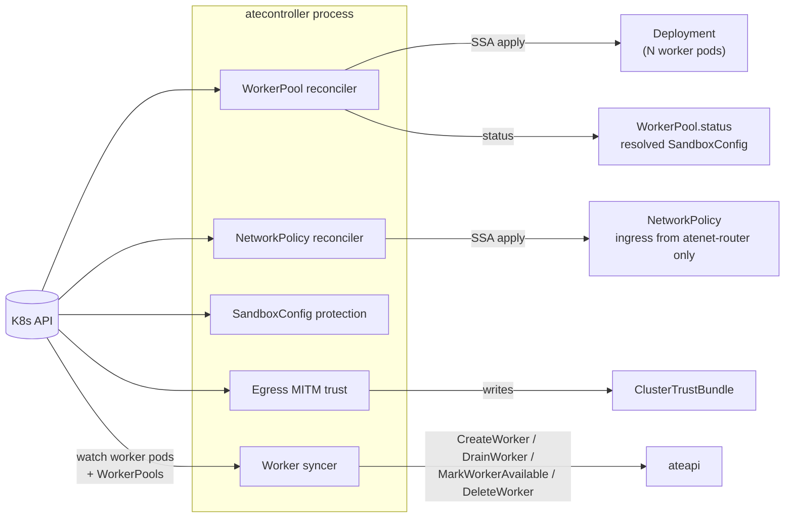
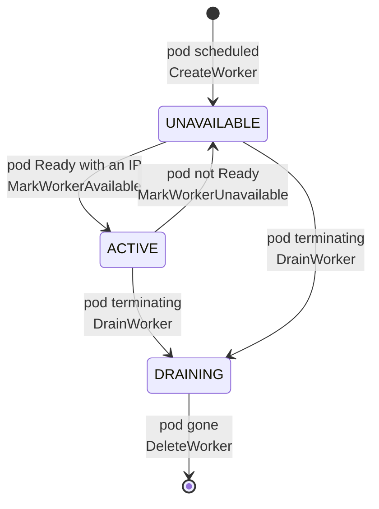

`atecontroller` is the Kubernetes-native half of the control plane. It owns the
infrastructure side of Substrate (the prepared capacity that actors run on) and
nothing about the actors themselves, and it runs as the `ate-controller`
Deployment in `ate-system`.

The split follows the resource model, where `WorkerPool`, `SandboxConfig`, and
`CSIDriverConfig` are Kubernetes CRDs (`ate.dev/v1`) and atespaces, actor
templates, actors, and tags are records in [ateapi](/components/ateapi/)'s
database. atecontroller reconciles the first group and reports what it sees to
ateapi, and it never touches an ActorTemplate (ateapi builds golden snapshots
itself).

## What it runs



The diagram above shows the five loops that run in the one process, and the
table below lists what each of them watches and what it produces.

| Loop | Watches | Produces |
|---|---|---|
| WorkerPool reconciler | `WorkerPool`, its `Deployment`, `SandboxConfig` | The worker Deployment, and `WorkerPool.status` (replicas, resolved SandboxConfig per sandbox class) |
| NetworkPolicy reconciler | `WorkerPool` | A NetworkPolicy per pool admitting ingress to worker pods only from atenet-router |
| SandboxConfig protection | `SandboxConfig`, `WorkerPool` | Removes the protection finalizer from a deleted SandboxConfig once no pool uses it |
| Egress MITM trust | The `egress-mitm-ca-pool` Secret | A ClusterTrustBundle actors use to trust the egress gateway's intercepting CA |
| Worker syncer | Worker pods, `WorkerPool` | Worker records in ateapi, kept in step with the pods |

## WorkerPool reconciler

```yaml
apiVersion: ate.dev/v1
kind: WorkerPool
metadata:
  name: agent-pool
  namespace: ate-demo
  labels:
    workload: secret-agent        # what template/actor selectors match
spec:
  replicas: 10
  workerImage: ko://go.ate.dev/substrate/cmd/ateworker-gvisor
  sandboxClasses:
  - name: gvisor                  # exactly one class today
    configRef:
      name: gvisor-default        # optional; else the class default
```

Given a pool like the one above, the WorkerPool reconciler goes through the
same three steps on each reconcile.

1. It resolves each sandbox class to a SandboxConfig (the one named by
   `configRef`, or the newest config of that class annotated as the class
   default) and adds a protection finalizer to it so it can't disappear while a
   pool depends on it.
2. It records the resolution in `status.sandboxClasses`. A switch to a new
   config goes through a `pendingConfigRef` first and is confirmed against the
   API server, so status never names a config whose protection was already
   released.
3. It server-side-applies a Deployment with the pool's name, owned by the pool,
   running `spec.workerImage`. A new pool gets its Deployment only once every
   class has a config, and an existing Deployment is applied first on every
   pass, so a SandboxConfig problem never blocks a scale.

Worker pods don't take anything from the SandboxConfig directly, since atelet is
what fetches the sandbox binaries it names (see
[SandboxConfig](/concepts/sandboxconfig/)).

So how does an actor end up on a pool's workers? A WorkerPool doesn't reference
templates at all, and placement is selector-based instead. The scheduler in
ateapi ANDs a template's `worker_selector` with the actor's own and matches them
against the pool's labels, which each Worker record mirrors.

## The worker syncer

The syncer is how ateapi learns about capacity. It watches pods labeled
`ate.dev/worker-pool` and the WorkerPools, and it drives each pod's Worker
record through ateapi's `Control` RPCs as the state diagram below shows.



- Registration happens once the pod is scheduled to a node. A Worker is named
  by the pod's UID, so a replacement pod with the same name is a different
  Worker.
- Readiness gates scheduling, and only a Ready pod with an IP is `ACTIVE`. The
  worker process itself still has to register its epoch, IPs, capacity, and
  runtimes through atelet before anything is placed on it.
- Termination marks the Worker `DRAINING` so nothing new lands there, without
  touching the actors on it (the pod is shutting them down itself).
- Deletion calls `DeleteWorker` once the pod is gone, and ateapi crashes any
  actor still running there and removes the record.
- During cleanup, a terminal pod (Succeeded or Failed), or one whose pool no
  longer exists, is deleted. On startup the syncer also walks every Worker
  record in ateapi and removes the ones whose pods vanished while it was down.

## Why is this a separate process from ateapi?

atecontroller is a standard Kubernetes operator (informer caches, reconcile
loops, owner references, server-side apply, etc), while ateapi is a gRPC server
optimized for request latency on database-backed records. Keeping the
Kubernetes reconciliation in atecontroller keeps ateapi out of the Kubernetes
API's hot path. The manager runs without leader election, and the install runs
a single replica.

## Related

- [WorkerPool](/concepts/workerpool/) · [SandboxConfig](/concepts/sandboxconfig/) ·
  [Worker](/concepts/worker/)
- [Worker lifecycle](/flows/worker-lifecycle/) follows the syncer's states end
  to end.
- [ateapi](/components/ateapi/) is atecontroller's only gRPC peer, and where
  golden snapshots are built.
- [Golden snapshot](/flows/golden-snapshot/) covers the ActorTemplate flow,
  which ateapi runs.
