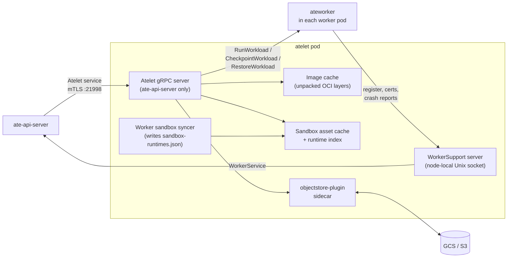

`atelet` runs on every worker node (it's a DaemonSet, so there's one pod per
node), and it's where the control plane's decisions turn into running
sandboxes. ate-api-server calls into it for every Run / Checkpoint / Restore,
and every worker process on the node calls into it to register and to get
credentials. Placement gets decided in ate-api-server, and atelet carries out
those decisions and reports back what only the node can see.

atelet works the same way whichever worker a pod runs (`ateworker-gvisor` or
`ateworker-microvm`), since it drives both over the same Unix-socket gRPC
contract. It also runs with low privilege on purpose. Mounts, netlink, device
and namespace work all happen inside the worker pod, so atelet itself only
reads and writes the node's `/var/lib/ate` tree.

## What it does

## Two gRPC services

As the diagram above shows, atelet serves two gRPC services, and each one has
different callers and different authentication.

The `Atelet` service is the downward path. ate-api-server finds the atelet pod
on the target node and dials it over mTLS on port `21998`. atelet admits
exactly one client identity (ate-api-server's SPIFFE ID), so no other pod can
drive the sandboxes on a node. atelet also runs at most one of these
operations per actor at a time, and a second call waits for the first.

| RPC | What atelet does |
|---|---|
| Run | Prepare the actor's directories, compose its rootfs from the image cache, stage the sandbox runtime the scheduler picked, write system-info volumes, then call `RunWorkload` on the worker |
| Restore | Same preparation, plus put the snapshot files in place (local copy, shared-snapshot cache, or a download), then call `RestoreWorkload` |
| Checkpoint | Call `CheckpointWorkload`, keep the snapshot locally, and make it durable in object storage now or in the background |
| PromoteSnapshot | Upload a local snapshot while keeping the local copy (e.g. for tagging) |
| DetachActor | Make the latest local snapshot durable, then drop the node's copies so the actor can resume anywhere |
| Terminate | Kill any running workload for the actor, detach its volumes, and clean up its node state |

`WorkerSupport` is the upward path. It listens on a Unix socket under
`/var/lib/ate` and only accepts worker pods that are scheduled on atelet's own
node and authenticate with their pod certificate. Most calls get forwarded to
ate-api-server's `WorkerService`, with atelet naming the worker its caller
proved itself to be.

| RPC | Purpose |
|---|---|
| AcquireWorkerEpoch / RegisterWorker | A worker process announces itself, its pod IPs, and its capacity |
| SetWorkerSandboxRuntimes | The worker reports which sandbox runtimes it can run (see below) |
| MintActorCertificate | `atunnel` gets a `worker-for-actor` certificate for the actor it is serving |
| GetActorEgressPolicy | `atunnel` reads the actor's egress policy |
| ReportActorCrashed | The worker saw an actor's sandbox die on its own |
| RequestActorSuspend | The worker asks the control plane to suspend an actor it hosts |

atelet also calls `WorkerService` on its own behalf, to report snapshot
uploads and detaches and to mint the short-lived `worker-for-actor` JWTs that
it hands to node-side plugins. We cover what those credentials carry on the
[Security](/security/) page.

## Sandbox runtimes: what each worker advertises

A worker can only take actors whose sandbox binaries it can run, and only
atelet knows what the node can run. So how does the control plane find out?
The _worker sandbox syncer_ in atelet watches this node's worker pods, their
`WorkerPool`s, and the pools' [SandboxConfig](/concepts/sandboxconfig/)s, and
it takes the same four steps for each worker.

1. Resolves the SandboxConfig the pool runs and picks the versions this
   node's architecture has assets for.
2. Hashes each version's asset digests into a `sandbox_bundle_hash` and
   records it in a node-local _runtime index_.
3. Fetches the assets and probes what a memory snapshot taken on that runtime
   would need to find again (ie, the CPU features `runsc` reports for gVisor,
   or the host CPU vendor and model for micro-VM).
4. Writes `sandbox-runtimes.json` into the worker's directory, with a default
   runtime plus any other restorable runtimes, each as a set of compatibility
   attributes.

The worker watches that file and re-reports it to the control plane whenever
it changes. A SandboxConfig or WorkerPool edit rewrites the files across the
fleet with up to thirty seconds of jitter, so workers don't all re-register at
once.

When ate-api-server later sends Run or Restore, the request names the runtime
the assigned worker registered, and atelet resolves its bundle hash in the
runtime index. If the index doesn't hold that hash, atelet refuses the request
as a placement error rather than serving it from whatever the request
describes.

## Sandbox asset cache

The binaries themselves live in one node-local, content-addressed cache
keyed by sha256. Each actor gets hard links into the cache under its own
`sandbox-assets/` directory, which is the only place a worker will run a
sandbox binary from. Nothing is copied per actor, an asset downloads once per
node, and each worker's default runtime stays linked so it's never evicted
while idle. With a byte budget set, a periodic pass evicts the oldest unlinked
entries. Downloads go through the object-store plugin (falling back to
anonymous reads for public `gs://` buckets such as gVisor's releases) and are
sha256-verified.

## Images and volumes

- atelet pulls container images itself, using the node's kubelet credential
  provider, and keeps the unpacked layers in a node-local, content-addressed
  image cache that survives restarts. An actor's rootfs is composed from those
  layers as an overlay, so a warm start skips image extraction, and image
  volumes come from the same cache.
- DurableDir volumes get a per-actor directory that the worker mounts and
  snapshots capture.
- External (CSI) volumes are a preview feature. ate-api-server provisions and
  attaches them, and atelet calls the driver's node plugin (found through a
  cluster-scoped `CSIDriverConfig`) to make them available on the node.
- System-info volumes are read-only files that atelet writes on every Run and
  Restore, holding the actor's own name, atespace, or UID, and selected trust
  bundles. Because they're regenerated on every activation, they're correct
  even for an actor restored from a shared golden snapshot.

## Snapshot storage

atelet holds no object-storage credentials. External snapshots move through
an object-store plugin sidecar in the atelet pod (the in-tree plugin backs GCS
or S3), which atelet reaches over a Unix socket. Each transfer
carries a `worker-for-actor` JWT that the plugin checks, so a transfer is
authorized for one actor. The plugin stores each file zstd-compressed and
refuses to serve snapshot locations as sandbox assets.

The worker reports exactly which files it wrote, so atelet ships precisely
that set. A suspended actor's snapshot also stays on the node, and the next
resume on that node restores from the local copy. By default the upload
happens in the background after the checkpoint returns, while a synchronous
suspend uploads before returning. After a detach delay (or when the node needs
room), atelet uploads if needed, deletes the local copy, and reports the
detach so the actor can resume on any node. Shared snapshots, such as a
template's golden snapshot, are cached once per node, so concurrent restores
share one download.

## Local filesystem layout

atelet and the workers share a host directory, `/var/lib/ate`, mounted at the
same path in both. Apart from the snapshot directory, this layout is an
implementation detail.

| Path | Contents |
|---|---|
| `actors/<actor-uid>/` | Per-actor tree: OCI bundles, volume roots, `sandbox-assets/` hard links |
| `snapshots/` | Per-actor snapshot staging; may be a dedicated disk mounted before actors run |
| `sandbox-asset-cache/` | Content-addressed sandbox binaries |
| `workers/<pod-uid>/worker.sock` | Each worker's gRPC socket, addressed by pod UID |
| `workers/<pod-uid>/sandbox-runtimes.json` | What that worker advertises |
| `workers/<pod-uid>/default-runtime/` | Links that keep the worker's default runtime cached |
| `worker-support.sock` | atelet's `WorkerSupport` socket |
| `atelet-otlp.sock` | Node-local OTLP relay that workers push telemetry into |

## Node devices

For the micro-VM class, atelet runs a device plugin that advertises
`/dev/kvm` as the extended resource `ate.dev/kvm`, but only on nodes where the
device exists. Micro-VM worker pods request that resource, so they land only
on KVM-capable nodes and get the device without running privileged.

## Why a DaemonSet, not a sidecar?

atelet caches images and sandbox binaries, runs the object-store plugin, and
keeps snapshots on local disk. Running one atelet per node, shared by every
worker pod and every actor on that node, keeps those costs per node instead of
per worker, and it lets a snapshot outlive the worker that took it.

## Related

- [Resume actor flow](/flows/resume-actor/) · [Suspend actor flow](/flows/suspend-actor/) -
  atelet's two main jobs.
- [ateworker-gvisor](/components/ateworker-gvisor/) · [ateworker-microvm](/components/ateworker-microvm/) -
  the two workers atelet drives.
- [Workers](/components/workers/) - how a worker registers through atelet.
- [Storage](/components/storage/) - snapshot layout in object storage.
