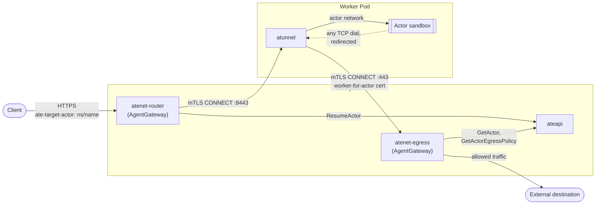
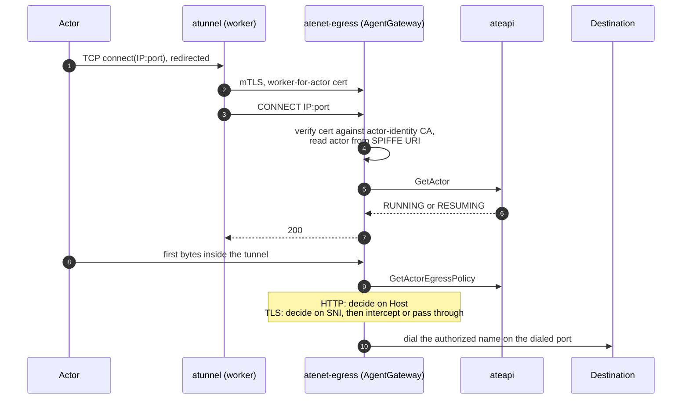

`atenet` is Substrate's networking layer, and it puts a proxy on each side of
every actor. On the way in, `atenet-router` (ingress) takes a client request
addressed to an actor by name, resumes the actor if it's suspended, and
forwards the request to whichever worker hosts it now. On the way out,
`atenet-egress` (the egress gateway) receives every outbound TCP connection an
actor makes, works out which actor it belongs to, and allows, inspects, or
refuses it against that actor's `EgressPolicy`. Joining the two is `atunnel`,
which runs inside every Worker Pod as part of the trusted worker supervisor.
It's the far end of the router's tunnels and the near end of the egress
gateway's, so actors never talk to either proxy directly. Both proxies are
Deployments in `ate-system` that every actor in the install shares (neither
one is a per-pod sidecar).

## Two dataplanes

The proxy itself is pluggable, and `ate-setup --atenet-dataplane` picks it for
both Deployments at install time.

- `envoy` is the default. Envoy carries the bytes, and the `atenet` Go binary
  runs beside it in the same pod as `atenet router --mode=ingress` (the xDS
  server and `ext_proc` callout on the router), `atenet router --mode=egress`
  (the `ext_proc` callout on the egress gateway), and `atenet sdsmint` (the
  egress gateway's certificate minter).
- `agentgateway` replaces each pod with a single AgentGateway container. The
  Substrate logic is built into AgentGateway as native policies that call
  `ateapi` directly from a static config, so no `atenet` process runs at all.

We show the AgentGateway path in this atlas's diagrams (like the one below) and
call out Envoy where it's the default or where it behaves differently in a way
that matters.



### What runs in each pod

| | AgentGateway | Envoy (default) |
|---|---|---|
| **`atenet-router` pod** | One `agentgateway` container | `envoy` + `atenet router --mode=ingress` |
| Actor lookup | Native `substrateIngress` policy calls `ateapi` | `ext_proc` on `127.0.0.1:50051` calls `ateapi` |
| Config | Static ConfigMap | xDS from `atenet` on `127.0.0.1:18000`, built once at startup |
| Router Service ports | `443` (TLS), `8444` (CONNECT over TLS), `80` (plaintext), `8081` (CONNECT, plaintext) | `443` (TLS, client cert required), `8444` (CONNECT over TLS, client cert required) |
| **`atenet-egress` pod** | One `agentgateway` container | `envoy` + `atenet router --mode=egress` (`ext_proc`) + `atenet sdsmint` |
| Interception leaves | Minted by AgentGateway from the MITM CA it mounts | Minted by `sdsmint`; the MITM CA key never enters the Envoy container |

In the Envoy variant, the Envoy admin API and the `atenet` `/statusz` debug
page bind loopback, so neither is reachable from other pods, and `/statusz`
redacts query strings from the requests it records.

## Ingress: finding the actor

So how does a client say which actor it wants? It puts the actor's atespace
and name in an `ate-target-actor` header, rather than in DNS or `Host`.

```
ate-target-actor: <atespace>/<actor>
```

`Host` and `:authority` stay application metadata and pass through to the
actor unchanged. There's no per-actor DNS name, so clients address the
`atenet-router` Service and let the header pick the actor. A request without a
valid header gets a 404 before the router makes any control-plane call.
Browsers can't set the header, so a browser-facing app puts a reverse proxy in
front that sets it from trusted configuration.

Let's follow what the router does with each request once it has the header.

1. It resolves the assignment by calling `ResumeActor` on `ateapi`. For a
   running actor that's a quick read that returns the current worker
   assignment, and for a suspended one it runs the
   [resume workflow](/flows/resume-actor/) first. Either way the answer
   carries the worker pod IP and the worker's SPIFFE ID.
2. It parks the request if it has to. Pool saturation and transient
   control-plane errors are retried inside a bounded park budget (5s by
   default) rather than failed (see
   [Request path](/flows/request-path/#request-parking)).
3. It tunnels to the worker, opening an mTLS `CONNECT` to `atunnel` on the
   worker pod's port 8443 that carries the actor reference and the target
   port. Tunnels to one worker share an HTTP/2 connection.
4. `atunnel` accepts only the router's client certificate
   (`spiffe://cluster.local/ns/ate-system/sa/atenet-router`), checks that the
   named actor is active on this worker, and forwards the request over the
   actor's private network to its port (80 unless a `CONNECT` named another).

Concurrent requests for the same actor share one in-flight `ResumeActor`, so a
burst of fifty requests at a cold actor costs one resume rather than fifty.

### Where the dataplanes differ on ingress

| Behavior | AgentGateway | Envoy (default) |
|---|---|---|
| Assignment reuse | Caches each actor's assignment for 5s, and a cache hit skips `ateapi` | No cache, so every request calls `ResumeActor` |
| Worker identity check | Verifies `atunnel`'s certificate chains to the pod-identity CA, but not which worker presented it | Pins `atunnel`'s certificate to the exact worker SPIFFE ID the assignment named |
| Actor moved since lookup | `atunnel` refuses with 421 (stale assignment); AgentGateway drops its cached entry, re-resolves, and retries | Rare without a cache; the request fails and is not retried |
| Park budget runs out | 504 | 503 with the capacity message |

The worker SPIFFE ID names the pool's ServiceAccount rather than one pod, so
the per-request guarantee that a request reaches the right actor comes from
`atunnel`'s own check against its active actors.

### Arbitrary ports

What if the client needs an actor port other than 80? It sends an HTTP
`CONNECT` whose authority names the port, with `ate-target-actor` on the outer
`CONNECT`. The router terminates the `CONNECT` and runs each request inside the
tunnel through the same lookup, so a long-lived tunnel still re-routes if the
actor moves. Only HTTP(S) works inside the tunnel today (raw TCP doesn't).

## Ingress client authentication

The two dataplanes differ most on how they authenticate ingress clients. The
Envoy router (the default) serves TLS listeners only and requires a client
certificate on both of them. That certificate must chain to
`--ingress-client-ca-file` (by default the pod-identity CA, which issues
`spiffe://cluster.local/ns/<namespace>/sa/<serviceaccount>`) and carry a SPIFFE
ID listed in `--ingress-allowed-spiffe-ids`, and `ate-setup` refuses to install
the Envoy router without that list. The list is the whole policy, which means
any listed client may reach any actor.

AgentGateway doesn't authenticate ingress clients at all. It also serves
plaintext HTTP and plaintext `CONNECT` alongside TLS, and
`--ingress-allowed-spiffe-ids` doesn't apply to it.

:::caution[An AgentGateway router is open to anything that can reach it]
The router's NetworkPolicy admits its ports from any pod, and nothing checks
who the caller is, so any client that can reach the `atenet-router` Service can
resume and call any actor by name. Put an authenticating proxy in front, or use
the Envoy dataplane, when callers are not all trusted.
:::

Neither dataplane authorizes per actor, and the router's own `ateapi` identity
holds the `ingress_router` system role, which allows `ResumeActor` on every
actor (see [Security](/security/#authorization-on-the-control-plane)).

## Egress: the gateway's side

Now let's look at the other direction. Every outbound TCP connection an actor
makes leaves through `atunnel` and the egress gateway. The Actor dials an
external destination, and the worker's nftables rules redirect that TCP
connection to `atunnel` in the trusted worker supervisor. `atunnel` then opens
an mTLS `CONNECT` through the egress gateway, presenting a `worker-for-actor`
certificate for that Actor, and the `CONNECT` target is the IP and port the
Actor dialed.



The sequence above shows what the gateway does with each tunnel.

1. It authenticates the tunnel. The gateway requires a client certificate
   signed by the actor-identity CA whose single SPIFFE URI is
   `spiffe://substrate-actor.local/worker-for-actor/<atespace>/<name>`, and it
   refuses CA certificates. It then asks `ateapi` whether that actor exists and
   is `RUNNING` or `RESUMING` (a booting actor may need the network before its
   wakeup probe passes), and anything else closes the tunnel.
2. It classifies the traffic by looking at the first bytes inside the tunnel.
   Cleartext HTTP is decided per request on `Host` against the actor's `http`
   rules, and TLS is decided at the ClientHello on SNI. With an `https` rule
   the gateway terminates TLS with a leaf it mints, decides each request, and
   re-originates TLS; with a `tls_passthrough` rule it relays the bytes
   untouched; and with no rule it closes the connection. WebSocket upgrades
   and nested `CONNECT` are refused, and any other protocol is closed.
3. It dials by name, resolving the name the policy authorized and dialing it
   on the port the Actor dialed. The IP in the `CONNECT` never picks the
   destination, so an Actor can't claim an allowed name while dialing some
   other address.
4. It injects credentials where a rule asks for them. A rule's
   `replaceHeaders` effect swaps a placeholder header for a credential from a
   credential provider, so the secret never enters the sandbox.

An actor with no `EgressPolicy` gets no egress. DNS doesn't go through the
gateway either (a relay in the sandbox answers only the names the actor's
policy allows).

| Behavior | AgentGateway | Envoy (default) |
|---|---|---|
| Policy freshness | Fetched from `ateapi` per decision | Cached per actor for 10s (`--egress-policy-cache-ttl`) |
| Actor JWT injection (`actorJwt`) | Not handled by the pinned image; only `credentialUri` entries resolve | Mints the token through `ateapi` |
| Extra `ext_proc` hook | Not available | `--experimental-additional-egress-extproc-service` |
| Interception CA key | Mounted in the proxy container | Held by the `sdsmint` sidecar, outside Envoy |

The egress gateway's NetworkPolicy admits only Worker Pods, and its `ateapi`
identity holds the `egress_gateway` system role, which is the only role that
may mint actor credentials.

## Graceful shutdown

On `SIGTERM` the router flips `/readyz`, waits out endpoint propagation
(`--drain-delay`, 13s in the manifest), drains established connections, and
lets parked requests finish before the pod exits. With Envoy, `atenet` drives
the drain through Envoy's admin API and releases Envoy's `preStop` hook when
it's done, while AgentGateway manages its own termination.

## Related

- [Request path](/flows/request-path/) - one ingress request end to end,
  parking, and error codes.
- [Resume actor flow](/flows/resume-actor/) - what `ResumeActor` does for a
  suspended actor.
- [Security & identity](/security/) - the certificates each hop presents and
  who verifies them.
- [Workers](/components/workers/) - the pods that host `atunnel`.
- [ateapi](/components/ateapi/) - the control plane both proxies call.
