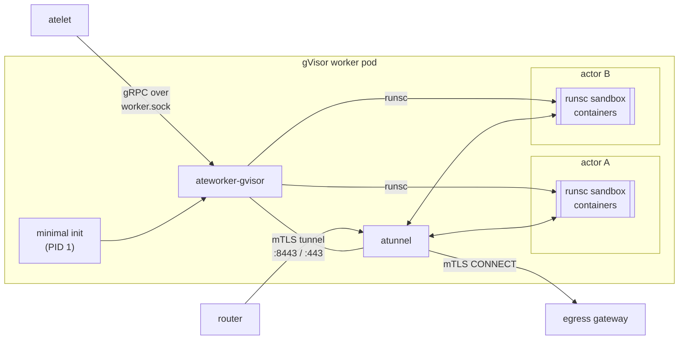

`ateworker-gvisor` is one of the two worker implementations in Substrate (the
other is [ateworker-microvm](/components/ateworker-microvm/)), and it's the
only container in each gVisor worker pod. It turns gRPC calls from atelet into
`runsc` invocations, builds each actor's private network, and embeds atunnel,
which carries the actor's ingress and egress.

A worker pod hosts many actors. Each actor runs in its own gVisor sandbox with
its own network namespace and cgroup, and the pod takes actors up to its actor
limit (`--max-actors`, default 1000) and its CPU and memory capacity (see
[Workers](/components/workers/) for how that capacity is reported and
scheduled). Both workers implement the same gRPC contract on a per-pod Unix
socket, so atelet drives them the same way and only the mechanics inside
differ.

## What it does



As the diagram above shows, the worker binary runs under a minimal init that
is PID 1. Every orphaned process in the pod (e.g. a runsc sandbox once
`runsc create` exits) reparents to PID 1, so the init reaps them and the
worker keeps reliable exit statuses for its own subprocesses.

## The gRPC contract

| RPC | What it does |
|---|---|
| RunWorkload | Cold-boot an actor from its OCI bundles |
| RestoreWorkload | Bring an actor back from a snapshot |
| CheckpointWorkload | Snapshot an actor and remove it from the pod |
| TerminateWorkload | Stop an actor's containers and clean up its network and bundles |
| GetWorkloadStats · GetActiveWorkloadStats | Resource-usage samples, per actor or for every hosted actor |

Before any of these calls, atelet prepares everything on disk, which means
the per-actor directories, the OCI bundles, and the `runsc` binary
hard-linked into the actor's `sandbox-assets/` directory. The worker refuses
to run a sandbox binary from anywhere else, and the gVisor release comes from
the pool's [SandboxConfig](/concepts/sandboxconfig/) rather than from the
worker image.

## The operations

### Run

Run boots an actor from scratch. The worker builds the actor's network, then
creates a sandbox with no root container (no pause process and no rootfs of
its own), and creates and starts each application container in it with these
`runsc` calls.

```bash
runsc create -no-root-container -bundle <bundle> -pid-file <pid> _sandbox
runsc create -bundle <bundle-dir> -pid-file <pid-file> <container>
runsc start <container>
```

Before returning, Run waits on the wakeup probe of each container that
declares one. The probe is a tight HTTP GET poll that notices the moment the
server starts accepting connections.

### Checkpoint

What a snapshot holds depends on its fidelity, and each fidelity maps to its
own `runsc` call, as the table below shows.

| Fidelity | runsc call | What is kept |
|---|---|---|
| `MEMORY` | `runsc checkpoint` of the sandbox | Process memory, with each container's rootfs writes in a `rootfs/` bundle and DurableDir volumes in an `fs/` bundle |
| `ROOTFS` | `runsc fscheckpoint` | The `rootfs/` and `fs/` bundles only |
| `VOLUMES` | `runsc fscheckpoint` | The `fs/` bundle only |

The worker reports exactly the files runsc wrote, so atelet ships precisely
that set. The worker then tears down the actor's network and removes the
actor from the pod.

### Restore

For a `MEMORY` snapshot, the worker rebuilds the network and runs
`runsc restore` for the sandbox and each container from the same checkpoint
image.

```bash
runsc restore -bundle <bundle-dir> -image-path <restore-dir> \
      -pid-file <pid-file> -background -detach <container>
```

`-background` restores lazily, demand-paging memory from the image files so
`runsc` returns as soon as the sandbox is up, and `-detach` returns without
blocking on the workload. For a `ROOTFS` or `VOLUMES` snapshot, the containers
cold-boot with the saved filesystem bundles passed as restore images. Either
way, the restore waits on wakeup probes before returning.

Where do these flags come from? The worker reads its `runsc` flags from a JSON
flags file that it watches and reloads, so an operator can adjust them without
rolling the pool.

## Actor networking

Each actor gets its own pair of network namespaces, joined by a veth pair.

| Thing | Value |
|---|---|
| Runtime namespace (gVisor takes over its interfaces) | actor side, `eth0`, `169.254.17.2/30` |
| Gateway namespace (per actor) | default gateway `169.254.17.1`, DNS relay, atunnel sockets |

Every actor uses the same fixed addresses. That's safe because each actor
lives in its own namespaces, and it keeps a restored actor's network config
valid on any pod. So why does each actor need two namespaces? gVisor claims
every interface in the namespace it runs in, which is why the gateway side
needs a namespace of its own.

nftables rules in the gateway namespace handle the actor's traffic in both
directions.

- For egress, every outbound TCP connection is redirected to atunnel, whatever
  destination it was aimed at, with the original destination preserved.
  Link-local destinations are rejected. Traffic to the gateway address itself
  isn't redirected, so DNS reaches the relay, which checks queries against the
  actor's egress policy.
- For ingress, there's no DNAT from the pod IP. The router opens an mTLS
  tunnel to atunnel (port 8443 for CONNECT, 443 for HTTPS), and atunnel
  forwards the request to the actor at `169.254.17.2:80`.

## atunnel

atunnel runs inside the worker, in the trusted supervisor rather than in any
sandbox. It authenticates the router by its SPIFFE ID on ingress. On egress,
the actor's TCP connection is redirected to atunnel, which opens an mTLS
CONNECT through the egress gateway, presenting a `worker-for-actor`
certificate for that actor that it obtained through atelet. An actor with no
egress gateway configured has its TCP captured and refused. AgentGateway is
the preferred router and egress dataplane, and Envoy is the install default.
We cover the details in [atenet](/components/atenet/) and
[Security](/security/).

## Isolation between co-hosted actors

- Each actor's host processes get their own cgroup leaf, so actors on one
  worker share CPU fairly and each stays within its declared limit. Memory is
  held with `memory.high` at the actor's limit, and a sandbox that stays over
  is killed on its own, so one actor's overrun never takes down the worker.
- When an actor's sandbox exits on its own, the worker tears it down and
  reports the crash through atelet, and the control plane moves the actor to
  `CRASHED`.
- Each container's stdout/stderr is forwarded to the worker pod's log, labeled
  with the actor and container identity.

## Pod privileges and shutdown

The worker pod isn't privileged. It runs as root with a fixed capability set
(for runsc's gofer, sandbox setup, and actor networking), with seccomp and
AppArmor unconfined because runsc mounts and pivots root, and with the host's
`/var/lib/ate` mounted at the same path as in atelet. On `SIGTERM` the worker
cancels any in-flight run or restore, lets running checkpoints finish, and
then stops the remaining containers within the pod's grace period.

## Related

- [ateworker-microvm](/components/ateworker-microvm/) - the micro-VM sibling.
- [atelet](/components/atelet/) - the worker's only RPC client.
- [Workers](/components/workers/) - registration, capacity, and the pod as a whole.
- [Suspend actor flow](/flows/suspend-actor/) · [Resume actor flow](/flows/resume-actor/) -
  where the runsc calls happen.
- [Snapshot](/concepts/snapshot/) - what fidelity means.
