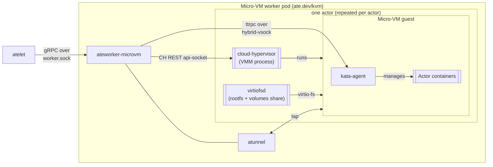

`ateworker-microvm` is one of the two worker implementations in Substrate (the
other is [ateworker-gvisor](/components/ateworker-gvisor/)). Instead of a
gVisor sandbox, it runs each actor as a cloud-hypervisor (CH) micro-VM using
the kata guest model, and it drives suspend/resume through CH's native
snapshot/restore.

It implements the same gRPC contract on the same per-pod Unix socket as
ateworker-gvisor, embeds the same atunnel, and builds the same per-actor
network layout, so atelet and the router treat both workers identically. Like
the gVisor worker, one pod hosts many actors (each in its own VM) up to its
actor limit and capacity. Micro-VM worker pods need `/dev/kvm`, which they
request as the `ate.dev/kvm` resource that atelet advertises only on
KVM-capable nodes.

## What it does

## The building blocks

ateworker-microvm boots cloud-hypervisor directly (there's no kata shim), so
the worker does the post-boot work the shim would normally do. The diagram
above shows how these pieces fit together for one actor.

- cloud-hypervisor is the VMM. The worker launches one per actor, drives it
  over its REST api-socket (create VM, add net device, boot, pause, snapshot,
  restore, resume), and owns it for teardown.
- kata-agent runs inside the guest. The worker talks to it over ttrpc on a
  hybrid-vsock socket to create the sandbox, configure guest networking, and
  start and stop containers.
- For the guest kernel and OS image, the guest image is attached as a
  virtio-pmem device and mounted read-only with DAX, so its file data stays in
  the host page cache instead of being copied into each guest's RAM.
- virtiofsd serves one virtio-fs share per actor, carrying each container's
  rootfs and the actor's DurableDir volumes.

All four binaries (`cloud-hypervisor`, `virtiofsd`, `kata-kernel`,
`kata-image`) come from the pool's [SandboxConfig](/concepts/sandboxconfig/)
and are fetched and hard-linked by atelet, so none of them are baked into the
worker image. Guest
vCPUs and memory come from the ActorTemplate's resource limits, so each VM is
sized to its actor rather than the worker pod.

### Memory, rootfs, and boot

- Each container's rootfs is an overlay assembled on the host, with the
  read-only OCI image as the lower and a per-actor directory as the writable
  upper. Rootfs writes cost host disk and reclaimable page cache, not guest
  RAM.
- The VM has a virtio-balloon device with free page reporting turned on, so
  memory the guest frees goes back to the host.
- The guest console is a virtio-console rather than an emulated UART, which
  keeps boot-time logging from dominating cold-start latency.

## The operations

### Run

Run cold-boots the actor. The worker builds the actor's network, assembles the
rootfs overlays, launches CH and virtiofsd, creates and boots the VM, attaches
a tap device for networking, and dials the kata-agent. Then it creates the
agent sandbox, configures guest networking, and starts each container. Before
returning, it waits on the wakeup probe of each container that declares one.

### Checkpoint

The worker pauses the guest first, whatever the fidelity. Because the
virtio-fs share is write-through, a paused guest's completed writes are
already on the host, so the tars in the table below are coherent.

| Fidelity | What ships |
|---|---|
| `MEMORY` | CH snapshot (`config.json`, `state.json`, sparse `memory-ranges`) plus the rootfs-upper and volume tars |
| `ROOTFS` | One tar per container's rootfs upper, plus volume tars; the guest is discarded |
| `VOLUMES` | One tar per DurableDir volume; the guest is discarded |

The read-only image lower is rebuilt from the OCI image at restore, so it
never ships. The worker reports exactly the files it wrote, so atelet ships
precisely that set.

### Restore

For a `MEMORY` snapshot the worker rebuilds the actor's network and a fresh
tap (the snapshot's virtio-net is fd-backed, so CH needs new tap FDs),
rewrites the snapshot config's per-VM paths, relaunches CH, and issues a
`vm.restore` over the REST api-socket with OnDemand memory restore. With
OnDemand, CH demand-pages guest RAM from the snapshot with `userfaultfd`, so
an idle guest only faults in what it touches. Then the worker resumes the VM.

Right after resume, the worker reseeds the guest's CRNG with fresh
per-restore entropy through the kata-agent. Without that, every actor restored
from one shared snapshot (a golden snapshot, or a tag) would resume with the
same random-number state. A failed reseed fails the restore.

Because an OnDemand snapshot only writes the pages faulted in since restore,
a later Checkpoint of a restored actor merges that delta with the source
snapshot to produce a complete, self-contained image.

A `ROOTFS` restore puts the rootfs uppers back and cold-boots on them. A
`VOLUMES` restore cold-boots on a pristine rootfs with the volumes in place.

## Actor networking

Networking follows the gVisor worker's model, except that a micro-VM's tap
and atunnel's sockets share a single network namespace per actor (gVisor
needs a second, gateway namespace because it claims every interface in its
own). The guest gets the fixed actor address `169.254.17.2/30` with gateway
`169.254.17.1`, outbound TCP is redirected to atunnel, DNS goes to the
gateway relay, and ingress arrives through atunnel.

Two MACs are fixed on purpose (the gateway's and the guest `eth0`'s), because
a CH snapshot freezes the guest's ARP cache and interface config.
Fixed MACs keep a restored guest's network valid on any pod.

## Why a micro-VM instead of gVisor?

gVisor gives a userspace kernel with fast checkpoint/restore and a small
footprint. A micro-VM gives a hardware-virtualized isolation boundary (a
real guest kernel behind KVM) for workloads that need it, while still
supporting suspend/resume through cloud-hypervisor's snapshot/restore. The
trade-off is the `/dev/kvm` requirement and a heavier per-actor footprint.

## Related

- [ateworker-gvisor](/components/ateworker-gvisor/) - the gVisor sibling, and
  the details of atunnel and actor networking.
- [atelet](/components/atelet/) - drives ateworker-microvm over the Unix socket.
- [Workers](/components/workers/) - registration, capacity, and the pod as a whole.
- [Suspend actor flow](/flows/suspend-actor/) · [Resume actor flow](/flows/resume-actor/) -
  where the snapshot/restore calls happen.
