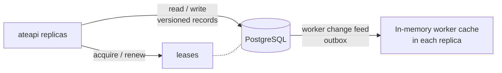
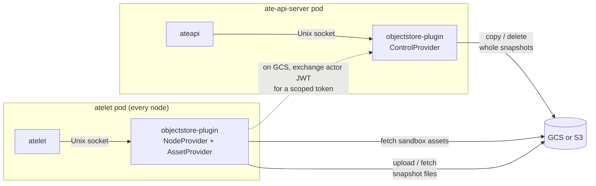

Substrate keeps its state in three places, and as the table below shows, each
one serves a different need and has a different owner. Every other component
reaches these stores through ateapi or atelet.

| Store | Holds | Who touches it |
|---|---|---|
| PostgreSQL | Every API resource record, worker assignments, leases, the worker change feed, authorization tuples | ateapi only |
| Object storage (GCS or S3) | External snapshots, tag copies, sandbox assets | The `objectstore-plugin` sidecars only |
| Node-local disk (`/var/lib/ate`) | Local snapshots, the sandbox asset cache, per-actor working state | atelet and the worker pods on that node |

## PostgreSQL for control-plane state

PostgreSQL is the source of truth for the control plane, and ateapi is its only
client, so every other component goes through ateapi's gRPC API.



### What it holds

| Data | Keyed by | Notes |
|---|---|---|
| Atespaces | `name` | Global |
| Actors, ActorTemplates, Tags | `(atespace, name)` | Each references its atespace, which cannot be deleted while any remain |
| Actor egress policies | `(atespace, actor_name)` | Deleted with the actor |
| Workers | `name` (the worker pod's UID) | Global |
| Worker assignments | actor UID | One row per hosted actor, so an actor has at most one worker |
| Leases | lease key | e.g. `lease:actor:<atespace>:<name>`, with an expiry |
| Worker outbox | transaction ID | Change feed for the worker cache |
| Access policies, OpenFGA tuples and model | - | Authorization state, in the same schema |

Each record is stored as its protobuf alongside a `uid` and a `version`, and
every update is a compare-and-set on `version`, so a lost race surfaces as
`Aborted` for the caller to retry. ateapi applies the schema migrations itself
at startup.

### Leases

A lease is a row with a token and an expiry, and ateapi takes one before any
workflow that mutates an actor, tag, template, or worker. The default TTL is 30
seconds, and the holder renews it in the background roughly every 10 seconds.
If renewal fails, the workflow's context is cancelled, so it stops before
another replica can claim the expired lease. A second operation on the same
resource gets `Aborted` instead of waiting.

### The worker change feed

Every write to a worker record appends an event to an outbox table in the same
transaction. Each ateapi replica polls the outbox to keep its in-memory worker
cache current, which is what the scheduler reads. The outbox is unlogged and
partitioned by time, so it's cheap to write and old events are dropped in bulk,
and a replica that falls behind the retention window detects the gap and
rebuilds from the workers table.

### Deployment options

- In the bundled setup, the installer runs a single-replica `postgres`
  StatefulSet (PostgreSQL 18) in `ate-system`. ateapi connects over TLS with no
  passwords, presenting Kubernetes pod certificates from a dedicated signer that
  only issues them to the `ate-api-server` ServiceAccount.
- If you bring your own database, ateapi takes owner and read/write connection
  strings, roles, and a schema name (default `substrate`), and the operator
  provisions the database, schema, and roles first.
- On Cloud SQL, an optional Cloud SQL Auth Proxy sidecar on the API server pod
  handles transport and IAM database authentication.

ateapi uses two connection pools under separate roles, an owner role for
migrations and partition maintenance and a read/write role for normal queries.
Both credentials live in the same process, so the split limits mistakes rather
than a compromised API server.

### Why a database and not the Kubernetes API?

Resuming an actor needs low-latency reads, atomic multi-row writes (an actor
and its worker assignment together), and leases that many replicas can
contend on. Those don't fit etcd's watch-and-reconcile model, and putting
thousands of actor transitions per second through the Kubernetes API would
load the cluster's own control plane. So Substrate keeps infrastructure
(WorkerPools, SandboxConfigs) in Kubernetes CRDs and workload state in
PostgreSQL.

## Snapshots: local and external

A snapshot is the state that lets a suspended actor come back. Each actor's
`status.snapshots` records its snapshot generations, and a snapshot can live in
two places at once, tracked by the two fields below.

| Field | Where | Meaning |
|---|---|---|
| `locality` | A node's disk | The node holding the snapshot's files; set while a local copy exists |
| `durable_snapshot` | Object storage | `PENDING` while uploading, `COMPLETED` once the upload is recorded |

A suspend always writes the checkpoint to the node first. An asynchronous
suspend (the default) returns at that point, and atelet uploads the snapshot in
the background (by default about 5 minutes later) and reports it so ateapi
marks it `COMPLETED`, while a synchronous suspend uploads before returning.
While a local copy exists, a resume is placed back on that node and restores
without touching object storage. After a detach delay (30 minutes by default),
or during a resume when that node has no room, atelet uploads if needed and
deletes the local files, and from then on the actor is free to resume anywhere.

What a snapshot holds is its _fidelity_, which is one of `VOLUMES` (durable
volumes only), `ROOTFS` (plus root filesystem changes), or `MEMORY` (plus
process memory), and the template's `preferred_fidelity` sets the ceiling. We
cover what each fidelity captures on the [Snapshot](/concepts/snapshot/) page.

## Object storage behind a plugin

Neither ateapi nor atelet talks to object storage for snapshots. As the diagram
below shows, both run the `objectstore-plugin` as a sidecar that serves the
`objectstore.v1` gRPC API over a Unix socket in its pod.



| Service | Runs beside | Does |
|---|---|---|
| `NodeProvider` | atelet | `UploadSnapshot`, `FetchSnapshot` for the files atelet names |
| `AssetProvider` | atelet | `FetchAsset` for sandbox binaries a SandboxConfig names, verified by sha256 |
| `ControlProvider` | ateapi | `CopySnapshot` (tags, golden snapshots), `CleanupSnapshot` (suspend, revert, delete) |

The in-tree plugin backs this with GCS (the default) or S3, chosen by
`ATE_STORAGE_BACKEND` on the sidecar, and neither main process holds object
storage credentials. Other providers come in through the same API, where a
platform implements the three services and ships its own plugin binary.

:::note[Per-actor storage credentials on GCS]
On GCS, each transfer carries a `worker-for-actor` JWT that ateapi minted for
the node hosting the actor. The node plugin exchanges it with the control
plugin for a short-lived token limited to that actor's snapshot prefix
(read-write) and the tag it was created from (read-only). The token is
refused once the actor leaves that node, so snapshot access is scoped per
actor rather than per node. On S3 the plugin ignores the JWT and transfers
with the pod's own credentials.
:::

### Object layout

The base location is ateapi's `--snapshot-location` (e.g.
`gs://my-bucket/substrate`), and every snapshot sits under it in the prefix of
the resource that owns it, as the layout below shows.

```
<location>/atespaces/<atespace>/actors/<actor-uid>/snapshots/<snapshot-uuid>/
  <file>.zstd        (one per file the sandbox runtime wrote)
  manifest.json      (the file list; uploaded last)
<location>/atespaces/<atespace>/tags/<tag-uid>/
  ...                (a tag's own copy of one snapshot)
```

Prefixes use the actor's UID rather than its name, so a deleted and recreated
actor never reads the old one's snapshots. The manifest is uploaded only after
every data file succeeds, so a reader that finds it can rely on every file it
lists. A tag is a separate copy, so suspending or deleting the source actor
can't collect it. With the `PerTemplateSnapshotLocation` preview gate, a
template's `snapshot_config.storage_location` overrides the base location.

### Compression

Network bandwidth between nodes and object storage is the bottleneck on a cold
resume. The plugin compresses each file with zstd in a sparse-extent
format that skips file holes, which matters for memory images that are mostly
empty. Uploads and downloads both run in parallel, and the node plugin shares
one memory budget (`--upload-memory-budget`, default 512Mi) across concurrent
uploads.

## Node-local storage

atelet and the workers keep node-local state under `/var/lib/ate`.

- `snapshots/` holds local checkpoints. It shares the boot disk by default, and
  an operator can mount a dedicated disk there (before any actors run) to keep
  heavy guest writes from slowing checkpoint and restore.
- `sandbox-asset-cache/` is a content-addressed cache of sandbox binaries
  (gVisor releases, micro-VM kernels and images). Each actor gets hard links
  into it, so an asset is downloaded once per node. See
  [atelet](/components/atelet/).
- `actors/<uid>/` is each actor's working directory on the node.

Worker pods see only `/var/lib/ate`, and the layout beyond `snapshots/` is an
implementation detail.

## External volumes

Actors can also mount per-actor external volumes from a CSI driver (a preview
feature). ateapi provisions and attaches them through the CSI controller during
the resume workflow, and deletes them with the actor. Their contents are never
part of a snapshot, so a revert or resume doesn't rewind them.

## Related

- [ateapi](/components/ateapi/) is PostgreSQL's only client.
- [atelet](/components/atelet/) handles local snapshots, uploads, and the asset
  cache.
- [Snapshot](/concepts/snapshot/) covers what the snapshot files are and what
  each fidelity captures.
