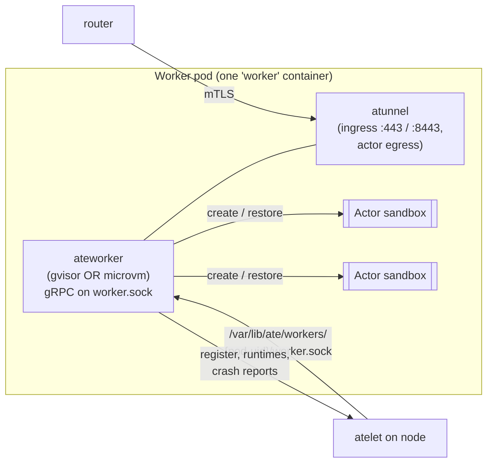
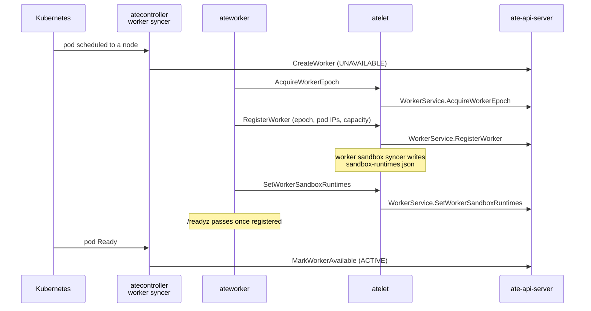

A worker in Substrate is a pre-warmed Kubernetes Pod that's ready to host
actors. By the time the scheduler places an actor on it, the in-pod
`ateworker` is running and registered, the node has its sandbox binaries
cached, and the pod network is up, so the worker can create the sandbox and
restore the actor without waiting on Kubernetes scheduling, image pulls, or
binary downloads.

A worker hosts many actors. Each actor runs in its own sandbox (a gVisor
sandbox or a micro-VM) with its own network namespace and cgroup, and the
worker takes actors until it reaches its actor limit or its CPU and memory
capacity. Every worker belongs to one `WorkerPool`, and a pool runs one
sandbox class, either gVisor (`ateworker-gvisor` + runsc) or micro-VM
(`ateworker-microvm` + cloud-hypervisor).

## Anatomy of a worker pod

As the diagram above shows, the worker's gRPC socket sits in the host's
`/var/lib/ate` tree (which atelet and every worker pod mount at the same path),
under a directory named by the pod UID, so the pod UID in that path is how a
worker gets addressed. Each actor's
network is built on assignment and torn down on checkpoint (see
[ateworker-gvisor](/components/ateworker-gvisor/#actor-networking)).

## How a worker registers

Two parties register a worker. atecontroller's worker syncer watches worker
pods and creates the `Worker` record in the control plane, and the worker
process itself reports what only the node can observe, through atelet. The
sequence below shows how those two halves interleave.

- The record is named after the pod UID and carries the pod's namespace,
  pool, name, node, SPIFFE ID, and a copy of the WorkerPool's labels.
- The worker's readiness probe fails until it has registered, so a pod is
  never Ready, and never `ACTIVE`, before the control plane knows its
  capacity.
- The worker watches `sandbox-runtimes.json` and re-reports its runtimes
  whenever atelet rewrites it (e.g. after a SandboxConfig gains a
  version).

## Capacity

A worker reports its capacity once per process, in `RegisterWorker`, and the
table below lists where each number comes from.

| Dimension | Source |
|---|---|
| `cpu_millicores` | The worker container's CPU limit, projected through the downward API |
| `memory_bytes` | The worker container's memory limit, likewise |
| `actors` | The worker's actor limit, `--max-actors` (default 1000) |

Without a container limit, the downward API projects the node's allocatable
CPU or memory instead, so set `spec.template.resources` on the pool to split a
node into several workers. The control plane tracks `allocated` as the sum of
the resource limits of the actors assigned to the worker, and an actor whose
template declares no limits costs only an actor slot. You can see the whole
fleet with `kubectl ate get workers` and `kubectl ate top workers`.

## Sandbox runtimes

Alongside capacity, a worker advertises which sandbox runtimes it can run,
meaning a default runtime for new and cold-booted actors plus restorable
runtimes from the SandboxConfig's other enabled versions. Each runtime is a
set of compatibility attributes that atelet computes (the architecture, a
`sandbox_bundle_hash` over the version's assets, and the CPU features for
gVisor or the CPU vendor and model for micro-VM). A worker that hasn't
reported its runtimes takes no actors.

When a memory snapshot is taken, it's stamped with the runtime the actor ran
under. A later memory restore needs a worker whose runtime matches, which
means every attribute on the snapshot must be present with the same value,
except `cpu_features`, where the snapshot's set must be a subset of the
worker's.

## The Worker record

Workers live in the control-plane store (PostgreSQL) rather than in etcd, and
each record carries these fields.

- Identity (immutable): `worker_namespace`, `worker_pool`, `worker_pod`,
  `worker_pod_uid`, `node_name`, `worker_spiffe_id`.
- `labels`: the WorkerPool's labels, which template and actor selectors match
  against.
- `status.state`: `UNAVAILABLE`, `ACTIVE`, or `DRAINING`.
- `status.capacity` / `status.allocated`: as above.
- `status.sandbox_classes`: the class and runtimes the worker reported.
- `status.ips`: the pod IPs, reported by the worker process.
- Epochs (`issued_epoch`, `registered_epoch`, `observed_epoch`): which worker
  process is current (see [Worker lifecycle](/flows/worker-lifecycle/)).

The actors a worker hosts are `ActorAssignment` subresources of the Worker,
one per hosted actor, each recording the resources it reserved. The
actor side holds a matching `WorkerAssignment` with a denormalized copy of the
worker's pod name, IPs, node, and the sandbox runtime the actor runs under.

## How an actor is placed

When ResumeActor runs, ate-api-server's scheduler picks from a watch-fed cache
of workers. So which workers can it pick? A worker is eligible when it meets
all of these conditions.

1. It is `ACTIVE` and has registered its runtimes.
2. If the actor resumes from a snapshot, the worker's sandbox class equals the
   snapshot's. A snapshot's files are written and read by one class, at every
   fidelity.
3. If the resume restores memory, the worker can run the snapshot's runtime
   (default or restorable).
4. Its labels match the template's `workerSelector` and the actor's own
   `worker_selector`.
5. If the actor's latest snapshot is still local to a node, the worker is on
   that node.

Among eligible workers with room, the scheduler samples two at random and
takes the less loaded one (the _power of two choices_), where load is the
higher of actor-slot and CPU/memory utilization. The store re-checks
eligibility and room under the worker's row lock when it binds, so two resumes
can't both take the last slot.

What if no worker that can run a memory snapshot's runtime has room? If the
snapshot is durable in object storage, placement drops that requirement and
the actor restores without memory state (its rootfs and volumes) on a worker
of the same class. An actor with no snapshot boots on whichever class its
selectors pick, and keeps that class from its first checkpoint on.

## How a worker is released

Suspend, delete, and crash each remove the actor's assignment, which returns
its reserved resources to the worker. Other actors on the same worker are
unaffected.

## Why two runtimes?

`runsc` (gVisor) gives a small-footprint userspace kernel with first-class
`checkpoint`/`restore`. The micro-VM class trades that footprint for a
hardware-virtualized boundary (a real guest kernel behind KVM), suspending and
resuming through cloud-hypervisor's snapshot/restore. A pool commits to one or
the other.

## What's pre-warmed vs. lazy

| Pre-warmed (before any actor) | Lazy (on placement) |
|---|---|
| Pod scheduled, IP and pod network ready | Actor network namespace(s) and atunnel listeners |
| ateworker running and registered with capacity and runtimes | Container image layers, if not already cached on the node |
| Default sandbox runtime cached on the node | Sandbox created, actor state restored |

## Related

- [Worker lifecycle](/flows/worker-lifecycle/) - states, epochs, and pod death.
- [WorkerPool](/concepts/workerpool/) - the CRD that makes workers exist.
- [ateworker-gvisor](/components/ateworker-gvisor/) · [ateworker-microvm](/components/ateworker-microvm/) -
  the two worker implementations.
- [atelet](/components/atelet/) - drives the workers and relays their reports.
