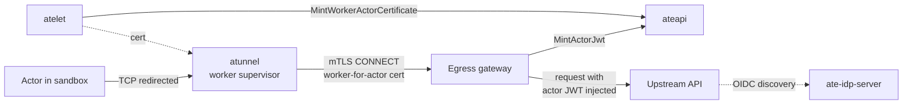

An actor moves between worker pods many times, since every suspend and resume
can land it on a different pod (and often on a different node), and the pod's
own credentials change with each move. But the actor's identity to external
services, the thing that says "this request comes from actor `checkout` in
atespace `team-a`", must not change.

Substrate uses the actor itself as that stable identity, which is
`(atespace, name)` plus its UID to tell a deleted and recreated actor from the
original, and there's no separate session resource for this. ateapi mints
credentials that assert it, and they read the same whichever worker the actor
is on.

## Three identities

| Identity | Held by | Asserts | Issued by |
|---|---|---|---|
| Pod identity | Worker pods, atelet, router, egress gateway, ateapi | "I am this Kubernetes ServiceAccount" (`spiffe://cluster.local/ns/<ns>/sa/<sa>`) | Kubernetes pod certificates |
| `worker-for-actor` | atelet and `atunnel` while they host an actor | "I am the Substrate component acting for this actor" | ateapi `WorkerService` |
| Actor | Never the actor itself; minted for the egress gateway to present on the actor's behalf | "This is the actor" | ateapi `Control` |

Keeping them apart lets a relying party tell who is calling. A
`worker-for-actor` credential says a trusted Substrate component is acting
_for_ the actor, which is right for infrastructure such as the egress tunnel or
snapshot storage, while an actor credential says the actor itself is calling,
which is what an upstream API should see. Subjects and claim names differ
(`worker-for-actor/...` vs. `actor/...`) so the two can be granted different
access.

## Actor credentials

Actor credentials come from two RPCs on ateapi's `Control` service, and only the
egress gateway may call them. An editor of the atespace can't, because holding
one would let a user impersonate the actor.

| RPC | Output |
|---|---|
| `MintActorJwt` | A JWT with `sub=actor/<atespace>/<name>`, the requested `aud` (at least one required), a lifetime of 5 to 60 minutes, `nbf` back-dated 5 minutes for clock skew, and an `actor.ate.dev` claim holding `atespace`, `actorName`, and `actorUID` |
| `MintActorCertificate` | An X.509 certificate signed from a CSR, valid one hour, with the SPIFFE URI `spiffe://substrate-actor.local/actor/<atespace>/<name>` and an X.509 extension carrying the atespace, name, and UID. The caller must authenticate with a client certificate, and must name the actor's current UID |

The actor must exist but need not be running, since a credential may be needed
while it boots or resumes.

So how does an actor use its JWT if it never holds it? When an `http` or
`https` rule in the actor's `EgressPolicy` asks for actor JWT injection, the
egress gateway mints a token for the actor making the request and writes it
into the outbound header before the request leaves the cluster. **The actor
sends a placeholder, so it can't read, snapshot, or leak the token.**

To verify a token, a relying party starts from the issuer, which is ateapi's
`--actor-jwt-issuer` (by default `https://idp.<namespace>.svc`). The
`ate-idp-server` Deployment serves the OpenID Connect discovery document and JWK
set at that issuer, so any relying party that trusts the issuer can verify actor
JWTs with standard OIDC discovery.

:::note[Certificate minting has no in-tree caller]
`MintActorCertificate` is implemented and authorized for the egress gateway,
but no component in the checked-in install calls it. Actor JWT injection is
the working path for presenting actor identity upstream.
:::

## `worker-for-actor` credentials

These are minted through ateapi's `WorkerService`, which serves only atelet,
and only for an actor assigned to a worker on that atelet's own node. The table
below lists the two RPCs and what each credential is used for.

| RPC | Output | Used for |
|---|---|---|
| `MintWorkerActorCertificate` | One-hour certificate, SPIFFE URI `spiffe://substrate-actor.local/worker-for-actor/<atespace>/<name>`, with the actor's UID in the X.509 extension | `atunnel` presents it when it opens the actor's egress tunnel to the egress gateway |
| `MintWorkerActorJwt` | One-hour JWT, `sub=worker-for-actor/<atespace>/<name>`, claims under `worker-for-actor.ate.dev` | atelet hands it to node plugins, such as the object-store plugin, which exchange it for storage credentials scoped to that actor |

ateapi reads the caller's node from atelet's pod certificate and mints only
for an actor on that node, so one node can't obtain `worker-for-actor`
credentials for actors it doesn't host. The certificate additionally requires
the actor to be assigned to a worker there, so a suspended actor gets none. The
JWT is also issued while a suspended actor's snapshot is still on the node,
which is when its background upload runs.

The egress gateway in the diagram above is part of atenet, where AgentGateway is
the preferred dataplane and Envoy is the install default. We cover how each one
handles egress on the [atenet](/components/atenet/) page.

## Actor vs. worker

| | Actor | Worker pod |
|---|---|---|
| Identifier | `(atespace, name)`, plus UID | Pod name and UID |
| Lives in | ateapi's PostgreSQL database | Kubernetes |
| Lifetime | Until `DeleteActor` | Until the pod is replaced |
| Credential identity | `actor/<atespace>/<name>` | `ns/<ns>/sa/<sa>` |

An actor can also learn its own name, atespace, and UID from a `system_info`
volume with an `actor_metadata` data source, although that's information for
the workload and doesn't act as a credential.

## Related

- [Actor](/concepts/actor/) covers the lifecycle behind the identity.
- [Atespace](/concepts/atespace/) covers the first half of every actor identity.
- [ateapi](/components/ateapi/) serves the `Control` and `WorkerService` RPCs.
- [Security & identity](/security/) covers trust boundaries across the system.
