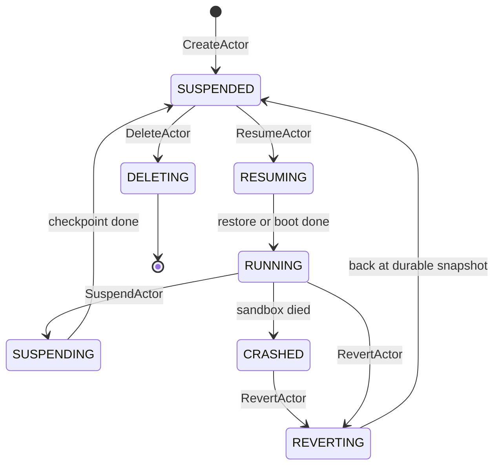

An _actor_ is the unit of work in Substrate. You can think of it as an
instance of an agent with its own memory, filesystem, and identity, but one
that isn't pinned to a pod. The same actor can suspend on worker A, resume on
worker B, and pick up where it left off. So what is an actor actually made of,
and where does each piece live?

## What an actor consists of

| Piece | Where it lives |
|---|---|
| Actor record | A row in ateapi's PostgreSQL store, keyed by `(atespace, name)` |
| Spec (images, env, volumes, size) | Inherited from the actor's [`ActorTemplate`](/concepts/actortemplate/) |
| Snapshots | `status.snapshots`: up to a few generations, each with a node-local copy, a durable copy in object storage, or both (see [Snapshot](/concepts/snapshot/)) |
| Running state | A gVisor sandbox **or** a micro-VM on a worker pod (only while `RESUMING`/`RUNNING`/`SUSPENDING`) |

## Lifecycle

An actor's `status.state` is one of seven `ActorState` values (`RESUMING`,
`RUNNING`, `SUSPENDING`, `SUSPENDED`, `CRASHED`, `DELETING`, and `REVERTING`,
each prefixed `ACTOR_STATE_`). `SUSPENDED` is the idle state a
new actor starts in. `RESUMING`, `SUSPENDING`, `REVERTING`, and `DELETING` are
set when a workflow begins and cleared when it finishes. `CRASHED` holds an
actor whose sandbox died or whose operation failed in a way the workflow
could not undo, and `status.crash` records why. You can delete an actor from
any state. The diagram above shows the main paths, and
[Actor lifecycle](/flows/actor-lifecycle/) covers every transition.

## Identity

An actor's identity is the tuple `(atespace, name)` in its
`ResourceMetadata`. The name is a DNS label that only has to be unique within
its [atespace](/concepts/atespace/), and the caller specifies both at creation
(neither can change afterward). ateapi also assigns a UID, which distinguishes
this actor from a later one created under the same name, and snapshots,
assignments, and credentials are keyed on it.

To send a request to an actor, a client goes through the atenet router and
names the actor in the `ate-target-actor: <atespace>/<name>` header. The
`Host` header passes through to the application and plays no part in picking
the actor (see [Resume actor](/flows/resume-actor/)).

Inside the sandbox, a template can project the actor's name, atespace, and
UID into files through a `systemInfo` volume. atelet rewrites that volume on
every run and restore, so an actor restored from a shared golden snapshot
still reads its own identity. [Security](/security/) covers how actors are
identified to the gateways and to external services.

## What's the relationship to a Pod?

The two are decoupled. An actor is a record in ateapi's store, and a worker
pod is a physical hosting slot. While an actor runs, `status.workerAssignment`
names the worker pod, its IPs, node, and pool, and that assignment changes
whenever the actor suspends and resumes elsewhere.

A worker can host several actors at once. Each worker reports its capacity
(CPU, memory, and a maximum actor count), and the scheduler books each actor's
template limits against it. So we get multiplexing in two directions (many
actors per worker at a time, and many more over time as idle actors suspend
and free their room).

After an asynchronous suspend, a `SUSPENDED` actor can stay attached to a
node (`status.assignedNode`) while its latest snapshot is kept on that node's
disk, and its next resume prefers that node (see
[Suspend actor](/flows/suspend-actor/)).

## What's the relationship to an ActorTemplate?

It's many-to-one. An `ActorTemplate` defines what kind of actor this is
(container images, env, volumes, compute size, snapshot policy, placement,
etc), and many actors share a template, each with its own state and
snapshots. A `SUSPENDED` actor
can be repointed at a new template with `UpdateActor`, under the constraints
on the [ActorTemplate](/concepts/actortemplate/#moving-an-actor-to-a-new-template)
page.

## Placement

Where an actor runs comes from selectors rather than a fixed pool reference.
The scheduler only considers workers that pass each of the checks below.

- match **both** the template's `workerSelector` and the actor's own
  `workerSelector` (set at create or with `UpdateActor`, effective on the next
  resume);
- run the sandbox class that wrote the actor's latest snapshot, if it has one;
- for a memory snapshot, still offer a sandbox runtime that can restore it
  (otherwise the restore falls back to a lower fidelity);
- sit on the actor's `assignedNode`, while it has one;
- have room for the template's CPU and memory limits and one more actor.

Among the eligible workers it samples two at random and picks the less loaded
one ("power of two choices"), which spreads actors across the warm pool.

## Related

- [Atespace](/concepts/atespace/) - the isolation boundary an actor's name is
  scoped to.
- [ActorTemplate](/concepts/actortemplate/) · [Worker](/concepts/worker/) ·
  [Snapshot](/concepts/snapshot/) · [Actor identity](/concepts/actor-identity/)
- [Actor lifecycle](/flows/actor-lifecycle/) - full state machine.
