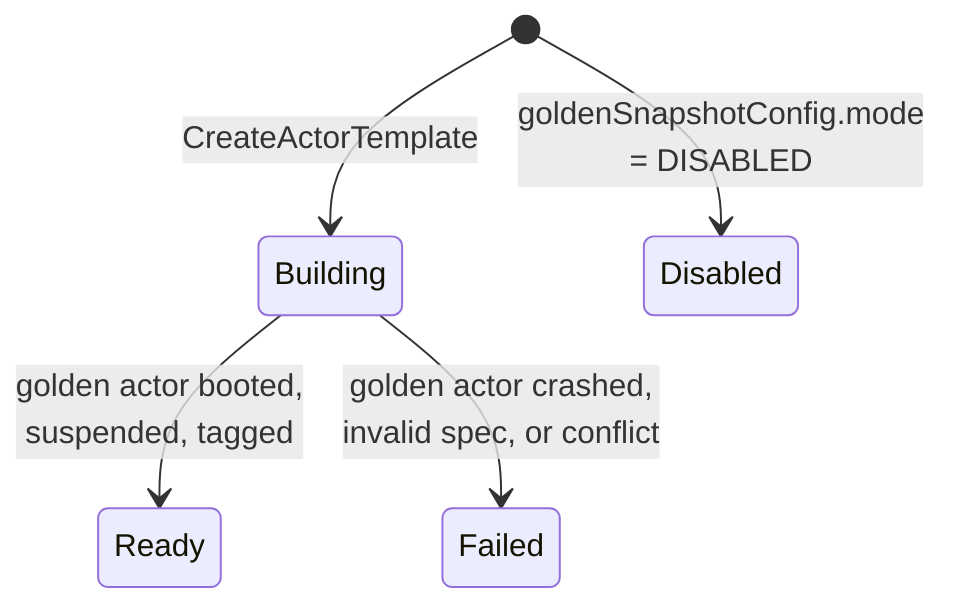

An `ActorTemplate` declares what an actor of a given kind looks like, e.g.
which container image(s), entrypoint, and environment it runs, which volumes
it mounts, how much CPU and memory it gets, which worker pools it may run on,
and what its snapshots capture. From a single template you create many actors
(instances).

You might expect to find templates with `kubectl get`, but an `ActorTemplate`
is a Substrate API resource rather than a Kubernetes object. It lives in an
[atespace](/concepts/atespace/), you create it through ateapi's
`CreateActorTemplate` RPC (`kubectl ate create actor-template -f ...`), and
ateapi stores it in its PostgreSQL database alongside actors, tags, and
workers. So `kubectl get actortemplate` returns nothing, and
`kubectl ate get actor-templates` is how we see them.

:::note[Templates are immutable]
There is no update RPC. Changing an image would invalidate every snapshot
taken from the old one, so a new "version" means a new template, and a
`SUSPENDED` actor can then be repointed to it with `UpdateActor`
(`kubectl ate update actor --template`), as described in
[Moving an actor to a new template](#moving-an-actor-to-a-new-template).
:::

## The spec

A template manifest is the protojson form of the `ActorTemplate` message
(camelCase field names). Let's look at the template from the `counter` demo.

```yaml
metadata:
  atespace: ate-demo-counter        # must already exist
  name: counter
workerSelector:                     # optional placement gate
  matchLabels: { workload: counter }
containers:                         # 1-10 containers
- name: counter
  image: registry.example/counter@sha256:...   # must be pinned by digest
  command: [/ko-app/counter]
  env:
  - { name: LOG_LEVEL, value: info }           # literal values only
  wakeupProbe:                                 # optional; gates every wakeup
    httpGet: { path: /readyz, port: 80 }
    timeoutSeconds: 30
  volumeMounts:
  - { name: data, mountPath: /home/counter }
resources:                          # required: both limits
  limits:
    cpuMillicores: 1000
    memoryBytes: 536870912          # 512Mi
snapshotConfig:                     # optional; every field has a default
  preferredFidelity: SNAPSHOT_FIDELITY_MEMORY
  goldenSnapshotConfig: { mode: GOLDEN_SNAPSHOT_MODE_ENABLED }
volumes:
- name: data
  durableDir: {}
```

That manifest is what we hand to `kubectl ate create actor-template -f`. If
you want to see what ateapi actually stored, including server-assigned
metadata and status, `kubectl ate get actor-template <name> -a <atespace> -o yaml`
prints it.

### Validation at create time

ateapi validates the whole template before storing it. The referenced
atespace must exist, a duplicate `(atespace, name)` returns `AlreadyExists`,
and the spec itself has to pass the checks below.

- Every container image is digest-pinned (`name@sha256:...`), as is the
  reference of any `image` volume, since a snapshot only means something
  against the exact bytes it was taken from.
- `resources.limits.cpuMillicores` and `memoryBytes` are both required. The
  scheduler books them against worker capacity, and a micro-VM is booted at
  that size.
- Every `volumeMounts[].name` refers to a declared volume, and mount paths
  are clean absolute paths that do not nest.
- A snapshot storage location must resolve (see [Snapshots](#snapshots)
  below), so a template whose actors could never be snapshotted is rejected
  up front instead of failing on their first suspend.
- `goldenEgressPolicy` requires golden snapshots to be enabled.

### Containers

Each `containers[]` entry supports the fields below. Most of them will look
familiar from a Kubernetes container spec, although `$(VAR)` references
behave differently (as noted below).

- `command[]` / `args[]` - override the image entrypoint, mirroring Kubernetes
  semantics: `command` replaces the image `ENTRYPOINT` and `CMD`, and the
  process argv is `command + args`. Unlike Kubernetes, `$(VAR)` references are
  _not_ expanded.
- `env[]` - name and literal `value`. Values are not `$(VAR)`-interpolated.
- `wakeupProbe` - an HTTP GET (`httpGet.path`, default `/`, and
  `httpGet.port`) polled on every wakeup, whether the actor cold-boots or
  restores from a snapshot. `ResumeActor` returns only after every probed
  container answers 200. A probe that does not answer within
  `timeoutSeconds` (default 30) crashes the actor. Without a probe, a resume
  returns as soon as the container has started, which may be before it
  listens.
- `volumeMounts[]` - mount a `volumes[]` entry by name. A volume may be
  mounted at several paths.
- `securityContext.capabilities` - `add`/`drop` Linux capabilities relative
  to the default set.
- `resources.limits` - per-container limits enforced inside the actor's
  sandbox (0 leaves a dimension unlimited).

### Volumes

Each `volumes[]` entry has exactly one source. There are four sources to
choose from, as the table below shows.

| Source | What it is |
|---|---|
| `durableDir` | A directory that persists across resumes and travels inside the actor's snapshots. |
| `image` | The contents of a digest-pinned OCI image, mounted read-only. |
| `systemInfo` | Read-only, Substrate-generated per-actor files: identity fields (name, atespace, UID) and named trust bundles. Regenerated by atelet on every run and restore. |
| `external` | A CSI volume provisioned per actor and deleted with it. Behind the `ExternalVolumes` preview gate. |

### Worker placement and sandbox class

`workerSelector` is a label selector that gates which worker pools this
template's actors may use. It is AND'd with each actor's own
`workerSelector`, which can only narrow the set further, and if it is unset,
every pool is eligible.

So how does a template choose between gVisor and a micro-VM? It doesn't name a
sandbox runtime at all. The pool decides whether an actor runs under gVisor or
in a micro-VM (see [WorkerPool](/concepts/workerpool/) and
[SandboxConfig](/concepts/sandboxconfig/)), which makes the selector the way a
template pins a class. If a cluster runs pools of both classes and the
workload needs one, select only pools of that class. An actor with no snapshot
and no selector may land on either, and keeps that class from its first
checkpoint on, because snapshots only restore into the class that wrote them.

### Snapshots

`snapshotConfig` has three fields, and all of them are optional.

- `preferredFidelity` (default `SNAPSHOT_FIDELITY_MEMORY`) - the highest
  [fidelity](/concepts/snapshot/#fidelity-what-a-snapshot-holds) a snapshot of
  these actors captures: `VOLUMES`, `ROOTFS`, or `MEMORY`. It is a ceiling,
  not a guarantee.
- `goldenSnapshotConfig.mode` (default `ENABLED`) - whether ateapi builds a
  [golden snapshot](/flows/golden-snapshot/) for the template. `DISABLED`
  means new actors cold-boot on their first resume.
- `storageLocation` - the object-storage prefix snapshots are written under.
  Honored only when the `PerTemplateSnapshotLocation` preview gate is on;
  otherwise every template uses ate-api-server's `--snapshot-location`.

`goldenEgressPolicy` (preview `GoldenEgressPolicy`) gives the golden actor an
egress policy while it warms up, and actors later created from the template
do not inherit it.

## What ateapi does with it

Creating a template stores it with an empty status. ateapi's template
reconciler (a loop inside ate-api-server rather than a Kubernetes controller)
picks it up on its next resync (every 20 s by default) and builds the golden
snapshot described in [Golden snapshot bootstrap](/flows/golden-snapshot/).
The diagram below shows where that build can end up.



The outcome lands in `status.goldenSnapshotStatus`, and
`kubectl ate get actor-templates` shows the golden tag name, `DISABLED`, or
`ERROR` in its columns.

| Field | Meaning |
|---|---|
| `goldenTag` | The [tag](/concepts/snapshot/#tags) that owns the golden snapshot. Set once the build succeeds. |
| `snapshotTime` | When the golden actor's warmup ends and its snapshot may be taken. |
| `errorMessage` | `<Reason>: <detail>` when the build failed. Terminal: the reconciler does not retry it. |

## What is the golden snapshot for?

When an actor is created without an explicit source tag, `CreateActor` seeds
it with the template's golden tag as it stands at that moment. The actor's
first resume restores from that snapshot instead of cold-booting the
container, so every new actor of the template starts from the same
pre-initialized state. An actor created before the golden build finishes has
no snapshot and cold-boots instead. See [Create actor](/flows/create-actor/).

## Moving an actor to a new template

`UpdateActor` can change an actor's `actorTemplate` reference, as long as the
rules below hold.

- the actor must be `SUSPENDED`;
- the new template must exist;
- its volumes, and the volume mounts of every container present in both
  templates, must be identical to the old template's;
- if the actor owns a snapshot, the new template must store snapshots under
  the same location.

Because the actor's latest snapshot was captured under a different template,
its next resume restores only the volumes from that snapshot and cold-boots
the new image on top of them, which discards the process memory and root
filesystem changes from the old image.

## Deleting a template

`DeleteActorTemplate` (`kubectl ate delete actor-template`) removes the
template's golden actor (if a build is in flight) and its golden tag, together
with the tag's snapshot, and then the template itself. Actors that were
seeded from the golden tag and never suspended still point at that snapshot,
and they will not resume after it is gone.

## Relationship to other concepts

| Concept | Cardinality |
|---|---|
| Atespace → ActorTemplate | one-to-many (templates live in an atespace) |
| ActorTemplate → WorkerPool | many-to-many, selector-gated (no pinned reference) |
| ActorTemplate → Actor | one-to-many (the template is the "class") |
| ActorTemplate → golden Tag | zero-or-one |

## Related

- [Actor](/concepts/actor/) - the per-instance entity.
- [WorkerPool](/concepts/workerpool/) - selected by `workerSelector`; decides
  the sandbox class.
- [Snapshot](/concepts/snapshot/) - fidelity, local vs. durable, and tags.
- [Golden snapshot bootstrap](/flows/golden-snapshot/) - the reconciler's flow.
- [ateapi](/components/ateapi/) - where templates are stored and reconciled.
