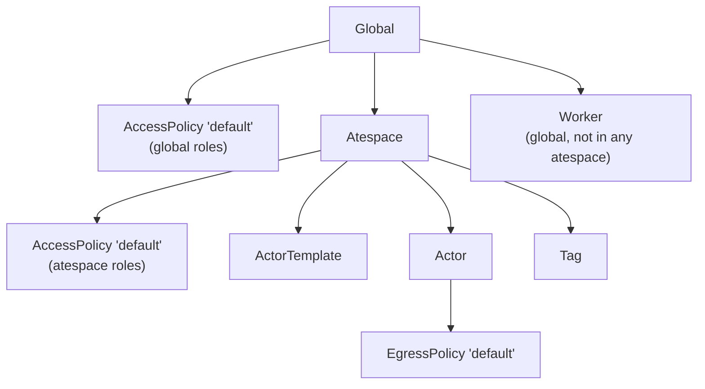

An _atespace_ is Substrate's tenancy boundary and the closest thing it has to a
namespace, although it's a Substrate-native resource rather than a Kubernetes
one. It's a record in [ateapi](/components/ateapi/)'s PostgreSQL database that
you create through the API (`kubectl ate create atespace <name>`), and it never
shows up as a Kubernetes object.

Every ActorTemplate, Actor, and Tag is created into an atespace, and its name is
only unique _within_ that atespace, so the real identity of an actor is the
tuple `(atespace, name)` carried in the common `ResourceMetadata` that every
resource has.

## What lives in an atespace

As the diagram above shows, an `Atespace` is itself global-scoped, which means
its `metadata.atespace` is empty and its identity is just `metadata.name` (a
DNS-label-style short name). Workers are global too, since the capacity they
provide is shared by every atespace.

## Where the atespace shows up

| Surface | Form |
|---|---|
| Control API | `ObjectRef{atespace, name}`, or a resource whose `metadata.atespace` is set |
| List RPCs | `ListActors`, `ListActorTemplates`, `ListTags` take an optional `atespace`; empty lists across all of them |
| Ingress routing | The `ate-target-actor: <atespace>/<actor>` header names the actor a request is for |
| Actor identity | SPIFFE ID `spiffe://substrate-actor.local/actor/<atespace>/<name>` and JWT subject `actor/<atespace>/<name>` |
| Snapshot storage | `<location>/atespaces/<atespace>/actors/<actor-uid>/...` and `.../tags/<tag-uid>` |
| Per-actor lease | `lease:actor:<atespace>:<name>` |

The caller specifies the atespace at creation, and just like the resource name,
it's immutable from then on.

## Authorization per atespace

ateapi authorizes every call per atespace, and a principal gets a role on an
atespace through that atespace's `AccessPolicy`.

| Role | Can |
|---|---|
| `viewer` | Get and list the atespace's templates, actors, and tags |
| `editor` | Everything a viewer can, plus create and operate actors, templates, and tags |
| `owner` | Everything an editor can, plus manage the atespace's AccessPolicy and delete the atespace |

A global `owner` is an owner of every atespace, and a global `viewer` can read
every atespace. Creating an atespace takes the global `owner` role. Today the
atespace is the finest boundary. There are no per-actor or per-template
bindings, so anyone who can operate one actor in an atespace can operate all of
them.

## Golden actors live in the template's atespace

When ateapi builds a template's [golden snapshot](/flows/golden-snapshot/), the
throwaway golden actor is created in the template's own atespace, named by the
template's UID, under the same policies and storage grants as ordinary actors.
The finished snapshot is kept as a golden tag in that atespace.

## Sharing across atespaces

So how does state get from one atespace to another? Tags are the one way it
crosses. A tag is always owned and addressed by its atespace, but its scope
decides who may start actors from it.

- `ATESPACE` limits it to actors in the tag's own atespace.
- `PUBLISHED` opens it to actors in any atespace (golden tags are published).

## Deleting an atespace

`DeleteAtespace` refuses (`FailedPrecondition`) while the atespace still holds
any actors, templates, or tags. Its AccessPolicy and authorization grants are
removed with it.

## Why identity is scoped this way

Scoping names to an atespace lets two tenants each have an actor named, say,
`checkout` without collision, and lets routing, identity, storage, locking,
and authorization all key off the same `(atespace, name)` pair. Storage paths
use the actor's UID under the atespace, so a deleted and recreated actor with
the same name never sees its predecessor's snapshots.

## Related

- [Actor](/concepts/actor/) covers what lives inside an atespace.
- [Actor identity](/concepts/actor-identity/) covers the credentials that carry
  `(atespace, name)` outside Substrate.
- [ateapi](/components/ateapi/) serves the atespace CRUD, access policies, and
  actor RPCs.
- [Snapshot](/concepts/snapshot/) explains how snapshots and tags are stored
  under their atespace.
