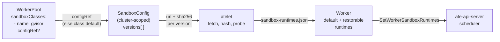

`SandboxConfig` is a cluster-scoped CRD that describes the sandbox binaries
for one sandbox class (`gvisor` or `microvm`) as a list of versions. It keeps
binary selection out of both the worker image and the workload. A
[WorkerPool](/concepts/workerpool/) resolves a SandboxConfig for its class,
and atelet fetches the assets (a gVisor release for gVisor, or a VMM,
virtiofsd, kernel, and guest image for a micro-VM). An ActorTemplate has no
say in which binaries an actor runs on.

## The spec

The platform installs the gVisor config below, annotated as the class
default.

```yaml
apiVersion: ate.dev/v1
kind: SandboxConfig
metadata:
  name: gvisor-default            # cluster-scoped: no namespace
  annotations:
    sandboxconfig.ate.dev/is-class-default: "true"
spec:
  sandboxClass: gvisor            # gvisor (default) | microvm
  defaultVersion: v5              # the version new sandboxes boot with
  versions:
  - name: v5
    state: Enabled                # Enabled (default) | Disabled
    assets:                       # map[arch]map[name]AssetFile
      amd64:
        gvisor:
          url: gs://gvisor/releases/release/20261019.0/x86_64/gvisor.tar.zstd
          sha256: 8637abfb...     # lower-case hex, 64 chars
      arm64:
        gvisor:
          url: gs://gvisor/releases/release/20261019.0/aarch64/gvisor.tar.zstd
          sha256: 88556c21...
```

The spec has three fields, and each version carries its own assets.

- `sandboxClass` is the runtime family this config applies to. A WorkerPool
  only uses configs whose class matches its own.
- `defaultVersion` (required) names the version that new and cold-booted
  actors start on. It must exist and can't be `Disabled`.
- `versions` (1 to 16) holds the versions, each with a DNS-label `name`, a
  `state`, and `assets` keyed first by architecture (GOARCH, e.g. `amd64`,
  `arm64`) and then by asset name. Each asset has a `url` and a `sha256` that
  both names the cached file and verifies the download.

Asset names are interpreted by the worker, and a `ValidatingAdmissionPolicy`
enforces each class's set (shown in the table below) for every architecture
of every version. A config that's missing one of its class's assets is
rejected at admission.

| Class | Required assets |
|---|---|
| `gvisor` | `gvisor`, the release tarball (`runsc` plus its helper binaries), which atelet extracts |
| `microvm` | `cloud-hypervisor`, `virtiofsd`, `kata-kernel`, `kata-image` |

## How it fits together



As the diagram above shows, a WorkerPool picks the config, and atelet turns
its versions into runtimes. Each worker then reports those runtimes to the
scheduler.

1. A WorkerPool names a config with `spec.sandboxClasses[].configRef`, or
   falls back to the class default, which is the newest SandboxConfig of that
   class annotated `sandboxconfig.ate.dev/is-class-default: "true"`.
   atecontroller records the result in the pool's status, and while a pool's
   status names a config, a finalizer keeps the config from being deleted.
2. atelet fetches each version's assets for the node's architecture through
   the node's object-store plugin, which serves its own backend's scheme
   (`gs://` or `s3://`). A `gs://` URL the plugin can't serve is read
   anonymously, which covers public buckets such as `gs://gvisor`. Every
   download is sha256-verified into a node-local content-addressed cache.
3. atelet hashes each version's asset digests into a `sandbox_bundle_hash` and
   probes the node (CPU features for gVisor, CPU vendor and model for a
   micro-VM). The default version becomes each worker's default runtime, and
   the other `Enabled` versions become restorable runtimes.

## Versions and snapshots

A memory snapshot is stamped with the runtime it was taken on, and it
restores its memory only on a worker that still offers that runtime. That's
the reason the config holds several versions instead of one.

- To upgrade, add a version and point `defaultVersion` at it. New and
  cold-booted actors start on the new version, while snapshots taken on the
  old one still restore with their memory on any worker that keeps it as a
  restorable runtime.
- Keep the previous version unless it has a known vulnerability. Removing it,
  or marking it `Disabled`, means snapshots taken on it can no longer resume
  with memory. Once such a snapshot is durable, the control plane falls back
  to restoring its rootfs and volumes and cold-booting the processes.
- Changing the config rewrites what every worker in the affected pools
  advertises, spread over a short jitter so the fleet doesn't re-register at
  once.

## A micro-VM example

Unlike the gVisor config, the micro-VM config is opt-in. You assemble the
asset set and stage it into a bucket the object-store plugin can serve, and
then apply a config like this one. Asset URLs must sit outside any snapshot
location, because the object-store plugin refuses to serve snapshot data as a
sandbox asset.

```yaml
apiVersion: ate.dev/v1
kind: SandboxConfig
metadata:
  name: microvm
  annotations:
    sandboxconfig.ate.dev/is-class-default: "true"
spec:
  sandboxClass: microvm
  defaultVersion: v2
  versions:
  - name: v2
    assets:
      amd64:
        cloud-hypervisor: { url: gs://my-bucket/kata-assets/cloud-hypervisor, sha256: ... }
        virtiofsd:        { url: gs://my-bucket/kata-assets/virtiofsd, sha256: ... }
        kata-kernel:      { url: gs://my-bucket/kata-assets/vmlinux, sha256: ... }
        kata-image:       { url: gs://my-bucket/kata-assets/rootfs.img, sha256: ... }
```

## Related

- [WorkerPool](/concepts/workerpool/) - resolves a SandboxConfig per class.
- [atelet](/components/atelet/) - fetches, caches, and probes the assets.
- [Workers](/components/workers/) - how runtimes gate snapshot restores.
