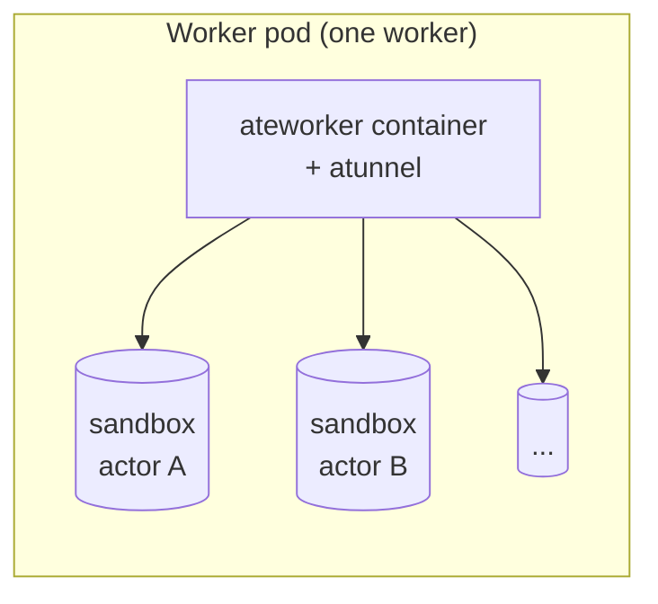

A worker is a Pod that's pre-warmed to host actors, so it's the hosting
capacity that actors run on. Worker pods come from a `WorkerPool` Deployment,
and they're pooled, fungible, and reused by many actors over their lifetime.
One worker hosts many actors at once, each in its own sandbox.

## What a worker actually is



As the diagram above shows, a worker pod has two pieces.

1. An `ateworker` process running as the pod's only container, ready to
   receive Run / Checkpoint / Restore RPCs from atelet. Its sandbox class
   (gVisor or micro-VM) is set by the pool.
2. Zero or more actor sandboxes, each created on placement with its own
   network namespace and cgroup, and removed when the actor suspends.

## The Worker record

The control plane keeps one global-scoped `Worker` per pod in its own store
(rather than in etcd), with the fields below.

```
Worker {
  metadata { name: <pod uid> }
  worker_namespace, worker_pool, worker_pod, worker_pod_uid,
  node_name, worker_spiffe_id,          # immutable
  labels{},                             # mirrors the WorkerPool's labels
  status {
    state: ACTIVE | UNAVAILABLE | DRAINING,
    capacity  { cpu_millicores, memory_bytes, actors },
    allocated { cpu_millicores, memory_bytes, actors },
    sandbox_classes [ { sandbox_class, default_runtime, restorable_runtimes } ],
    ips[], issued_epoch, registered_epoch, observed_epoch,
  }
}
```

The actors it hosts are `ActorAssignment` subresources, one per actor, each
naming the actor and the resources it reserved.

- The worker process reports its capacity, which is CPU and memory from its
  container limits and an actor count from its actor limit.
- atelet computes the sandbox runtimes from the pool's
  [SandboxConfig](/concepts/sandboxconfig/) and the node's CPU, and the worker
  reports them. A memory snapshot can only restore on a worker whose runtime
  matches the one it was taken on.
- Labels let ActorTemplates and actors select workers.

## Many actors per worker

A worker takes actors until it runs out of actor slots, CPU, or memory, as
measured against the resource limits each actor's template declares. Each
actor gets its own sandbox, network namespaces, and cgroup, so co-hosted
actors are isolated from one another and one actor's crash doesn't affect
the others. When an actor suspends, its assignment is removed and its
resources return to the worker.

## How workers get created

You don't create workers directly. Instead you declare a
[`WorkerPool`](/concepts/workerpool/), and `atecontroller` reconciles a
Deployment of N pods. Once a pod is scheduled, atecontroller's worker syncer
creates a `Worker` record (`UNAVAILABLE`) for it. The worker process then
registers its IPs, capacity, and runtimes through atelet, and the syncer marks
the worker `ACTIVE` once the pod is Ready.

## How workers get destroyed

When a pod starts terminating (scale-down, rollout, eviction, node drain), the
worker is marked `DRAINING` and takes no new actors. Once the pod is gone the
record is deleted. Actors that already suspended stay resumable, and actors
still running on it are moved to `CRASHED`.

## Related

- [Worker lifecycle](/flows/worker-lifecycle/) - states, epochs, and recovery.
- [WorkerPool](/concepts/workerpool/) - where workers come from.
- [Workers component](/components/workers/) - registration, capacity, and placement in depth.
