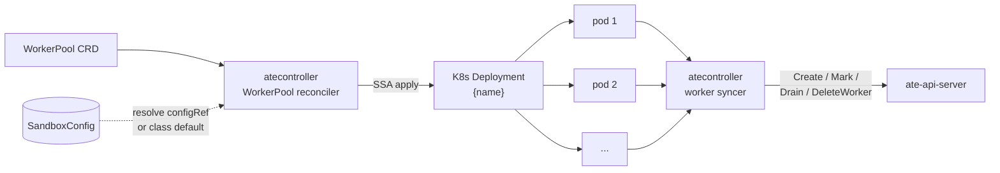

`WorkerPool` is one of Substrate's CRDs, and it's how you ask for N
pre-warmed worker pods of a given sandbox class, ready to host actors. From a
single pool, `atecontroller` resolves which
[SandboxConfig](/concepts/sandboxconfig/) the pool runs and maintains a
Kubernetes `Deployment`.

:::note[Decoupled from ActorTemplate]
A WorkerPool knows nothing about templates, and templates don't name a pool.
Eligibility is selector-based, so an actor can land on any pool whose labels
satisfy the template's `workerSelector` AND the actor's own
`worker_selector`. The pool decides the sandbox class, so a template that
needs a particular class selects only pools of that class.
:::

## The spec

```yaml
apiVersion: ate.dev/v1
kind: WorkerPool
metadata:
  name: counter-microvm
  namespace: ate-demo-counter-microvm
  labels:
    workload: counter-microvm     # matched by ActorTemplate.workerSelector
spec:
  replicas: 2                     # required
  workerImage: .../ateworker-microvm   # required
  sandboxClasses:                 # required; exactly one entry today
  - name: microvm                 # gvisor | microvm; immutable
    configRef:                    # optional; else the class default
      name: microvm
  template:                       # optional pod metadata, scheduling, resources
    resources:
      limits: { cpu: "1", memory: ... }
    # labels, annotations, nodeSelector, tolerations,
    # priorityClassName, nodeAffinity, serviceAccountName
status:
  replicas: 2
  readyReplicas: 2
  sandboxClasses:
  - name: microvm
    configRef: { name: microvm }  # the SandboxConfig in use
    conditions: [{ type: Resolved, status: "True" }]
```

The spec has four fields, and only `template` is optional. The `status`
block is what atecontroller reports back.

- `replicas` (required, `>= 0`) is the desired worker pod count.
- `workerImage` (required) is the worker container image, either
  `ateworker-gvisor` or `ateworker-microvm` to match the class.
- `sandboxClasses` (required, exactly one entry) is the runtime family the
  pool runs. The class name drives the worker pod shape and can't change after
  creation. `configRef` optionally names a cluster-scoped SandboxConfig of the
  same class, and without it the pool uses the newest SandboxConfig of that
  class annotated `sandboxconfig.ate.dev/is-class-default: "true"`.
- `template` (optional) holds extra labels and annotations for the Deployment
  and pods (the `ate.dev` domain is reserved), `nodeSelector`, `tolerations`,
  `priorityClassName`, `nodeAffinity`, `resources`, and `serviceAccountName`
  (default `ateworker`).

`kubectl get workerpools` prints the desired, current, and ready replica
counts, the SandboxConfig in use, and whether the class resolved.

## Labels and capacity

Two settings on a pool matter most to the scheduler. Both of them end up on
the Worker records that it places actors against.

- The pool's own `metadata.labels` are copied onto every Worker record, and
  they're what template and actor selectors match. (`spec.template.labels`
  only label the Kubernetes objects.)
- `spec.template.resources.limits` become each worker's CPU and memory
  capacity, which the scheduler fills with actors' declared limits. Kubernetes
  schedules the pods by their requests, so a request below the limit keeps
  the pool placeable without changing what actors may use. Each worker also
  reports an actor-count limit of its own.

## What atecontroller does with it



As the diagram above shows, the WorkerPool reconciler turns a pool into a
Kubernetes Deployment. Along the way, it resolves and protects the pool's
SandboxConfig and keeps the pool's status up to date.

1. It resolves the class's `configRef` (or the class default), checks that the
   config's class matches, and reports the result in `status.sandboxClasses`
   with a `Resolved` condition. A missing, deleting, or mismatched config sets
   `Resolved` to `False`, in which case an existing Deployment keeps running
   on the last resolved config and a new pool waits.
2. It protects the config, so a SandboxConfig that a pool's status names
   carries a finalizer and can't be deleted out from under the pool.
3. It server-side-applies a Deployment named after the pool, owner-referenced
   by it, with the replica count, `workerImage`, and the pod shape described
   below.
4. It reports status (`replicas`, `readyReplicas`, and the label selector).
   The CRD exposes a `scale` subresource, so `kubectl scale` works.

The reconciler doesn't create Worker records or work out runtimes. A
separate worker syncer in atecontroller watches the pods and registers each
one with ate-api-server (see [Worker lifecycle](/flows/worker-lifecycle/)),
and atelet is what turns the resolved SandboxConfig into the runtimes each
worker advertises.

## The worker pod shape

Every pod in the Deployment runs a single container named `worker`. The list
below covers its privileges, host state, identity, capacity, ports, placement,
and shutdown.

- The container isn't privileged. It runs as root with a fixed capability set
  for its sandbox class, and seccomp and AppArmor are unconfined because the
  sandbox mounts filesystems and pivots root. The micro-VM class adds the
  capabilities virtiofsd needs.
- The host's `/var/lib/ate` is mounted at the same path as in atelet, so the
  two share sockets, actor directories, and cached binaries.
- A projected pod certificate identifies the worker to atelet and to the
  router, and a separate trust bundle verifies the egress gateway.
- The container's own CPU and memory limits are projected into it through the
  downward API.
- Ports 443 and 8443 carry router-to-atunnel traffic, and 8080 serves
  `/readyz`, which fails until the worker has registered.
- Pods tolerate the `ate.dev/sandboxClass=<class>:NoSchedule` taint, so a
  cluster can reserve nodes per class. Micro-VM pods request one `ate.dev/kvm`
  from atelet's device plugin, which keeps them on KVM-capable nodes, and
  mount `/dev/net/tun`.
- A one-hour termination grace period gives hosted actors time to finish
  checkpoints, and rollouts replace at most 10% of pods at a time with no
  surge.

## Isolation and eligibility

Pools are the capacity and placement boundary, and because binding is
selector-based, you can use them in several ways.

- To separate sandbox runtimes, since a `gvisor` pool and a `microvm` pool
  never share workers and a snapshot only restores on its own class.
- To steer workloads with labels, by labeling a pool (e.g. `tier: gpu`) and
  gating templates to it with `workerSelector`.
- To size workers differently per workload class and scale them
  independently.
- To isolate failure domains.

:::caution[An unselective template can land on any class]
An actor with no snapshot and no selector that excludes a class may cold-boot
on a pool of either class, and keeps that class from its first checkpoint on.
If your cluster runs both classes, give templates a `workerSelector` that
picks one.
:::

## Scaling

When you edit `spec.replicas` (or use `kubectl scale`), atecontroller updates
the Deployment, and new pods register themselves with no actor downtime. On
scale-down a terminating worker is marked `DRAINING` and takes no new actors.
Actors that suspend during the grace period stay resumable, while actors still
running when the pod disappears are moved to `CRASHED`.

## Related

- [Worker](/concepts/worker/) - what a pool member actually is.
- [SandboxConfig](/concepts/sandboxconfig/) - where a pool's sandbox binaries come from.
- [ActorTemplate](/concepts/actortemplate/) - the `workerSelector` that picks pools.
- [Worker lifecycle](/flows/worker-lifecycle/) - the state machine.
- [atecontroller](/components/atecontroller/) - the reconciler and worker syncer.
