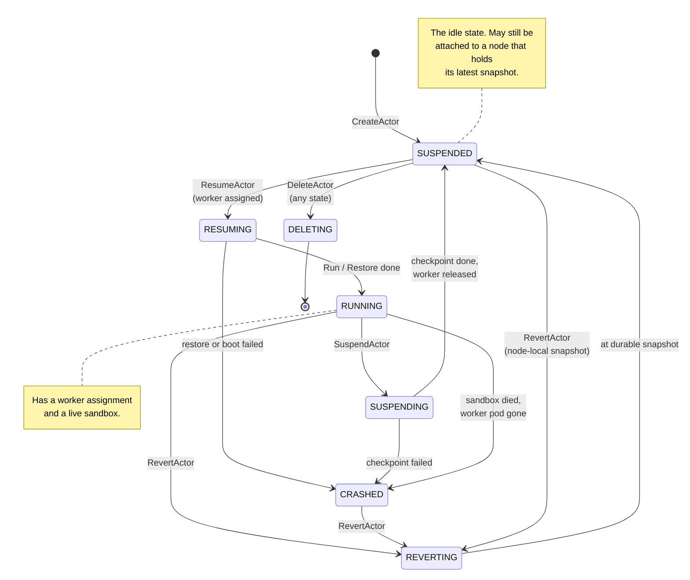
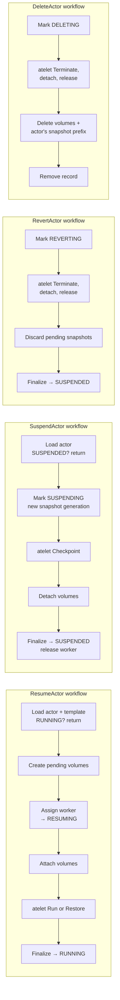

Every actor is in exactly one of seven states at any moment. That state is
stored in the actor's row in ateapi's PostgreSQL store and changed by ateapi's
workflows, each of which holds a per-actor lease while it runs. The
`ActorState` values are `ACTOR_STATE_RESUMING`, `RUNNING`, `SUSPENDING`,
`SUSPENDED`, `CRASHED`, `DELETING`, and `REVERTING` (plus the unused
`UNSPECIFIED` zero value), and we can see in the diagram below how an actor
moves between them.

## The states

`DeleteActor` is accepted from every state, but the diagram draws only the
`SUSPENDED` edge to keep it readable.

## What each state means

| State | Worker assigned? | Snapshot activity | Typical exit |
|---|---|---|---|
| `SUSPENDED` | No (may be attached to a node) | Latest snapshot is node-local, durable, or both | `ResumeActor` |
| `RESUMING` | Yes (just assigned) | Restoring the latest snapshot, or cold-booting if there is none | Finalize to `RUNNING` |
| `RUNNING` | Yes | n/a (live) | `SuspendActor` |
| `SUSPENDING` | Yes (about to release) | A new snapshot generation is being written | Finalize to `SUSPENDED` |
| `CRASHED` | No | Keeps its snapshots, including any partial one | `RevertActor` or `DeleteActor` |
| `REVERTING` | Being released | Discarding node-local and in-progress snapshots | Finalize to `SUSPENDED` |
| `DELETING` | Being released | Collecting the actor's own snapshot prefix | Record removed |

## Allowed transitions

| From | RPC or event | To |
|---|---|---|
| `(none)` | `CreateActor` | `SUSPENDED` |
| `SUSPENDED` | `ResumeActor` | `RESUMING` → `RUNNING` |
| `RUNNING` | `ResumeActor` | unchanged; returns `resumed=false` |
| `RUNNING` | `SuspendActor` | `SUSPENDING` → `SUSPENDED` |
| `SUSPENDED` | `SuspendActor` | unchanged; returned as it is |
| `RUNNING`, `CRASHED`, or `SUSPENDED` with a node-local latest snapshot | `RevertActor` | `REVERTING` → `SUSPENDED` |
| any | `DeleteActor` | `DELETING` → gone |
| `RESUMING` / `SUSPENDING` | an atelet failure the workflow cannot retry | `CRASHED` |
| `RUNNING` | the worker reports its sandbox died | `CRASHED` |
| `RUNNING` (or mid-operation) | the worker pod is deleted, or its worker process restarts | `CRASHED` |

Anything else is rejected with `FailedPrecondition`, e.g. `ResumeActor` on
a `CRASHED` actor, or `RevertActor` on a `SUSPENDED` actor whose snapshot is
already durable-only (it is already where a revert would take it).

So what happens when a client retries in the middle of one of these
transitions? Every workflow is re-entrant, and each step derives from the
persisted record whether its work is already done, so a retry after a lost
response or a failed ateapi replica fast-forwards to where the last attempt
stopped. A `RESUMING` actor resumed again continues on the worker it was
already assigned, and a `SUSPENDING` actor suspended again re-sends the same
snapshot, which atelet answers without checkpointing twice.

## The CRASHED state

`CRASHED` means the actor lost its sandbox, or an operation on it failed in a
way that cannot simply be retried. ateapi records a human-readable reason and
time in `status.crash`, releases the actor's worker, and clears the
assignment. The typical causes are listed below.

- atelet's `Run`, `Restore`, or `Checkpoint` returned a non-transient error,
  including a `wakeupProbe` that never answered 200. (Transport errors,
  `Unavailable`, and deadline errors are returned for a retry instead.)
- The worker assigned to a `RESUMING` actor is gone, draining, no longer
  hosts it, or no longer matches its placement constraints.
- The node holding the actor's only copy of its latest snapshot no longer
  exists.
- The sandbox exited on its own while `RUNNING`, which the worker reports
  through atelet (`ReportActorCrashed`).
- The worker pod was deleted, or its worker process restarted and
  re-registered with a new epoch, while the actor was bound to it.

Substrate does not recover a crashed actor automatically. The actor keeps
its snapshot entries (including a partial one from a failed suspend, so the
objects it names can still be cleaned up), and there are two ways out of
`CRASHED`. `RevertActor` terminates anything still running for it, detaches
volumes, discards node-local and in-progress snapshots, and returns it to
`SUSPENDED` at its last completed durable snapshot, so the next resume
restores from there. `DeleteActor` removes it entirely.

## Who writes each transition

As the diagram above shows, each RPC runs its own workflow inside ateapi.
`DeleteActor` is best-effort across its cleanup steps, so if any of them
fails, the record stays in `DELETING` and a retried delete picks up where it
left off.

## How are concurrent operations kept apart?

Every resume, suspend, revert, delete, and update (and every tag created from
an actor) runs under a PostgreSQL lease named
`lease:actor:<atespace>:<name>`. The lease has a 30-second TTL and is renewed
in the background for as long as the workflow runs, and if renewal fails, the
workflow's context is canceled. A second operation on the same actor gets
`Aborted` ("another operation is in progress for this actor").

On top of the lease, every write carries a version precondition, so a write
based on a stale read fails rather than overwriting. Together they prevent
races like "resume + suspend at the same time" or "delete while a sandbox is
still live." The node side has its own guard too, since atelet and the
worker processes serialize the operations they run for each actor UID with
an in-process lock.

## What can move an actor without a client RPC?

- When the worker reports a dead sandbox, atelet forwards the worker's
  `ReportActorCrashed`, and a `RUNNING` actor goes to `CRASHED`. An actor in
  the middle of another operation is left to that operation, which fails on
  its own.
- When a worker pod enters `Terminating`, the worker-pool syncer marks the
  Worker `DRAINING` so nothing new is placed on it, and the worker propagates
  `SIGTERM` into its sandboxes. Once the pod is gone, ateapi deregisters the
  Worker. Actors already `SUSPENDED` are left alone, actors still bound to it
  go to `CRASHED`, and atelet is asked, best-effort, to reclaim their on-node
  state.
- When atelet finishes a background upload or detach after an asynchronous
  suspend, it reports through `ReportActorSnapshotState` that the snapshot
  reached object storage or that it deleted the node-local copy. ateapi
  records the first as the snapshot's durable copy becoming `COMPLETED`, and
  the second by clearing the snapshot's node and the actor's `assignedNode`.
  Neither changes the actor's state.

## Lifecycle events

Each committed state change emits an `ate.actor.state_changed` event (an OTLP
log event, or a stdout record), and every crash an `ate.actor.crashed` event.
The last record for an actor's UID is the state it is in now. Actor identity
is barred from metric labels, so these events are how a transition is
attributed to one actor.

## Where does state actually live?

All of it lives in ateapi's PostgreSQL store, which holds the serialized
`Actor` message. Every other component (atelet, atecontroller, and the atenet
router) reads it through ateapi RPCs and never touches the database
directly.

## Related

- [Create actor](/flows/create-actor/) · [Resume actor](/flows/resume-actor/) ·
  [Suspend actor](/flows/suspend-actor/)
- [Worker lifecycle](/flows/worker-lifecycle/) - the matching state machine
  on the worker side.
- [Snapshot](/concepts/snapshot/) - generations, local vs. durable copies.
- [ateapi internals](/components/ateapi/) - the workflow engine that drives
  every transition.
