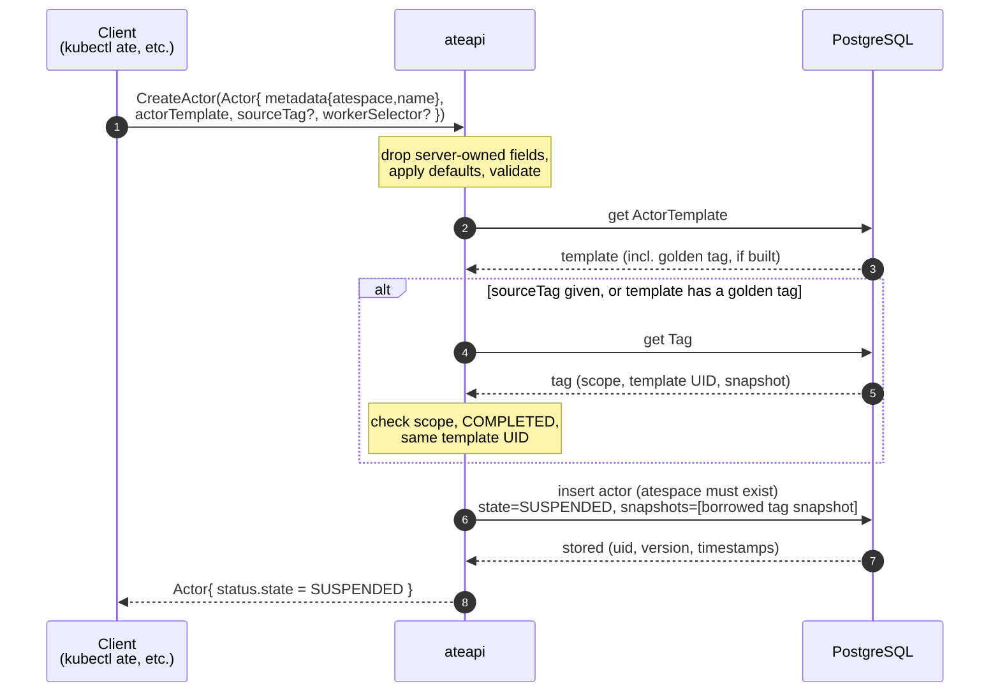

`CreateActor` is intentionally minimal, and all it produces is a new Actor
record in `ACTOR_STATE_SUSPENDED` with no worker. The first real work happens
later, on the first `ResumeActor` (usually triggered by the first request the
router receives for the actor). Let's look at what goes into that record and
what gets checked along the way.

## Sequence

`CreateActorRequest` carries an `Actor` body. Identity comes from
`actor.metadata.{atespace, name}`, and the template is an `actorTemplate`
reference `{atespace, name}`. An optional `sourceTag` seeds the actor from a
specific [tag](/concepts/snapshot/#tags), and an optional `workerSelector`
narrows its placement. From the CLI, you create an actor with or without a
tag like this.

```bash
kubectl ate create actor my-actor --template=my-template -a my-atespace
kubectl ate create actor my-actor --template=my-template -a my-atespace --tag my-tag
```



## What's checked

| Check | Failure |
|---|---|
| Request shape: DNS-label names, required fields | `InvalidArgument` |
| The referenced `ActorTemplate` exists | `FailedPrecondition` |
| An explicit `sourceTag` exists, is `COMPLETED`, and was taken under the **same template UID** | `FailedPrecondition` |
| An explicit tag's scope allows this atespace (`ATESPACE` tags only seed actors in their own atespace; `PUBLISHED` tags seed actors anywhere) | `FailedPrecondition` |
| An explicit tag is not used with a template that has `external` volumes | `FailedPrecondition` |
| The actor's atespace exists | `FailedPrecondition` |
| No actor with the same `(atespace, name)` exists | `AlreadyExists` |

The template check is only a convenience. Nothing stops the template from
being deleted afterwards, which is why the resume workflow resolves it
again.

## What's actually written

The result of a create is a new row in ateapi's PostgreSQL store, holding
the `Actor` message with these values.

| Field | Value at create time |
|---|---|
| `metadata.atespace` / `metadata.name` | **caller-supplied** (identity, immutable) |
| `metadata.uid`, `version`, timestamps | server-assigned |
| `actorTemplate` | from the request |
| `workerSelector` | from the request, if set (per-actor placement) |
| `sourceTag` | from the request, if set |
| `status.state` | `ACTOR_STATE_SUSPENDED` |
| `status.snapshots` | one borrowed snapshot from the tag, or empty |
| `status.lastAssignedGeneration` | `1` with a borrowed snapshot, else `0` |
| `status.workerAssignment` / `assignedNode` | unset |

### Where the first snapshot comes from

If the request names a `sourceTag`, that tag seeds the actor. Otherwise
`CreateActor` uses the template's golden tag as it stands right now, provided
the [golden snapshot build](/flows/golden-snapshot/) has finished. Either way
the actor borrows the snapshot instead of copying it.

- the snapshot entry is recorded as generation 1, owned by the tag;
- its object-storage URI stays under the tag's prefix, so deleting the actor
  never collects it;
- the actor's first suspend writes a snapshot under the actor's own prefix
  and stops borrowing.

With no tag at all (golden snapshots disabled, or the build not finished
yet), the actor has no snapshot and its first resume cold-boots the
containers from the template spec, and a later golden build does not
retrofit existing actors. Borrowing also means that deleting a tag destroys
its snapshot, so an actor that borrowed it and was never suspended can no
longer resume.

## What isn't touched

No worker is assigned, atelet is never called, and nothing is read from
object storage. `CreateActor` takes no actor lease either, because the
store's unique `(atespace, name)` constraint already makes concurrent creates
safe. External (CSI) volumes, when the template declares them, are recorded
as pending and provisioned by the first resume. Each create still emits an
`ate.actor.state_changed` event, so an actor that is created and never
resumed leaves a lifecycle record.

## Why is creation so cheap?

Actor creation is cheap and lazy because the expensive work (placing the
actor, downloading a snapshot, restoring memory, etc) only happens when
something actually needs the actor running, and we cover that in the
[resume flow](/flows/resume-actor/).

## Related

- [Resume actor](/flows/resume-actor/) - what happens on first wakeup.
- [Actor lifecycle](/flows/actor-lifecycle/) - full state machine.
- [Golden snapshot bootstrap](/flows/golden-snapshot/) - where the golden tag
  comes from, and the reconciler's own use of `CreateActor`.
- [Snapshot](/concepts/snapshot/) - tags and borrowed snapshots.
