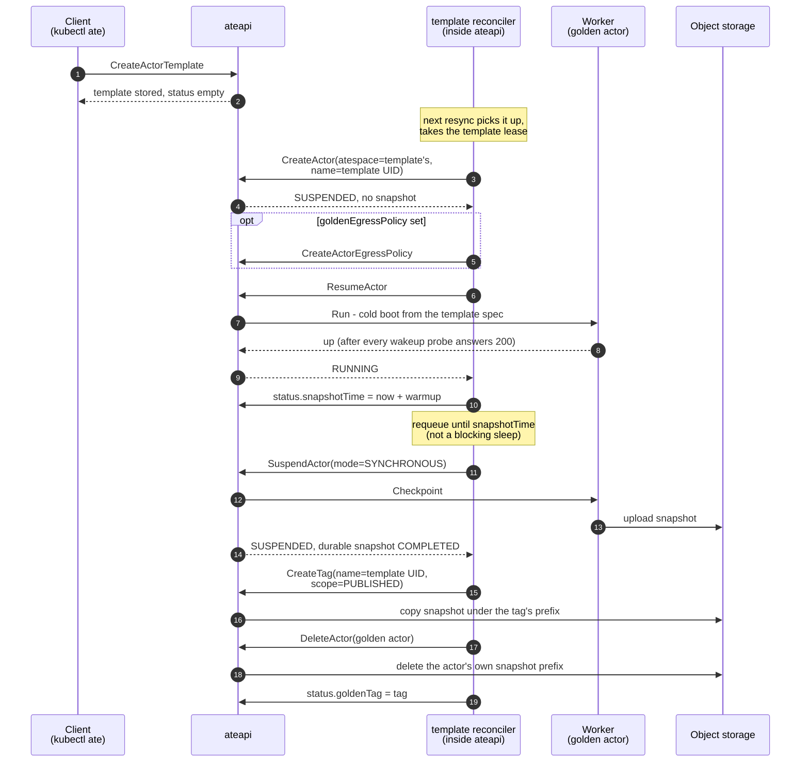

import goldenLifecycle from '../../../assets/golden-snapshot-lifecycle.svg?raw';

An [`ActorTemplate`](/concepts/actortemplate/) says what an actor of this
kind looks like (container image(s), entrypoint, env, volumes, compute size,
and a `workerSelector`), and by itself that's just a record in ateapi's
database. So how does Substrate get from that record to a _golden snapshot_
that lets later actors of this template skip their cold boot? Substrate boots
the workload for real on a worker, lets it initialize, and then captures
whatever state the running workload ended up with.

:::caution[How the golden snapshot is made]
ateapi's template reconciler creates a throwaway "golden" actor from the
template in the template's own atespace, resumes it, and lets the workload
actually boot on a real worker (same sandbox class, same pulled OCI image,
real CPU and RAM). Once the workload has initialized, it suspends the actor
synchronously, which checkpoints the running sandbox and uploads the snapshot
to object storage. It then copies that snapshot into a
[tag](/concepts/snapshot/#tags), deletes the golden actor, and records the
tag on the template as `status.goldenSnapshotStatus.goldenTag`.

**The "golden" image is a live snapshot of a freshly booted workload rather
than a precomputed artifact.** At the default `MEMORY` fidelity, new actors
get the side effects of all that initialization work (heap state, JIT caches,
parsed config, etc) without paying for it again.
:::

In the diagram below, we can follow the whole lifecycle, from the golden
actor's warmup on a worker to the tag that later actors restore from.

<figure style="margin: 1.5rem 0;">
  

  <figcaption style="text-align: center; font-size: 0.85em; opacity: 0.7; margin-top: 0.5rem;">
    The bootstrap occupies room on a worker for the warmup window, and once
    the golden tag is recorded, every later actor of this template skips the
    boot and restores from the tagged snapshot.
  </figcaption>
</figure>

## Who drives it?

The reconciler is a loop inside ate-api-server rather than a Kubernetes
controller, and there is no watch on templates. Every resync interval
(`--template-resync-interval`, 20 s by default) it lists all templates and
queues each one whose golden build is neither finished nor failed, skipping
templates with `goldenSnapshotConfig.mode: DISABLED`, and a small pool of
workers drains the queue. Each pass over a template holds a PostgreSQL lease
on that template, so several ateapi replicas never interleave its
transitions.

It drives the golden actor through the same Control RPCs a client would call
(`CreateActor`, `ResumeActor`, `SuspendActor`, `CreateTag`, `DeleteActor`),
in process, acting as the system.

## The golden actor

| Property | Value |
|---|---|
| Atespace | The template's own atespace, under the same access policies and storage location as ordinary actors |
| Name | The template's UID, so a template recreated under the same name never collides with an old golden actor |
| Source snapshot | None, so it always cold-boots |
| Egress policy | The template's `goldenEgressPolicy`, if set (preview) |

## Sequence

## The warmup wait

After the golden actor is running, the reconciler stamps
`status.goldenSnapshotStatus.snapshotTime = now + warmup` and requeues the
template for the remaining time. The work queue holds the item, so no
goroutine is blocked. How long is the warmup? It depends on whether the
containers declare wakeup probes.

- If every container declares a `wakeupProbe`, the warmup is 0.
  `ResumeActor` only returns once every probe answers 200, so the workload is
  already serving by the time the reconciler sees `RUNNING`.
- Otherwise it falls back to a 20 s warmup as a coarse "give the workload
  time to initialize" budget.

If you rely on the fallback and your workload needs longer (e.g. downloading
a model), the golden snapshot captures a partially initialized process, and
that is what every actor of this template will restore from. Declaring a
`wakeupProbe` on every container makes the snapshot point deterministic. Keep
in mind that the golden actor holds a real slot on a worker for the whole
window, so if the eligible pools are tightly sized, the bootstrap competes
with regular actors for room.

## Why a tag, and why delete the actor?

A tag is an atespace-owned, immutable name for its own copy of one external
snapshot. Copying the golden actor's snapshot into a tag means the golden
snapshot outlives the actor that produced it, which lets the reconciler delete
the golden actor (and the actor's own snapshot prefix with it) once the copy
is complete. The tag is created with `PUBLISHED` scope, and it is only usable
by actors of the template it was taken under, since `CreateActor` checks that
a source tag's template UID matches.

## What does "ready" mean?

Once `status.goldenSnapshotStatus.goldenTag` is set, the template's actors
start from the golden snapshot.

- `CreateActor` for this template, with no explicit source tag, freezes the
  golden tag into the new actor, so the actor is born `SUSPENDED` holding a
  borrowed snapshot (generation 1, owned by the tag). See
  [Create actor](/flows/create-actor/).
- The actor's first resume restores that snapshot instead of running the
  container from scratch. Because the snapshot is tag-owned and shared by many
  actors, atelet can serve it from a node-local snapshot cache after the first
  download on that node.
- The actor's first suspend writes a snapshot under its own prefix and stops
  borrowing.

An actor created before the golden tag exists has no snapshot and cold-boots
on its first resume, and it does not pick up the golden snapshot later. Once
a template has a golden tag, the reconciler skips it. Templates are
immutable, so there is no in-place refresh, and to get a new golden snapshot
you create a new template.

## Failure paths

Each pass is level-triggered, which means it observes the golden actor (and
any tag already named after it), takes the one action that state demands,
and re-observes. Every action is reentrant, so a pass that dies midway (e.g.
a lost ateapi replica, a failed RPC) is picked up by the next one. Ordinary
errors (no worker with room, an object-storage blip, etc) are requeued with
exponential backoff.

A few outcomes are terminal. For those, the reconciler writes
`status.goldenSnapshotStatus.errorMessage` as `<Reason>: <detail>` and stops
retrying.

| Reason | When |
|---|---|
| `GoldenActorCrashed` | The golden actor reached `CRASHED` before its snapshot was taken, e.g. because a wakeup probe never answered 200. |
| `GoldenActorInvalid` | `CreateActor` rejected the golden actor as invalid. |
| `GoldenTagConflict` | A tag with the golden name exists but belongs to another actor or template. |
| `GoldenEgressPolicyConflict` | The golden actor already has an egress policy that differs from the template's. |
| `GoldenActorUnexpectedState` | Something else moved the golden actor to `DELETING` or `REVERTING`. |

A failed build still leaves the template usable, and actors created from it
simply cold-boot. To try the build again, recreate the template.

## Related

- [ActorTemplate](/concepts/actortemplate/) - the resource itself.
- [Create actor](/flows/create-actor/) - where the golden tag is frozen into
  a new actor.
- [Resume actor](/flows/resume-actor/) - the restore path a golden-seeded
  actor takes.
- [Snapshot](/concepts/snapshot/) - tags, fidelity, and durable storage.
- [ateapi](/components/ateapi/) - where the reconciler runs.
- [Atespace](/concepts/atespace/) - the template's atespace hosts its golden
  actor and tag.
