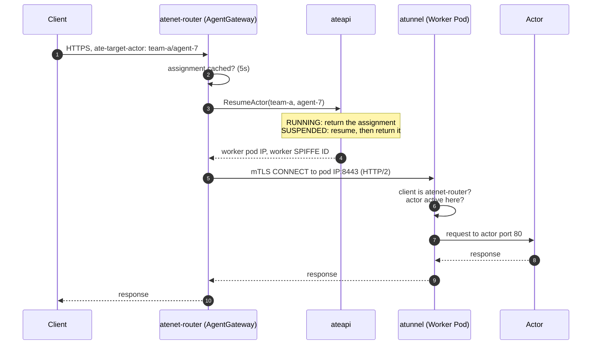

The [resume actor flow](/flows/resume-actor/) covers what happens inside the
control plane when a suspended actor wakes up. On this page we follow the
request itself, from how a client names an actor and how the router learns
which worker hosts it, to how the request crosses to that worker and what the
client sees when something goes wrong. The diagrams show the AgentGateway
router, and the default Envoy router follows the same path (we call out the
differences as we go).

## The path at a glance



## Naming the actor

The client sends its request to the `atenet-router` Service and names the
actor in an `ate-target-actor` header.

```
ate-target-actor: <atespace>/<actor>
```

DNS and `Host` play no part in selecting the actor, so `Host` and
`:authority` stay whatever the application expects and reach the actor
unchanged. Both halves of the header must be valid resource names, and
anything else gets a 404 before the router calls the control plane. gRPC
clients send the same value as metadata, and WebSocket clients put it on the
upgrade request. For a non-default port, the client sends an HTTP `CONNECT`
naming the port and puts the header on the outer `CONNECT`.

Because the address is just the router plus a header, an actor keeps the same
address for its whole life, wherever it runs and whether or not it's running
right now.

## Warm path and cold path

The router calls `ResumeActor` for the actor in the header, and what the
control plane does next depends on the actor's state. On the warm path the
actor is `RUNNING`, so `ResumeActor` reads the Actor record and returns its
current worker assignment without running a workflow or touching atelet, a
snapshot, or a sandbox.

On the cold path the actor is `SUSPENDED`, so `ResumeActor` claims a worker,
restores the actor there, and returns the new assignment once the actor is
running (see [Resume actor](/flows/resume-actor/)). The client can't tell
which path its request took except by latency, since the request just waits
while the router holds it.

## How the router learns the worker

Does the router call `ateapi` for every request? That depends on the
dataplane, because the two trade freshness against control-plane load
differently.

- AgentGateway caches each actor's assignment for 5 seconds, and a request
  inside that window goes straight to the worker without calling `ateapi`. If
  the actor has moved in the meantime, `atunnel` on the old worker refuses the
  request with a 421 marked as a stale assignment, and AgentGateway drops the
  cached entry, resolves again, and retries.
- Envoy (the default) keeps no cache, and its `ext_proc` callout calls
  `ResumeActor` on every request. It never routes on stale data, at the cost
  of one control-plane round trip per request.

Either way, concurrent lookups for the same actor share one in-flight
`ResumeActor`, so a burst of fifty requests at a cold actor produces one
resume and all fifty requests use its result.

## Request parking

What happens when there's no room for the actor? Substrate packs many actors
onto few workers, so a burst can briefly leave a pool with no free worker.
Rather than fail those requests, the router _parks_ them, which means it
holds each request and retries `ResumeActor` with backoff until the actor is
routable or the park budget runs out.

| Setting | Default | Meaning |
|---|---|---|
| Park budget | 5s | How long one resume attempt series may keep retrying. Requests that join an in-flight resume share its remaining budget. |
| Parked-request limit | 1024 | Concurrent parked requests. Beyond it, requests are shed with 503. `0` disables parking. |
| Retry backoff | 100ms, x1.1 | First retry delay and growth factor. |

The router parks only the conditions that can clear by waiting, which are no
worker with room (`ResourceExhausted`), a transient actor state
(`FailedPrecondition`), a concurrent operation on the actor (`Aborted`), and a
control-plane blip (`Unavailable`), and it fails everything else fast. On the
Envoy router these are the `--parked-request-*` flags, and a parked request
survives a router rollout because the drain waits for it. On AgentGateway
they're the `requestParking` settings of the `substrateIngress` policy.

## Crossing to the worker

The router never sends actor traffic to a pod IP in the clear. Instead it
opens an mTLS `CONNECT` tunnel to `atunnel` on the worker pod's port 8443, and
tunnels to the same worker share one HTTP/2 connection. The tunnel carries the
actor reference and the target port, and `atunnel` strips both before the
request reaches the actor. Each hop along the way authenticates separately,
as the table below shows.

| Hop | Client presents | Server presents | Verified by |
|---|---|---|---|
| Client to router | Envoy: a certificate whose SPIFFE ID is on the allowlist. AgentGateway: nothing. | `servicedns` certificate for `atenet-router.ate-system.svc` | Client checks the router; Envoy checks the client |
| Router to `ateapi` | Router's pod certificate (`.../sa/atenet-router`) | `ateapi`'s `servicedns` certificate | `ateapi` maps the router to the `ingress_router` role |
| Router to `atunnel` | Router's pod certificate | Worker Pod's pod certificate | `atunnel` accepts only the router's SPIFFE ID; Envoy also pins the worker's SPIFFE ID, AgentGateway checks only the CA |
| `atunnel` to actor | - | - | Private per-actor network inside the worker |

`atunnel` then checks that the actor named in the tunnel is one it's currently
serving on this worker. Ingress is switched on for an actor only once it's
ready, so a request doesn't reach a half-restored workload.

:::note[Why one shared router, not a sidecar per worker]
Workers are interchangeable capacity, and Substrate can move an actor to any
worker between requests. A central router that asks the control plane where
the actor is (or caches the answer for a few seconds) needs no routing state
pushed to every pod, and the extra hop is small next to a cold restore.
:::

## Error mapping

The router turns the control plane's gRPC status into an HTTP status, and the
table below shows the mapping for each dataplane.

| Situation | AgentGateway | Envoy (default) |
|---|---|---|
| Missing or malformed `ate-target-actor` | 404 | 404 |
| `NotFound` (no such actor) | 404 | 404 |
| Park budget spent, still no room | 504 | 503, with the capacity message |
| Parking limit reached | 503 | 503 |
| `FailedPrecondition`, `Aborted`, `Unavailable` (after retries) | 503 | 503 |
| `DeadlineExceeded` | 504 | 504 |
| `PermissionDenied` | 403 | 403 |
| `Unauthenticated` | 401 | 401 |
| Anything else | 500, generic body | 500, generic body |

The Envoy router also rejects a TLS client whose certificate is missing or
not on its allowlist during the handshake, before any HTTP status exists.

## Tracing

Both routers emit OpenTelemetry spans for the ingress request and the
`ResumeActor` call, and `ateapi` tags its spans with the actor's atespace and
name, so one resume can be followed from the router through the control
plane.

## Related

- [atenet](/components/atenet/) - the router, the egress gateway, and the two
  dataplanes.
- [Resume actor](/flows/resume-actor/) - the cold path inside the control
  plane.
- [Security & identity](/security/) - the identities each hop presents.
- [System topology](/topology/) - where the router sits in the cluster.
