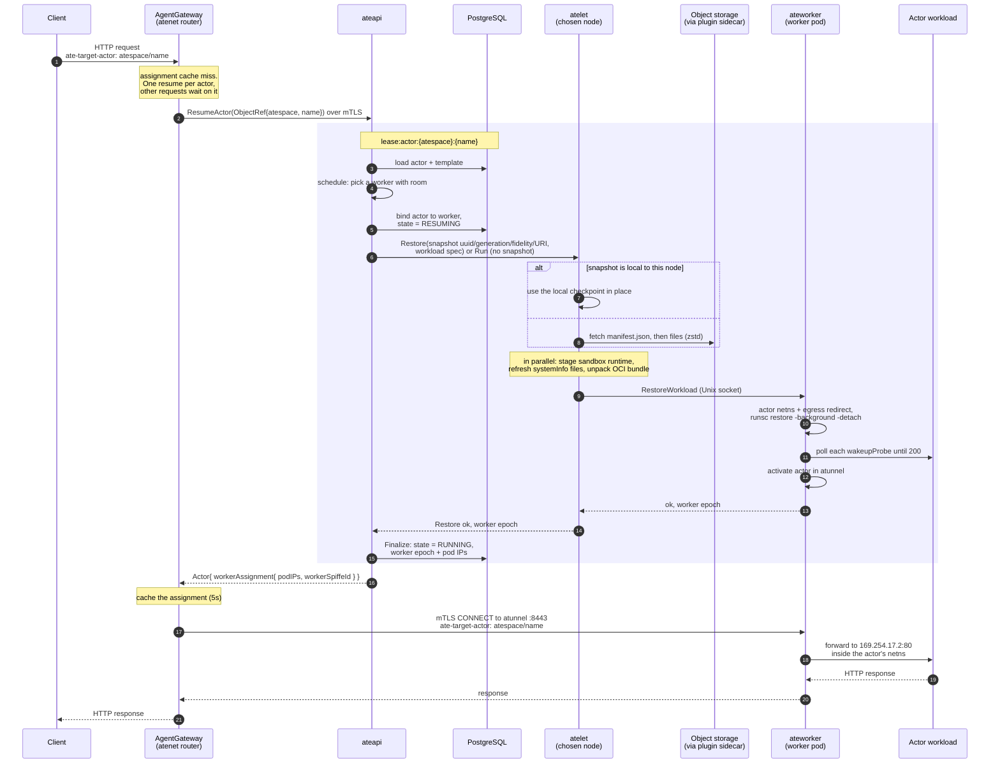
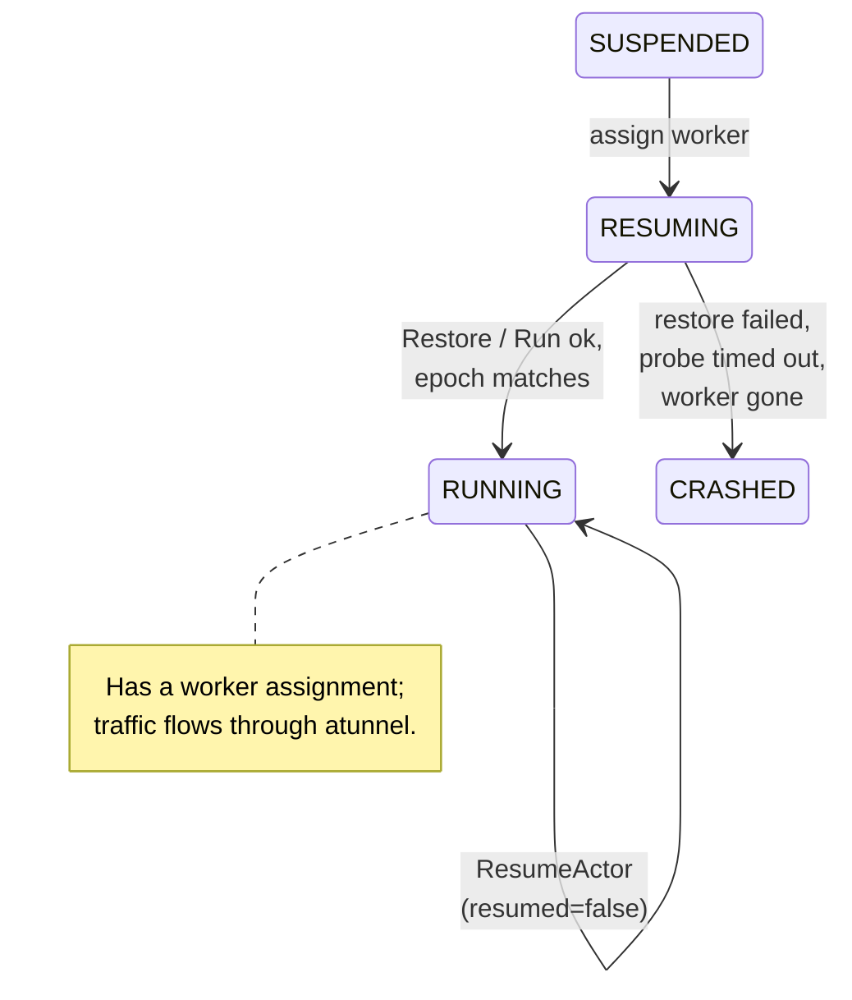

import nodeHostpath from '../../../assets/resume-node-hostpath.svg?raw';
import lazyPaging from '../../../assets/resume-lazy-paging.svg?raw';

If you want to understand Substrate, this is the flow to understand. A single
HTTP request for a suspended actor touches the ingress gateway, ateapi's
resume workflow and its PostgreSQL store, the scheduler, atelet on the chosen
node, the object-store plugin, the worker process in the pod, the sandbox
runtime, and the worker's `atunnel` listener.

The ingress gateway is the atenet router Deployment, and it runs one of two
dataplanes, chosen at install time with
`ate-setup --atenet-dataplane envoy|agentgateway`. The default Envoy dataplane
is Envoy plus an `ext_proc` server in the atenet-router container that calls
ateapi. AgentGateway replaces both with a single AgentGateway proxy
whose built-in Substrate ingress policy calls ateapi directly. We follow the
AgentGateway path on this page and call out where Envoy differs in a way that
changes the flow.

## The setup

- The actor was created earlier and is now `SUSPENDED`. Its newest usable
  snapshot is one of the following.
  - node-local, on the node it is still attached to after an asynchronous
    suspend;
  - durable, in object storage;
  - borrowed from a tag (for a new actor, usually the template's golden
    tag);
  - or none, in which case the resume cold-boots the template's containers.
- Worker pods are pre-warmed, registered with ateapi, and `ACTIVE`. Each
  reports how much CPU, memory, and how many actors it can still take.
- A client wants to reach the actor by its `(atespace, name)` identity.

Let's follow that request through the cold path, step by step.

## The full sequence (cold path)



## What's happening in each step

### 1. Naming the actor

A client sends its request to the atenet router Service and names the target
in the `ate-target-actor: <atespace>/<name>` header. The header alone selects
the actor, and `Host` passes through to the application untouched, so the
workload sees whatever authority the client used. A missing or malformed
header gets a `404`.

Plain HTTP requests go to the actor's port 80. To reach another port, the
client sends an HTTP `CONNECT` to the router naming the port in the
authority, and each request inside that tunnel is routed (and the actor
resumed) independently.

### 2. The gateway resolves the actor

AgentGateway keeps a short-lived assignment cache per actor (`cacheTtl`, 5 s
by default). On a hit it routes immediately, with no call to ateapi, and on a
miss it calls `ResumeActor` over gRPC with mutual TLS, presenting the
atenet-router pod identity. Concurrent misses for the same actor share one
in-flight call, so a burst of 50 requests to a cold actor produces one
resume.

With Envoy, the `ext_proc` server calls `ResumeActor` on every request, since
there is no assignment cache. Concurrent calls for the same actor are still
collapsed into one in-flight "flight". For an actor that is already
`RUNNING`, ateapi answers from a single read without taking the lease (see
[the warm path](#what-about-the-warm-path)).

### 3. ateapi runs the resume workflow

If the actor is already `RUNNING`, ateapi returns it with `resumed=false`.
Otherwise it takes the actor's PostgreSQL lease (`Aborted` if another
operation holds it) and steps through the workflow in this order.

1. Load the actor and its template.
2. Create pending external volumes (CSI, preview), if the template has any.
3. Assign a worker. The scheduler filters the fleet for workers that
   match both the template's and the actor's `workerSelector`, run the sandbox
   class that wrote the snapshot, can still restore its runtime (for a memory
   snapshot), sit on the actor's `assignedNode` if it has one, and have room
   for the template's CPU and memory limits plus one more actor. It samples
   two candidates at random and takes the less loaded. ateapi binds the actor
   to that worker (a per-worker `ActorAssignment`, admitted against the
   worker's remaining capacity in the same write), then records the
   `workerAssignment` and moves the actor to `RESUMING`.
4. Attach external volumes to the chosen node.
5. Call atelet on that node, with `Restore` if the actor has a snapshot and
   `Run` if it has none.
6. Finalize to `RUNNING`, recording the worker epoch atelet returned and the
   worker pod's current IPs.

Keep in mind that a worker is a shared host. It can run many actors at once,
and the actor only claims its share of the worker's capacity.

### 4. Choosing what to restore

ateapi restores the newest usable snapshot generation, meaning one still on
a node or one whose durable copy is `COMPLETED`. It tells atelet which
snapshot (uuid, generation, object URI) to restore and at what fidelity,
following the decision below.

```
newest generation with a local copy or a COMPLETED durable copy?
├─ no                                  → Run: cold boot from the template spec
└─ yes                                 → Restore that snapshot
     ├─ captured under another template → at VOLUMES fidelity
     ├─ memory runtime not on worker    → at ROOTFS fidelity
     └─ otherwise                       → at the snapshot's own fidelity
```

You'll notice there is no separate "golden" branch, because a new actor's
golden snapshot is simply its first, borrowed generation. If the snapshot is
local to a different node
than the one assigned, the actor is restored from the durable copy and the
binding to the old node is dropped.

### 5. atelet prepares the restore

ateapi dials the atelet on the assigned worker's node over mutual TLS, with
each side checking the other's SPIFFE identity. atelet is a per-node
DaemonSet, so one atelet serves every worker pod on its node.

So where do the snapshot bytes go? They land on the node rather than in the
pod. Every per-actor file lives under the node directory `/var/lib/ate`,
which atelet and every worker pod mount via `hostPath` at the same path.

- If the snapshot is local and was written on this boot, atelet restores
  from its local checkpoint directory in place, with no copy and no
  download.
- Otherwise atelet fetches `manifest.json` and then the files through its
  object-store plugin sidecar, decompressing them into the actor's restore
  directory. A snapshot shared through a tag is served from a node snapshot
  cache after its first download on that node.

While the download runs, atelet in parallel stages the sandbox runtime
binaries from its content-addressed asset cache, rewrites the actor's
`systemInfo` files (its name, atespace, and UID, which come out correct even
when the snapshot was taken by a golden actor), and unpacks the OCI bundle
for each container. Only the final restore call needs all of them. atelet
then calls the worker process over a Unix socket at
`/var/lib/ate/workers/<podUID>/worker.sock`, which both pods see through the
shared mount, as the diagram below shows.

<figure style="margin: 1.5rem 0;">
  <div class="atlas-hero-svg" set:html={nodeHostpath} />
  <figcaption style="text-align: center; font-size: 0.85em; opacity: 0.7; margin-top: 0.5rem;">
    Two pods on one node talk through the node's own filesystem. atelet
    delivers the snapshot files through the shared <code>hostPath</code>, and
    finds the Unix socket to the worker process there too. The actor's OCI
    image runs inside a sandbox the worker process starts, rather than in the
    worker process itself.
  </figcaption>
</figure>

:::note[What the worker process actually is]
A worker pod's container runs `ateworker-gvisor` or `ateworker-microvm`, a
small gRPC server that is _not_ itself sandboxed. Its job is to receive RPCs
from atelet and drive the sandbox runtime (`runsc` for gVisor, Cloud
Hypervisor for micro-VMs), which runs each actor's workload, from the actor's
OCI image, in a sandbox of its own. One worker pod hosts many actor sandboxes
side by side, and it also hosts `atunnel`, the listener every request to its
actors comes through. See
[ateworker-gvisor](/components/ateworker-gvisor/) and
[ateworker-microvm](/components/ateworker-microvm/).
:::

### 6. The worker restores the sandbox

Before restoring, the worker builds the actor's network, which is a dedicated
network namespace with a link-local address (`169.254.17.2`), and nftables
rules that redirect all of the actor's outbound TCP to `atunnel`'s egress
listener, which carries it to the egress gateway on the actor's behalf.
Egress is active before the sandbox starts, but ingress isn't yet.

For gVisor it then runs `runsc restore -background -detach`, and the two
flags do different jobs.

- `-detach` makes `runsc restore` return once the sandbox is up, instead of
  waiting for it to exit.
- `-background` restores memory on demand, so the sandbox starts running
  with the memory image mapped but not yet loaded, and pages are brought in as
  the workload touches them.

Micro-VMs get the same effect from Cloud Hypervisor restoring guest memory on
demand through `userfaultfd` (or prefaulting it eagerly, depending on the
Cloud Hypervisor version).

:::note[What "on demand" means]
An eager restore would have to load the entire memory image before the
workload could execute a single instruction, which for a multi-GB snapshot
means seconds spent just moving bytes. With on-demand restore, the sandbox
starts with its memory image mapped but not yet resident. The first time the
workload touches a page, the fault is caught, just that page is read from the
image, and execution continues, so pages the workload never touches are never
loaded. The Linux kernel does the same thing for `mmap`'d files, and here it's
applied to a checkpointed process's RAM.
:::

<figure style="margin: 1.5rem 0;">
  <div class="atlas-hero-svg" set:html={lazyPaging} />
  <figcaption style="text-align: center; font-size: 0.85em; opacity: 0.7; margin-top: 0.5rem;">
    Without <code>-background</code>, restore would have to load every page of
    the memory image before the workload can run a single instruction. With it,
    the sandbox is up as soon as its state is loaded, and the first request
    faults its own working set in.
  </figcaption>
</figure>

Does the restore return as soon as the sandbox is up? The worker still waits
on the workload first, polling every container's `wakeupProbe` until it
answers `200` (a probe that never does crashes the actor), and only then does
it activate the actor in `atunnel` and return,
along with its worker epoch. So ateapi moves the actor to `RUNNING` only once
the workload is actually serving.

### 7. Finalize

ateapi checks the epoch atelet returned against the epoch the worker
registered. If the worker process restarted during the restore, the result is
`Unavailable` and the request is retried. Otherwise ateapi writes `RUNNING`,
the epoch, and the worker pod's IPs, and returns the actor.

### 8. Forwarding through the worker's tunnel

The gateway does not send traffic to the actor directly, because worker pod
ports are not an ingress path. It opens an mTLS `CONNECT` to `atunnel` on the
worker pod's IP, port 8443, carrying the `ate-target-actor` header. `atunnel`
checks that the caller presents the router's identity and that the named
actor is active on this worker, then dials the actor at `169.254.17.2:80` (or
the requested port) inside its network namespace and strips the routing
headers.

If the actor has moved, `atunnel` answers `421` with
`X-Ate-Assignment-Stale: true`, and AgentGateway evicts its cached
assignment, resolves again, and retries. From the workload's perspective,
this is a plain HTTP request arriving at its listener, and it has no idea it
was suspended five seconds ago.

## Request parking

In an oversubscribed system, the momentary answer to "resume this actor" is
often "not yet" (e.g. every eligible worker is full, a suspend still holds
the actor, or ateapi is mid-rollout). Rather than fail fast, the gateway parks the
request and retries the resume with backoff until it succeeds or a budget
runs out. The table below shows how each `ResumeActor` result is handled.

| `ResumeActor` result | Behavior |
|---|---|
| `OK` | Route to the worker |
| `Aborted` (another operation holds the actor) | Retry |
| `ResourceExhausted` ("no worker has room for the actor") | Park and retry |
| `FailedPrecondition` (transient actor state) | Park and retry |
| `Unavailable` (control plane or worker restarting) | Park and retry |
| `NotFound` | Fail fast: `404` |
| `PermissionDenied` / `Unauthenticated` | Fail fast: `403` / `401` |

Both dataplanes share the same defaults, which are a 5 s park budget per
actor (shared by every request waiting on that actor's resume), at most 1024
parked requests per router (a full lot sheds with `503`), and a first retry
after 100 ms growing by 1.1x. With parking disabled (`max = 0`), only
`Aborted` is retried, within 15 s. See `docs/request-parking.md` for the
metrics and flags.

## Where AgentGateway and Envoy differ

The parking defaults are shared, but the two dataplanes behave differently in
several other places, and the table below lines them up.

| | AgentGateway | Envoy (default) |
|---|---|---|
| Who calls `ResumeActor` | AgentGateway's built-in Substrate ingress policy | The `ext_proc` server in the atenet-router container |
| Running actors | Cached for 5 s; no ateapi call on a hit | `ResumeActor` on every request |
| Parking slot | Taken on every cache miss | Taken only once a resume has to retry |
| Budget runs out | The in-flight attempt is canceled; client gets `504` | The in-flight attempt is allowed to finish and served late if it succeeds; otherwise `503` |
| No worker has room | `429` | `503` |
| Stale `421` from `atunnel` | Evict, re-resolve, retry | Returned to the client |
| Worker identity check | Chains to the pod-identity CA | Pins the worker's exact SPIFFE ID |
| Ingress client auth | Not yet enforced | mTLS, with a SPIFFE-ID allowlist |

## What if there are no free workers?

The scheduler answers immediately, and if no eligible worker has room,
ateapi returns `ResourceExhausted` ("no worker has room for the actor") and
the gateway parks the request. (ateapi itself only retries its assignment, up
to a dozen times with jittered backoff capped at 250 ms, when it loses a race
for a worker another resume just filled.)

If the actor is attached to a node from an asynchronous suspend and _that_
node is full, ateapi first checks that some other node has room, then asks
the old node's atelet to detach the actor (uploading its snapshot if it is
not durable yet, then deleting the local copy), and schedules again without
the node constraint. The restore then downloads from object storage.

## What about the warm path?

If the actor is already `RUNNING`, AgentGateway usually has its assignment
cached and forwards straight to `atunnel` (step 8) without calling ateapi.
Envoy calls `ResumeActor`, which reads the actor without taking the lease and
returns it with `resumed=false`. Either way, no atelet, object storage, or
sandbox work happens.

## State transitions during this flow



A transient failure (`Unavailable`, a deadline, a lost race, etc) leaves the
actor `RESUMING` with its worker assignment, and the next `ResumeActor` picks
up on the same worker. A `CRASHED` actor cannot be resumed until
`RevertActor` returns it to `SUSPENDED` (see
[Actor lifecycle](/flows/actor-lifecycle/)).

## Why this design is interesting

- The Kubernetes scheduler stays off the hot path. Worker pods are
  pre-warmed, and ateapi places the actor with an in-memory view of the fleet
  and one database write.
- A worker runs many actors at once, so placement is a capacity booking
  rather than a pod claim.
- A recently suspended actor resumes in place on the node that still holds
  its snapshot, with no download.
- Memory is restored on demand, so the workload runs as soon as the sandbox
  is up and pages arrive as it touches them.
- Two concurrent resumes for the same actor never race, because the gateway
  collapses them and ateapi's per-actor lease serializes anything left.

## Related

- [Suspend actor](/flows/suspend-actor/) - the reverse flow.
- [Actor lifecycle](/flows/actor-lifecycle/) - full state machine.
- [Request path](/flows/request-path/) - the ingress path in more detail.
- [ateapi internals](/components/ateapi/) - the workflow engine in detail.
- [atenet](/components/atenet/) - the router and its dataplanes.
