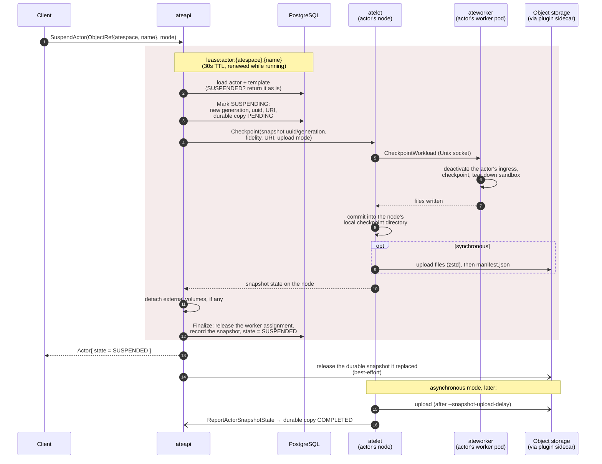

Freezing a running actor is how Substrate runs far more actors than its
workers could hold at once. A running actor is checkpointed, its room on the
worker is released back to the pool, and the actor record is updated to point
at the new snapshot, so the next request triggers a
[resume](/flows/resume-actor/).

So who decides an actor should be suspended? Suspend is explicit, and a
client or a higher-level system calls `SuspendActor`
(`kubectl ate suspend actor`) when it decides an actor is idle. The
[golden snapshot](/flows/golden-snapshot/) reconciler also calls it to
capture a template's golden actor. `SuspendActorRequest` names the actor by
`ObjectRef{atespace, name}` and optionally sets `options.mode`, which picks
one of the two modes below.

| Mode | `SuspendActor` returns | Durable copy at return |
|---|---|---|
| `DURABILITY_MODE_ASYNCHRONOUS` (default) | As soon as the checkpoint is committed on the node | `PENDING`; atelet uploads it in the background |
| `DURABILITY_MODE_SYNCHRONOUS` (`--mode=sync`) | After the snapshot is uploaded to object storage | `COMPLETED` |

Both modes run the same workflow, and the mode only decides when atelet
uploads. Let's walk through the sequence below.

## Sequence

## What happens in each step

### Load, and the idempotent short-circuit

ateapi takes the actor's lease and loads the actor and its template. A
`SUSPENDED` actor is returned unchanged whatever the mode, even if its latest
snapshot is still only on its node. An actor already `SUSPENDING` (a previous
attempt died midway) continues from where that attempt stopped, and any other
state is rejected with `FailedPrecondition`.

### Mark suspending and mint the new generation

Before any work, ateapi flips the actor to `ACTOR_STATE_SUSPENDING` and
appends a new entry to `status.snapshots` with these values.

- `generation = lastAssignedGeneration + 1`, and a fresh `uuid`;
- `fidelity` from the template's `snapshotConfig.preferredFidelity`;
- the sandbox runtime the actor is running under, so a later restore can find
  a compatible worker;
- a durable copy in state `PENDING`, at
  `<location>/atespaces/<atespace>/actors/<actor-uid>/snapshots/<uuid>`.

Why record the URI up front? If anything fails midway, the partial objects
have a known owner and location, and a retry re-sends the same snapshot
rather than starting another.

### Drive the checkpoint on atelet

ateapi dials the atelet on the node named in the actor's worker assignment,
over mutual TLS, and sends `Checkpoint` with the snapshot's uuid, generation,
fidelity, and URI, plus the upload mode (`DEFERRED` for an asynchronous
suspend, `IMMEDIATE` for a synchronous one). From there, the steps on the
node go in this order.

1. atelet calls the worker process in the pod (`ateworker-gvisor` or
   `ateworker-microvm`) over a Unix socket in the node directory both pods
   mount.
2. The worker first deactivates the actor's ingress in its `atunnel`
   listener, so no new request reaches the actor, then checkpoints at the
   requested fidelity and tears the sandbox down. If it already holds a
   completed checkpoint of this snapshot (e.g. a retry after a lost
   response), it returns that instead of checkpointing again.
3. atelet commits the files into the node's local checkpoint directory for
   the actor, writing a `manifest.json` beside them.
4. In `IMMEDIATE` mode, atelet uploads each file zstd-compressed through its
   object-store plugin sidecar, and writes the manifest last.

atelet finishes a checkpoint it has started even if ateapi stops waiting, so a
caller timing out cannot leave half a snapshot behind. It returns its view of
the actor's snapshots on the node, i.e. the latest local one, any upload in
flight, and the latest durable one.

### Detach volumes, then finalize

External (CSI) volumes, if the template has any, are detached from the node.
Then ateapi re-reads the actor (if something else has moved it out of
`SUSPENDING` meanwhile, the step fails rather than overwrite it) and does
three things in one update.

1. It releases this actor's assignment on the worker, returning its CPU,
   memory, and actor slot to the pool. Other actors on the same worker are
   untouched.
2. It records the new snapshot. A synchronous suspend marks its durable copy
   `COMPLETED`. If atelet kept a local copy, or the durable copy is still
   `PENDING`, the snapshot's `locality` is set to the node and the actor stays
   attached to it (`assignedNode`); otherwise the node binding is cleared.
3. It clears `workerAssignment`, prunes generations it no longer needs, and
   sets `state = SUSPENDED`.

Finally, ateapi asks its object-store plugin to delete any durable snapshot
the update dropped. This is best-effort, and a failure only leaves objects in
storage until the actor is deleted. A snapshot borrowed from a tag is never
deleted, and an asynchronous suspend keeps the previous durable snapshot
until a newer one is `COMPLETED`, so the actor always has one to fall back
to.

## After an asynchronous suspend

The actor is `SUSPENDED` but still attached to its node, because that node
holds the only copy of its newest state. From there, a few things can
happen to it.

- A resume within the window restores from the local files on that node,
  with no download. If the node has no room, the resume first asks atelet to
  detach the actor (uploading the snapshot if needed) and then places it
  anywhere.
- The background upload runs about `--snapshot-upload-delay` (5 minutes by
  default) after the checkpoint. atelet reports it through
  `ReportActorSnapshotState`, and ateapi marks the durable copy `COMPLETED`.
- The detach runs after `--snapshot-detach-delay` (30 minutes by default).
  atelet makes sure the snapshot is durable, deletes the local files, and
  reports it, and ateapi clears the snapshot's `locality` and the actor's
  `assignedNode`.

With an asynchronous suspend we trade durability for latency, because until
the upload completes, the newest state exists only on that node. If the node is
lost first, a resume tries the upload location on another node, and crashes
the actor if the snapshot never got there (`RevertActor` then returns it to
its previous durable snapshot). Use `--mode=sync` when the snapshot must be
in object storage before the call returns, e.g. before creating a
[tag](/concepts/snapshot/#tags) from it, or before a planned node drain.
(`CreateTag` waits for a pending upload itself.)

## What gets checkpointed

The contents depend on the template's fidelity, which is `VOLUMES`,
`ROOTFS`, or `MEMORY` (the default), and [Snapshot](/concepts/snapshot/)
covers what each captures and the on-disk layout per sandbox runtime. For
gVisor at `MEMORY` fidelity that is a `runsc checkpoint` of the sandbox plus
separate filesystem bundles, and for micro-VMs it's a Cloud Hypervisor memory
snapshot plus tars of the rootfs upper layer and durable volumes.

## What about in-flight requests?

Suspend isn't graceful toward requests. There is no drain phase and no signal
to the workload, and the worker's first move is to deactivate the actor in
`atunnel`. That cancels requests already inside the tunnel and waits for their
handlers to exit (so the client sees its request fail), and it refuses new
requests for the actor with `421` and an `X-Ate-Assignment-Stale` header,
telling the gateway its cached assignment is stale.

Whatever the workload was doing in memory is then captured mid-flight. A
`MEMORY` snapshot preserves that in-progress state, but the response is gone,
so **suspend has at-most-once semantics for in-flight work.** Anything that
must survive should be flushed to a durable volume or an external system
before the workload reports it done, which is the same discipline you'd want
anyway, since suspend can be called at any moment.

### Requests that arrive during the freeze

What about a request that shows up while the actor is frozen? The gateway
calls `ResumeActor` for the actor. While the suspend holds the actor's lease,
that call returns `Aborted`, and once the actor is `SUSPENDING` it returns
`FailedPrecondition`. Both are parked and retried (see
[request parking](/flows/resume-actor/#request-parking)). When the suspend
finishes, the next attempt resumes the actor (typically in place on the same
node from its local snapshot), and the request is served late rather than
failed. If the suspend outlasts the park budget (5 s by default), the client
gets an error.

With AgentGateway, a request that hits the stale `421` evicts the cached
assignment and re-resolves, so it joins the same park-and-resume path. With
Envoy, the default dataplane, a request that was already routed when the
actor was deactivated receives the `421` instead.

## Failure modes

- A lease conflict with another operation on the same actor returns
  `Aborted`, so back off and retry.
- On transient atelet errors (`Unavailable`, deadline exceeded, a snapshot
  conflict reported as `Aborted`), the error is returned and the actor stays
  `SUSPENDING` with its assignment intact, and a retried `SuspendActor`
  resumes the same snapshot.
- Any other checkpoint failure moves the actor to `CRASHED`, releases its
  worker, and keeps the partial snapshot entry so `RevertActor` or
  `DeleteActor` can clean it up.
- If atelet's snapshot state conflicts with the record at finalize, the
  workload is already gone, so the actor is crashed rather than retried.
- If the worker pod dies mid-suspend, the checkpoint cannot complete, and the
  actor typically ends up `CRASHED`, either from the failed checkpoint or
  when ateapi deregisters the dead worker. `RevertActor` returns it to its
  last durable snapshot (see
  [actor lifecycle](/flows/actor-lifecycle/#what-can-move-an-actor-without-a-client-rpc)).

## Related

- [Resume actor](/flows/resume-actor/) - the reverse flow.
- [Actor lifecycle](/flows/actor-lifecycle/) - full state machine, including
  `CRASHED` and `REVERTING`.
- [Snapshot](/concepts/snapshot/) - generations, fidelity, local vs. durable.
- [atelet](/components/atelet/) - the node-side machinery.
