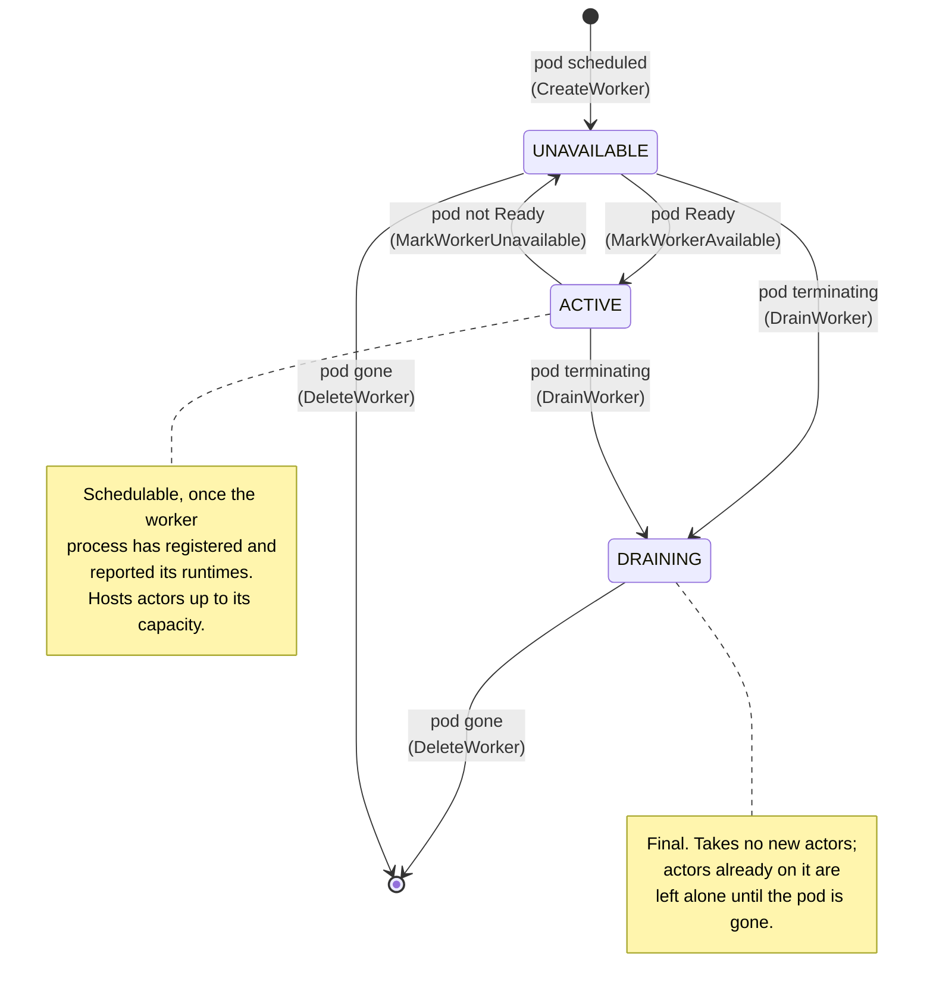
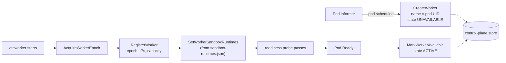
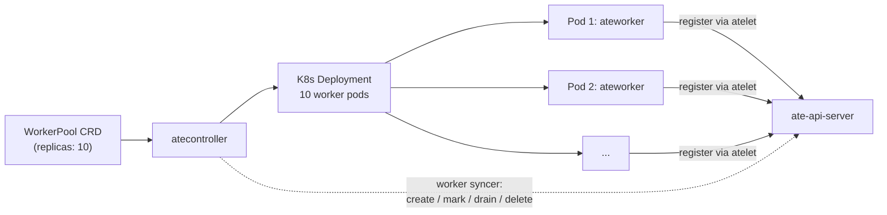

A worker in Substrate is a pre-warmed pod (a member of a `WorkerPool`
Deployment running `ateworker-gvisor` or `ateworker-microvm`) that hosts many
actors at once. Its lifecycle tracks whether the scheduler may place actors on
it. How busy a worker is doesn't change its state, so a worker with ten actors
and a worker with none are both simply `ACTIVE`.

Two parties drive that lifecycle. atecontroller's worker syncer watches the
pod and moves the record between states, and the worker process reports what
only it can know (its epoch, IPs, capacity, and sandbox runtimes) through
atelet.

## States

| State | Meaning | Schedulable |
|---|---|---|
| `UNAVAILABLE` | Registered but its pod is not Ready (starting, or the worker process restarting) | No |
| `ACTIVE` | Pod Ready with an IP | Yes, if registered with runtimes |
| `DRAINING` | Pod is terminating; never leaves this state | No |

Leaving `ACTIVE` never evicts anything, and actors already on an
`UNAVAILABLE` or `DRAINING` worker stay bound to it.

## Registration

The syncer creates the record as soon as the pod has a node, copying the
WorkerPool's labels onto it, and updates them if the pool's labels change. The
worker process registers through the node-local atelet, which only accepts
worker pods on its own node and forwards to ate-api-server. Because the
worker's readiness probe fails until registration succeeds, a pod can't
become Ready (and the worker can't become `ACTIVE`) before the control plane
has its IPs and capacity. And because the scheduler also requires
reported runtimes, an `ACTIVE` worker takes nothing until it has said which
sandbox runtimes it can run.

## Epochs: when the worker process restarts

The worker process can restart while its pod lives on (a container restart,
or a recreated pod sandbox). Its sandboxes die with it, so the control plane
has to tell old actors from new ones. It does that with epochs, and every
worker process goes through the same three steps.

1. It acquires an epoch, a number ate-api-server hands out per worker.
2. It registers once with that epoch, which must be higher than the worker's
   `registered_epoch`. A process whose epoch has been superseded is refused
   and stops serving.
3. It stamps each actor it starts with its epoch.

When `registered_epoch` rises, a reconciler in ate-api-server crashes every
actor that ran under an earlier epoch and releases its assignment, then
advances `observed_epoch`. The worker's previously reported runtimes are
cleared on the new registration, so it takes no actors until it reports them
again.

## How actors get placed and released

Placement adds an `ActorAssignment` under the worker and adds the actor's
declared limits to the worker's `allocated` resources, and suspend, delete,
and crash remove it and give them back. The scheduler picks among eligible
`ACTIVE` workers with room using power-of-two-choices on load, and the bind
re-checks room under the worker's row lock. We cover the eligibility rules
(sandbox class, runtime, selectors, node pinning) on the
[Workers](/components/workers/#how-an-actor-is-placed) page.

## What happens when a worker pod dies

When the pod starts terminating, the syncer marks the worker `DRAINING`, and
the worker process gets `SIGTERM`. It cancels any
in-flight run or restore, lets checkpoints already running finish, and stops
the remaining containers within the pod's grace period (one hour).
Actors suspended during that window are released normally.

When the pod object is deleted (or replaced by a same-named pod with a new
UID), the syncer calls `DeleteWorker`, which releases every actor still bound
to the worker before removing the record. What happens to each actor depends
on where it is in its own lifecycle.

- An actor that already reached `SUSPENDED` is left untouched and stays
  resumable.
- An actor still running is moved to `CRASHED`, and its node state is
  reclaimed best-effort through atelet. A crashed actor can be reverted to its
  last durable snapshot and resumed.

If a release fails or another operation holds the actor, the record stays and
the delete is retried. The syncer also cleans up in a few other cases.

- A pod in a terminal phase is never Ready again, so the syncer deletes it.
- A pod whose WorkerPool is gone is left to garbage collection, or deleted
  gracefully if it was orphaned.
- At startup the syncer re-reads every Worker record, so records whose pods
  vanished while it was down are cleaned up.

## Pre-warming: where workers come from

As the diagram above shows, the `WorkerPool` owns a Deployment of N replicas.
Pods come up, start the pool's worker, register their capacity and runtimes,
and become `ACTIVE` once they're Ready. Rollouts replace at most 10% of a pool's pods at a time with no
surge, so capacity drains gradually.

## Worker pools as placement boundaries

A `WorkerPool` is never named by an `ActorTemplate`. An actor can land on any
pool whose labels satisfy both the template's `workerSelector` and the
actor's own `worker_selector`, subject to its snapshot's sandbox class and
runtime. That makes pools the unit at which you do each of the following.

- Separate sandbox runtimes, since a `gvisor` pool and a `microvm` pool never
  share workers and a snapshot restores only on its own class.
- Choose worker size, node placement, and sandbox binaries.
- Scale capacity independently per workload class, and target templates at a
  pool with labels.

## Related

- [Actor lifecycle](/flows/actor-lifecycle/) - the state machine on the actor
  side.
- [Resume actor](/flows/resume-actor/) · [Suspend actor](/flows/suspend-actor/)
- [WorkerPool](/concepts/workerpool/) · [Workers](/components/workers/)
