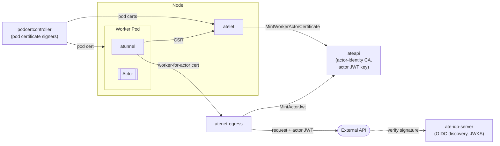
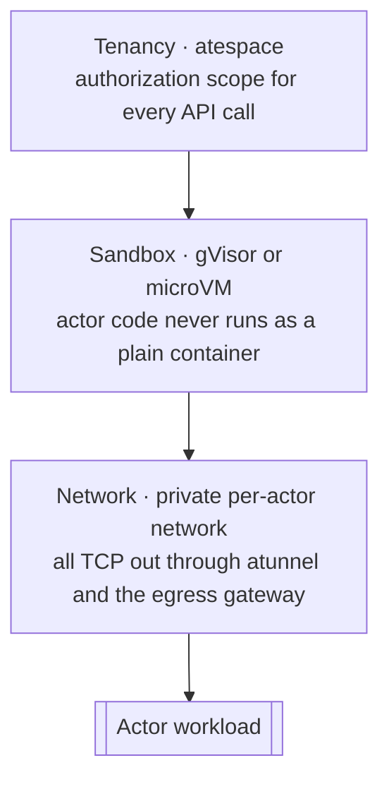

Substrate has to keep answering two questions, "who is this?" (identity and
authentication) and "what may it touch?" (authorization and isolation), and it
answers both at several layers that are spread across the other pages in this
atlas. Let's pull them together here.

:::note[Authoritative sources]
The project's [`docs/security.md`](https://github.com/agent-substrate/substrate/blob/main/docs/security.md)
lists the security principles with an implementation status for each, and
[`docs/threat-model.md`](https://github.com/agent-substrate/substrate/blob/main/docs/threat-model.md)
catalogs threats and the mitigations it recommends. A recommended mitigation
isn't necessarily implemented. This page maps the mechanisms that are wired up
today, and when in doubt, the code wins.
:::

## Logical identity versus infrastructure identity

An Actor is addressed by `(atespace, name)`, and a server-assigned UID marks
one incarnation at that address. The UID survives suspend, resume, and moves
between workers, but deleting and recreating the actor gives it a new UID. The
[atespace](/concepts/atespace/) is the tenancy boundary.

The pods that do the work have identities of their own, and Substrate keeps
the two apart. A Worker Pod hosts many actors over its life, so its
certificate says which pod is talking, never which actor, and anything that
must name an actor gets a separate, actor-scoped credential. The diagram below
shows who issues each of these credentials and where they're presented.

## Who is this? The identities in play

| Identity | Held by | Issued by | Names | Presented to |
|---|---|---|---|---|
| Pod certificate | Every Substrate pod: `ateapi`, controllers, atelet, routers, gateways, Worker Pods | `podidentity.podcert.ate.dev/identity` signer | `spiffe://cluster.local/ns/<ns>/sa/<sa>` | `ateapi` and other components, as an mTLS client |
| Service DNS certificate | Servers: `ateapi`, the router, the egress gateway, `ate-idp-server` | `servicedns.podcert.ate.dev/identity` signer | The Service DNS names that select the pod | Their clients, as the TLS server |
| `worker-for-actor` certificate | `atunnel`, one per actor activation | `ateapi`, signed by the actor-identity CA | `spiffe://substrate-actor.local/worker-for-actor/<atespace>/<name>` | The egress gateway |
| Actor JWT | Never the actor; the egress gateway injects it | `ateapi`, signed by the actor JWT key | `sub: actor/<atespace>/<name>` | External services |

### Infrastructure: pod certificates

`podcertcontroller` implements Kubernetes Pod Certificates signers, backed by
local CAs, and kubelet projects the certificates into pods and rotates them.
The `podidentity` signer's certificates authenticate components to each
other, the `servicedns` signer's certificates serve TLS, and a third signer,
`postgres.podcert.ate.dev/identity`, issues `ateapi` its client certificates
for the bundled PostgreSQL. All of these establish which pods are talking, and
none of them identifies an actor.

### Acting for an actor: `worker-for-actor`

When a worker activates an actor, `atunnel` generates a private key and sends
only a certificate signing request to the node-local atelet. Atelet then calls
`ateapi`'s `MintWorkerActorCertificate`, presenting its own pod certificate,
and `ateapi` signs only for the worker the actor is assigned to, only for an
atelet on that worker's node, and only when the request's actor UID matches
the current incarnation. The certificate lives for one hour.

The private key stays in `atunnel`, outside the sandbox and its snapshots.
`atunnel` presents this certificate when it opens a `CONNECT` through the
egress gateway on the actor's behalf, so the gateway can tell which actor a
connection belongs to, where a pod certificate would only say which worker
sent it. The certificate carries the actor's UID in an `ActorIdentity` X.509
extension, but its SPIFFE URI names only `(atespace, name)`.

A JWT counterpart, `MintWorkerActorJwt` (claims under
`worker-for-actor.ate.dev`), lets atelet's node plugins exchange it for
credentials scoped to one actor, such as a downscoped storage token for that
actor's snapshots.

### The actor itself: actor JWTs

The credential that speaks for the actor is a JWT that `ateapi` mints under
the install's issuer (by default `https://idp.<namespace>.svc`). Its `sub` is
`actor/<atespace>/<name>`, and its claims under `actor.ate.dev` carry the
atespace, name, and UID. `ate-idp-server` publishes the OIDC discovery
document and key set that relying parties verify it with, and
`kubectl ate admin` rotates the signing key.

The actor doesn't hold this token. The egress gateway requests it from
`ateapi` and swaps it into an outbound request header when the actor's
`EgressPolicy` asks for an `actorJwt` injection, so the destination learns
which actor is calling without the token ever entering the sandbox. The Envoy
egress gateway implements this, while the pinned AgentGateway image resolves
only stored-secret injections.

`ateapi` also has a `MintActorCertificate` RPC for an X.509 actor certificate
(`.../actor/<atespace>/<name>`), but no deployed component calls it.

An actor that needs to know its own name, atespace, or UID can have them
projected as files with a `systemInfo` volume's `actorMetadata` source. Those
files are plain metadata, and none of them is a credential.

## Authenticating to `ateapi`

So how does a caller prove who it is to `ateapi`? It accepts two kinds of
caller credential.

- mTLS client certificates, where components present their pod certificates
  and the principal is the certificate's SPIFFE ID.
- Bearer JWTs from the providers listed in its authentication config. The
  default install trusts the cluster's ServiceAccount token issuer, so a
  ServiceAccount token with audience `api.ate-system.svc` works, and other
  OIDC issuers can be added (`kubectl ate --token-file` sends one).

Authentication only establishes a principal, so the next question is whether
that principal may make the call.

## Authorization on the control plane

`ateapi` checks every RPC against an OpenFGA model embedded in the server
(stored in the same PostgreSQL). There's no switch to turn it off, and an RPC
without a rule is denied.

- People and automation get `owner`, `editor`, or `viewer` through an
  `AccessPolicy`, either on the global scope or on one atespace, managed with
  `kubectl ate ... access-policy`. The atespace is the finest grant, and there
  are no per-actor or per-template roles.
- Bootstrap owners, set at install time, always hold global `owner`. If none
  is set, `ate-setup` uses the shared `ate-client` ServiceAccount, which makes
  anyone who can mint a token for it a global owner, so replace it outside
  development.
- Components hold fixed system roles bound to their pod certificates (listed
  in the table below), and no access policy can grant those roles.

| Role | Held by | Allows |
|---|---|---|
| `ingress_router` | `atenet-router` | `ResumeActor` on any actor; list actors everywhere |
| `egress_gateway` | `atenet-egress` | Read actors and their egress policies; mint actor JWTs and certificates |
| `controller` | `ate-controller` | Manage Worker records |
| `atelet` | atelet | Read actors' egress policies |

Only `egress_gateway` may mint actor credentials (not even a global owner
can), since a credential lets its holder act as the actor. Worker-facing RPCs
(registering a worker, minting `worker-for-actor` credentials, requesting a
suspend) skip the role model and instead require atelet's pod certificate
from the right node.

## Isolation, layer by layer

A request has to clear several independent boundaries before it reaches your
code, and the code has to clear them again on the way out.

- At the tenancy layer, every actor, template, tag, and egress policy lives in
  an atespace, and authorization is granted per atespace.
- At the sandbox layer, each actor runs in
  [gVisor](/components/ateworker-gvisor/) (a userspace kernel that intercepts
  its syscalls) or a [micro-VM](/components/ateworker-microvm/) (a guest
  kernel behind KVM). A snapshot from one class never restores on the other,
  and Worker Pods aren't privileged (they run with a fixed capability set the
  sandbox needs).
- At the network layer, each actor has its own network namespace, joined to
  the worker over a link-local `/30` (`169.254.17.1` gateway, `169.254.17.2`
  actor). Every outbound TCP connection is redirected to `atunnel` and leaves
  through the egress gateway under the actor's `EgressPolicy`, and an actor
  with no policy has no egress. DNS goes to a relay that answers only names
  the policy allows, other UDP and other protocols are dropped, and link-local
  destinations outside the actor's own `/30` (e.g. cloud metadata servers) are
  blocked before they reach the gateway.
- On the control plane network, every pod in `ate-system` denies ingress by
  default and NetworkPolicies admit only the flows the system needs. Worker
  Pods are excluded from reaching `ateapi`, and only Worker Pods may reach the
  egress gateway.

## The network edges

Both edges are shared proxies, which we cover in [atenet](/components/atenet/),
and the table below compares the parts of each that affect security.

| Edge | AgentGateway | Envoy (default) |
|---|---|---|
| Ingress client authentication | None; plaintext ports are served too | mTLS required; SPIFFE ID must be on `--ingress-allowed-spiffe-ids` |
| Ingress authorization | None per actor | None per actor; the allowlist is all-or-nothing |
| Router to worker | mTLS; `atunnel` accepts only the router; router checks the CA | mTLS; `atunnel` accepts only the router; router pins the worker's SPIFFE ID |
| Egress authentication | `worker-for-actor` certificate, then actor must be `RUNNING` or `RESUMING` | Same |
| Egress authorization | Per-actor `EgressPolicy` on `Host` or SNI; dials the authorized name | Same |
| Interception CA key | Inside the proxy container | In a separate minting sidecar |

The egress gateway never trusts what the actor says about the destination, so
it authorizes a name from `Host` or SNI and then dials that name itself (on the
port the actor dialed) rather than the IP in the tunnel.

## Secrets and credentials

- By default there are no credentials in the sandbox. Template environment
  variables take literal values only (there's no `secretKeyRef`), and
  Substrate projects no private key or token into an actor.
- Credentials get injected at the gateway instead. An `EgressPolicy` rule can
  tell the egress gateway to replace a placeholder header with a secret from a
  _credential provider_ or with an actor JWT, so the actor sends the
  placeholder and never sees the value. The bundled `k8s.io` provider reads
  Kubernetes Secrets and is default-deny (an atespace may read only the
  namespaces an admin grants it), and the provider is the only component that
  reads secret storage; the gateway never does.
- Interception needs consent from the template. For an `https` rule the
  gateway terminates the actor's TLS with leaves from its own CA, and the
  actor trusts that CA only if its template projects the `egress-mitm.ate.dev`
  trust bundle.
- For logs, the Envoy router's `/statusz` page redacts query strings from the
  requests it records, since they may carry credentials.

## Integrity controls

- Container images must be pinned by digest, because a snapshot depends on the
  exact bytes it was taken from.
- Every `SandboxConfig` asset carries a `sha256`, which the node's object-store
  plugin checks before atelet can read the file, and atelet checks it again
  (see [SandboxConfig](/concepts/sandboxconfig/)).
- Templates are immutable. There's no update call for an `ActorTemplate`, so
  you publish a new template and repoint actors (see
  [ActorTemplate](/concepts/actortemplate/)).
- atelet and the worker never hold object-store credentials. On GCS each
  snapshot transfer runs on a token downscoped to one actor's snapshot
  prefixes, issued only while that actor is assigned to the requesting node,
  and on S3 the object-store plugin transfers with its own credentials (see
  [Storage](/components/storage/)).

## Limits of these boundaries

:::caution[Know these before relying on a boundary]
- AgentGateway ingress is unauthenticated, so anything that can reach the
  router can resume and call any actor by name. The Envoy allowlist is
  all-or-nothing, and neither dataplane checks a caller against a specific
  actor.
- The egress gateway doesn't check the actor UID. The `worker-for-actor`
  certificate carries the UID, but both gateways identify the actor by
  `(atespace, name)` and check only that it's running or resuming. A
  still-valid certificate from a deleted incarnation (it lives an hour) would
  name a recreated actor at the same address, though using it requires the
  private key held in `atunnel`.
- The atespace is the only authorization boundary, which means any atespace
  editor can tag an actor, and a tag is a durable copy of its memory and disk
  (including any secrets in them).
- Every atelet shares one identity, so the `atelet` role can read the egress
  policy of any actor, including actors on other nodes.
- Snapshots aren't verified before restore. The threat model calls for
  checking a snapshot against a trusted digest or signature, which isn't
  implemented, and per-actor snapshot encryption is future work, so snapshot
  integrity rests on access control to object storage.
:::

## Threats and mitigations

`docs/threat-model.md` enumerates attacks from external networks, from internal
clients, from actors (the primary untrusted party, which the sandbox, network,
and tenancy layers above defend against), from nodes, insiders,
misconfiguration, and detection and response. For each it states a
mitigating invariant and, where one exists, the current state.
`docs/security.md` keeps a per-principle status (met, in progress, future, out
of scope). Read both as a map of where the system is headed, and this page as
what it does now.

## Related

- [atenet](/components/atenet/) - the router, egress gateway, and `atunnel`.
- [Request path](/flows/request-path/) - the identities on each ingress hop.
- [Atespace](/concepts/atespace/) - the tenancy and authorization boundary.
- [ateapi](/components/ateapi/) - where authentication and authorization run.
- [ateworker-gvisor](/components/ateworker-gvisor/) ·
  [ateworker-microvm](/components/ateworker-microvm/) - the sandbox
  boundaries.
