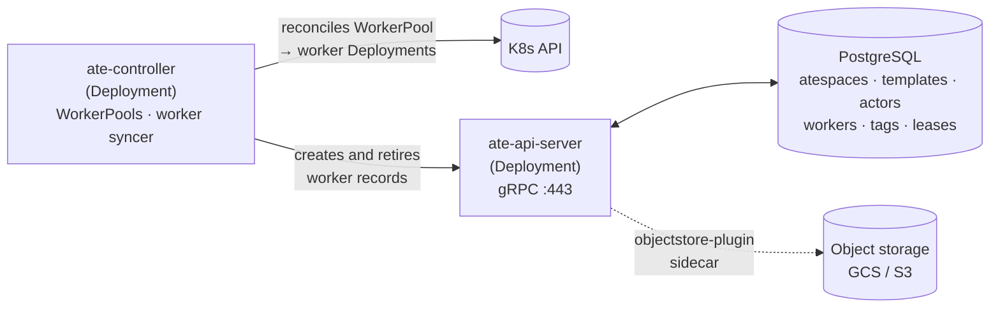
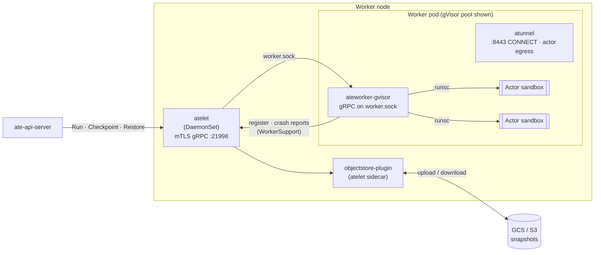
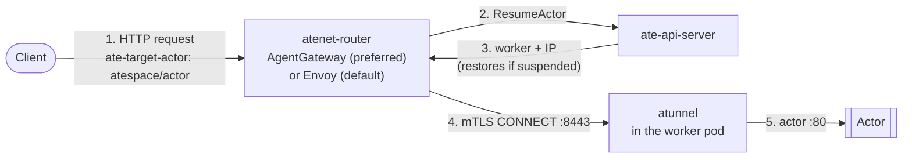

Substrate runs on Kubernetes, but it deliberately keeps the Kubernetes scheduler
out of the hot path. Kubernetes schedules worker pods ahead of time, and when an
actor needs to run, `ate-api-server` assigns it to one of those pods in
milliseconds (rather than waiting on `kube-scheduler` to place a new pod, which
takes seconds). That split between a control plane that decides and a data plane
that already has capacity waiting is the thing to keep in mind as we walk through
the rest of this page.

## In three pictures

The hero diagram on the [Overview](/) is the whole system on one whiteboard. Here
we zoom in on the three regions that matter most, what's inside each plane, and
how a request actually reaches an actor. Let's start with the control plane,
since that's where our decisions about actors get made.

### 1 · Control plane

Kubernetes only holds the capacity side of the system. `WorkerPool`,
`SandboxConfig`, and `CSIDriverConfig` are the CRDs, and that's it. Everything
about the actors themselves (atespaces, ActorTemplates, actors, tags, worker
records, etc) lives in PostgreSQL behind `ate-api-server`, which also runs the
golden-snapshot reconciler. As the diagram above shows, `ate-controller` turns
WorkerPools into worker Deployments and keeps a worker record in step with every
worker pod, so the API server always knows what capacity it can hand out.

### 2 · Data plane (one worker node)

Now let's look at a single worker node, which is where those decisions turn into
running sandboxes. Every node runs one `atelet` and some number of worker pods. A worker pod hosts
many actors (as many as its capacity allows), and each actor gets its own
sandbox, cgroup, and network namespaces. You'll notice in the diagram that atelet
never talks to object storage directly. It holds no storage credentials, so
snapshot bytes move through its `objectstore-plugin` sidecar instead.

There are two sandbox runtimes, and a pool picks one through its
`sandboxClasses` entry and the [SandboxConfig](/concepts/sandboxconfig/) that
entry names. The `gvisor` class runs `ateworker-gvisor`, which drives `runsc`,
and the `microvm` class runs `ateworker-microvm`, which drives a Cloud Hypervisor
micro-VM and needs `/dev/kvm` on the node.

So can an actor move between the two? Once it has a snapshot it can't, because a
WorkerPool is single-class and a gVisor checkpoint is a completely different
format from a micro-VM snapshot (we can't restore one on the other). From then
on, placement treats the actor's sandbox class as a hard gate, and a memory
restore also needs a matching runtime. An actor that has never run boots on whatever
class its template's `workerSelector` picks (see
[ActorTemplate](/concepts/actortemplate/) and [Workers](/components/workers/)).

Whichever runtime a pool uses, atelet drives it over the same
`RunWorkload` / `CheckpointWorkload` / `RestoreWorkload` gRPC on a Unix socket.
We cover each runtime on its own page, see
[ateworker-gvisor](/components/ateworker-gvisor/) and
[ateworker-microvm](/components/ateworker-microvm/).

### 3 · Request flow

Finally, let's follow a request in from a client. How does it find an actor that
may not even be running? The router
resolves it at the moment the request arrives. The client names the actor in the
`ate-target-actor` header, and there are no per-actor DNS records, no sidecars in
the actor, and no scheduler involved. The router asks `ate-api-server` where the
actor lives (which resumes it if it's suspended) and then tunnels the request to
`atunnel` in that worker pod. AgentGateway caches the assignment for a few
seconds and parks requests while an actor resumes. Envoy, which is the install
default, asks `ate-api-server` on every request. We walk through the full
sequence in [Request path](/flows/request-path/) and
[Resume actor](/flows/resume-actor/).

Outbound traffic takes the mirror-image path. The actor dials a destination, its
connection gets redirected to `atunnel`, and `atunnel` opens an mTLS CONNECT to
the egress gateway (`atenet-egress`), presenting a `worker-for-actor`
certificate for that actor. The [atenet](/components/atenet/) page covers the
egress side in detail.

## What each component is for

| Component | Kind | Role |
|---|---|---|
| **ate-api-server** | Deployment | Source of truth for atespaces, templates, actors, tags, and workers. Serves the public `Control` API and the node-only `WorkerService`. Runs the suspend, resume, revert, and delete workflows and the golden-snapshot reconciler. |
| **PostgreSQL** | StatefulSet (bundled) or external | Holds every record, plus the leases that serialize per-actor workflows. Bundled by default; bring-your-own and Cloud SQL are supported. |
| **ate-controller** | Deployment | Reconciles `WorkerPool` into worker Deployments, resolves and protects `SandboxConfig`s, and runs the worker syncer that creates and retires worker records. |
| **ate-idp-server** | Deployment | Publishes OIDC discovery and the JWKS for actor JWTs, so outside services can verify them. |
| **atenet-router** | Deployment | Ingress gateway. Reads `ate-target-actor`, gets the assignment from ate-api-server, parks requests during resume, and tunnels to the worker's `atunnel`. Runs AgentGateway, or Envoy with `atenet` ext_proc and xDS. |
| **atenet-egress** | Deployment | Egress gateway. Terminates `atunnel`'s CONNECT, identifies the actor, applies its egress policy, and injects credentials. |
| **k8s-credential-provider** | Deployment (optional) | The bundled provider of secrets for egress credential injection, backed by Kubernetes Secrets. You can point the egress gateway at your own provider instead, or turn injection off. |
| **atelet** | DaemonSet | One per worker node. Takes Run/Checkpoint/Restore from ate-api-server, stages runtimes and images, drives the worker over a Unix socket, relays the worker's registration and crash reports, and moves snapshots through its `objectstore-plugin` sidecar. |
| **Worker pods** | Deployment (from a `WorkerPool`) | Pre-started gVisor or micro-VM capacity. Each runs `ateworker-*` and `atunnel` and hosts many actor sandboxes. |
| **objectstore-plugin** | Sidecar (atelet, ate-api-server) | Holds the object-storage credentials. Uploads and downloads snapshot files to GCS or S3. |
| **podcertificate-controller** | Deployment | Signs pod certificates (service DNS and SPIFFE pod identity) for the system components. Not on the hot path. |

## Ports at a glance

| Service | Port | Protocol |
|---|---|---|
| ate-api-server (`api`) | 443 | gRPC over mTLS |
| atelet | 21998 | gRPC over mTLS (ate-api-server only) |
| atelet `WorkerSupport` | Unix socket | gRPC from worker pods on the same node |
| ateworker | Unix socket | gRPC - `/var/lib/ate/workers/{pod-uid}/worker.sock` |
| atenet-router | 443 → 8443, 8444 | HTTPS, CONNECT over TLS |
| atenet-router (AgentGateway only) | 80 → 8080, 8081 | Plaintext HTTP, CONNECT |
| atenet-egress | 443 | mTLS CONNECT from `atunnel` |
| atunnel | 8443 / 443 / 15001 | Ingress CONNECT / HTTPS / egress intercept |
| ate-idp-server (`idp`) | 443 | HTTPS (OIDC discovery, JWKS) |
| PostgreSQL | 5432 | TLS, client-certificate auth |

:::caution[Ingress authentication differs by dataplane]
With Envoy, the router requires client certificates on its TLS ports and only
admits the SPIFFE IDs listed in `--ingress-allowed-spiffe-ids`. AgentGateway
doesn't authenticate clients at all and also serves plaintext ports. See
[Security & identity](/security/).
:::

## Keeping kube-scheduler off the hot path

When an actor needs to wake up, `ate-api-server` picks a worker with room from its
worker records and tells that node's atelet to restore the actor into it. The
Kubernetes scheduler never sits on that path, and **that's how Substrate gets
sub-second resumes while running far more actors than pods.** Kubernetes still
does what it's good at (scheduling and healing the worker pods), it just does it
ahead of time.

:::tip[Go deeper]
Each component box above links to its own page. For the current implementation,
browse the source and the authoritative `docs/` (architecture, glossary, API guide,
etc).
:::
